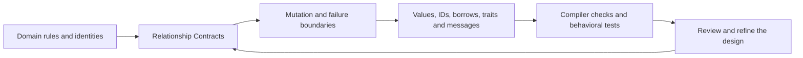

# ROO — Relationship & Ownership Oriented design

**Design relationships with ownership, authority, time, and failure in view.**

ROO is a proposed, language-independent software design method supported by an executable learning laboratory. It revisits object-oriented concepts and software architecture by making relationships explicit: who retains data, who may change it, how access expires, and how failure is handled. Rust is the laboratory language; Java and the other language mappings show how the same contracts can use different enforcement mechanisms.

The ambition is straightforward: a design should explain who owns data, who can change it, how long access remains valid, and what happens when an operation fails **before** those questions appear as compiler errors or production bugs.

ROO does not introduce a language, compiler, object runtime, or inheritance extension. Version 0.1 is a first edition of the method, a literature map, reusable design worksheets, and a small standard-library-only Rust library. It is intended to grow through worked examples and evidence.

ROO originally stood for Rust Object Oriented. The expansion changed because the method applies beyond Rust; Rust remains the laboratory language.

## Run the adoption track

The [public repository](https://github.com/limaronaldo/roo) includes equivalent
orders/payments exercises in Java composition, Java Template Method, and Rust
composition. Run them with an isolated PostgreSQL lifecycle using Docker:

```sh
bash case-studies/orders-payments/track/compose.sh
```

See the [Docker and CI guide](case-studies/orders-payments/track/DOCKER.md) for
learner commands and the [GitHub reproduction guide](docs/10-github-reproduction.md)
for hosted AMD64 execution, evidence, and published validation.

## The central idea

A class diagram describes structure. A **Relationship Contract** adds the operational meaning of each connection:

| Field | Question |
|---|---|
| Owner / resource custodian | Who retains the value and determines its local lifecycle? |
| Stable identity | Is this an embedded value, a temporary view, or an independently identified entity? |
| Mutation authority | Which API is allowed to change which state and preserve which invariant? |
| Access regime | Is access owned, borrowed, copied, transferred, or explicitly shared? |
| Validity horizon | When does access cease to be valid: end of call, owner destruction, version change, cancellation? |
| Execution domain | Which thread, task, actor, process, or transaction coordinates access? |
| Failure boundary | What is retained, rolled back, retried, or delivered if an operation fails? |

An `Order` can own its `LineItem` values, retain a `CustomerId` rather than a live customer reference, lend a short-lived read view to pricing code, and transfer an owned submission message to a worker. Those relationships have different meanings even if a traditional diagram draws all of them as arrows.

Memory ownership, business responsibility, authorization, database identity, and transaction boundaries are related decisions. They are not interchangeable. A component can retain a resource without being authorized to perform every business operation; a durable identifier can outlive any one in-memory instance.

## Design commitments

1. **Preserve the intent of OO concepts.** Encapsulation, substitutability, cohesion and information hiding remain useful; their implementation need not be a class hierarchy.
2. **Describe ownership before pointer shape.** An association does not automatically require a reference, reference counter, or mutex.
3. **Make mutation authority visible.** Private fields and narrow operations protect invariants; synchronization alone does not express business permission.
4. **Give access a time boundary.** A borrowed view, durable ID, snapshot and message have different validity rules.
5. **Select extensibility deliberately.** Decide whether the set of behaviors is closed, selected statically, or extended at runtime. Rust enums, generics and trait objects are possible realizations of those decisions.
6. **Model failure alongside success.** An operation should explain which state remains available after rejection, how uncertain outcomes are resolved, and what delivery semantics events require.
7. **Share intentionally.** Define who coordinates access and for how long before selecting shared references, locks or messages. Rust's `Rc`, `Arc` and interior mutability provide specific mechanisms with lifecycle and coordination costs.
8. **Assign evidence to each obligation.** Compiler checks, runtime tests, database constraints, protocol observations and human review support different claims. Compilation establishes selected type, borrowing and thread-safety properties; it does not prove behavioral subtyping, domain correctness, authorization, deadlock freedom or distributed consistency.

Rust already supports several object-oriented capabilities, including encapsulated state and behavior. Its lack of class-based implementation inheritance motivates different representations of the same design intent. See the official [discussion of object-oriented characteristics](https://doc.rust-lang.org/book/ch18-01-what-is-oo.html).

## Read the first edition

| Chapter | Purpose |
|---|---|
| [1. Foundations](docs/01-foundations.md) | Definitions, intellectual lineage, principles and limits |
| [2. Relationship design](docs/02-relationship-design.md) | The contract, notation, decision process and a worked domain |
| [3. Concept atlas](docs/03-concept-atlas.md) | Classical OO, inheritance, SOLID and polymorphism through portable relationship decisions and Rust mappings |
| [4. Pattern catalog](docs/04-pattern-catalog.md) | All 23 GoF patterns, relationship decisions, realizations and tradeoffs |
| [5. Software architecture](docs/05-architecture.md) | DDD, ports/adapters, layers, messages, persistence and failure |
| [6. Cross-language transfer](docs/06-cross-language.md) | Applying the method in Rust, Java and other languages |
| [7. Learning path](docs/07-learning-path.md) | Reading sequence, exercises, assessment and a capstone |
| [8. Rust and object-oriented design](docs/08-rust-and-object-design.md) | Improved English edition of the supplied guide, with a 29-topic coverage map |
| [9. Practical adoption](docs/09-adoption-guide.md) | Adopt ROO through orders and payments, three completed templates, and the same decisions in Java and Rust |
| [Executable adoption track](case-studies/orders-payments/track/README.md) | Six progressive exercises with Java/Rust starters, solutions, shared tests, PostgreSQL restart and HTTP response-loss recovery |
| [Orders and payments case](case-studies/orders-payments/README.md) | Java inheritance, Java composition and Rust under one executable failure contract |
| [PostgreSQL evolution](case-studies/orders-payments/postgres/README.md) | Durable transactions, competing processes, SIGKILL recovery and PostgreSQL crash restart under the same Java/Rust oracle |
| [HTTP APIs](case-studies/orders-payments/http/README.md) | Java and Rust APIs with strict JSON, durable idempotency, bounded concurrency and recovery after lost responses |
| [Supplied guide assessment](research/guide-assessment.md) | Specific corrections, preserved strengths and source-check evidence |
| [Research and literature](research/literature.md) | Annotated primary sources and provenance |
| [Research agenda](research/agenda.md) | How to test whether the proposed synthesis improves design |

For a project, start with the [Relationship Contract worksheet](templates/relationship-contract.md), record consequential choices with the [architecture decision template](templates/architecture-decision.md), then use the [design review guide](templates/design-review.md).

Keep two artifacts connected: a language-independent contract for the scenario and invariant, and an implementation mapping that names the language, runtime, storage and protocol mechanisms used to uphold it. Each obligation should name its evidence and remaining assumptions. Adopting the method does not require a Rust implementation.

## From an object diagram to an implementation



For each relationship:

1. Name the invariant and decide whether the related data has an independent identity and lifecycle.
2. Identify its custodian and the operation that may change it.
3. Choose the access regime and state when it expires.
4. Specify concurrency, transaction and failure behavior.
5. Select a language representation that preserves those decisions.
6. Identify the evidence for both a permitted operation and an important forbidden operation, and record what that evidence leaves unproved.

The diagram's values, IDs, borrows, traits and messages illustrate representation choices in the Rust laboratory. In another language, retain the preceding relationship decisions and choose mechanisms that preserve them. The orders-and-payments studies follow this approach from in-memory objects to durable PostgreSQL state and HTTP requests; their shared oracle compares recorded observable behavior, while each layer needs its own evidence for access, concurrency and recovery.

When Rust rejects a design, examine whether the representation expresses the intended relationship. Sometimes the right answer is a shorter borrow, an owned message, an ID lookup, or a different API. Sometimes it is a legitimate advanced representation or an explicit runtime coordination mechanism. Compiler friction is a diagnostic signal, not a verdict on architecture.

## Run the laboratory

The local baseline is Rust 1.96.0, edition 2024. The package has no third-party dependencies. See the [laboratory guide](docs/laboratory.md) for the modules, examples and proof boundaries.

```sh
cargo test --offline
cargo run --offline --example order_workflow
cargo fmt --all -- --check
cargo clippy --offline --all-targets -- -D warnings
```

Doctests in `src/` include positive examples and `compile_fail` cases. The latter should fail for the documented reason: they demonstrate forbidden borrowing, ownership or state transitions. Chapter snippets marked as sketches are explanatory material rather than separately tested applications.

The [orders-and-payments case](case-studies/orders-payments/README.md) extends this laboratory with a standalone Rust crate and dependency-free Java 21 sources. Both Java variants and Rust use the same [scenario inputs](case-studies/orders-payments/scenarios.tsv) and [independent expected results](case-studies/orders-payments/expected.tsv). It models payment uncertainty, persisted intent, reconciliation, refunds, local commit failures and duplicate outbox delivery with deterministic in-memory adapters.

```sh
bash case-studies/orders-payments/verify.sh
```

This requires Rust/Cargo, JDK 21 or newer, Python 3 and Bash. The current validation host uses Rust 1.96 and JDK 26 with Java compilation targeting release 21. The case's [run record](research/orders-payments-run.md) separates the new evidence from the historical v0.1 laboratory results.

The [PostgreSQL evolution](case-studies/orders-payments/postgres/README.md) adds real local persistence while preserving both Java variants and the Rust implementation. It uses a dedicated synthetic cluster, separately committed provider and inbox records, row locks, and a shared process/restart test harness. PostgreSQL 18 server tools and the pinned Java/Rust database dependencies are additional requirements.

```sh
bash case-studies/orders-payments/postgres/verify.sh
```

This creates and restarts only its marked local test cluster, then stops it while retaining synthetic data. See the [PostgreSQL validation](research/postgres-validation.md) for the executed evidence and its limits.

The [HTTP evolution](case-studies/orders-payments/http/README.md) exposes the same
PostgreSQL application through two Java servers and a Rust server. A shared
client checks real HTTP requests, concurrent calls, lost responses, graceful
termination and database recovery. Payment and refund identities remain durable;
line addition requires inspection after an uncertain response.

```sh
bash case-studies/orders-payments/http/verify.sh
```

The command uses only marked local test processes, then stops the HTTP servers
and database. See the [HTTP validation](research/http-validation.md) for the
executed evidence and its limits.

## What is proposed, and what is established

The underlying ideas have substantial prior art: information hiding, behavioral subtyping, ownership types, separation logic, capability-oriented design, RAII, domain-driven design, typestate, and Rust's existing type system.

ROO proposes an integrated teaching and review workflow: use one Relationship Contract across classical OO concepts, architecture boundaries and implementations in different languages. Rust representations make selected obligations visible to its compiler; other realizations may use encapsulation, runtime checks, database constraints or protocols. The contract vocabulary, worksheets and evaluation agenda are this project's contribution. No claim of unprecedented theory, universal superiority, or empirical validation is made.

This edition covers a curated set of influential concepts. It does not establish a quantitative ranking of today's literature or claim exhaustive coverage of every OO or architectural school. Source attribution and future evaluation are part of the method.

## Status and development

Version 0.1 is published research and educational code. The examples are deliberately smaller than production infrastructure and document their limits. The [run record](research/run-ledger.md) and [validation evidence](research/validation.md) distinguish authored material, executed checks and independent review.

Contributions should include the classical intent, Relationship Contract, implementation choices, tradeoffs, source provenance, executable evidence where appropriate, and cross-language implications. A pattern earns its place by solving a concrete design problem.
