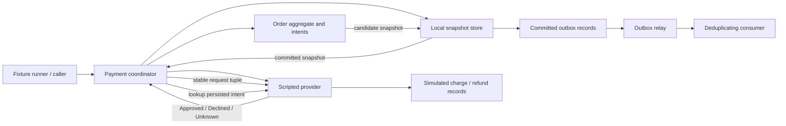
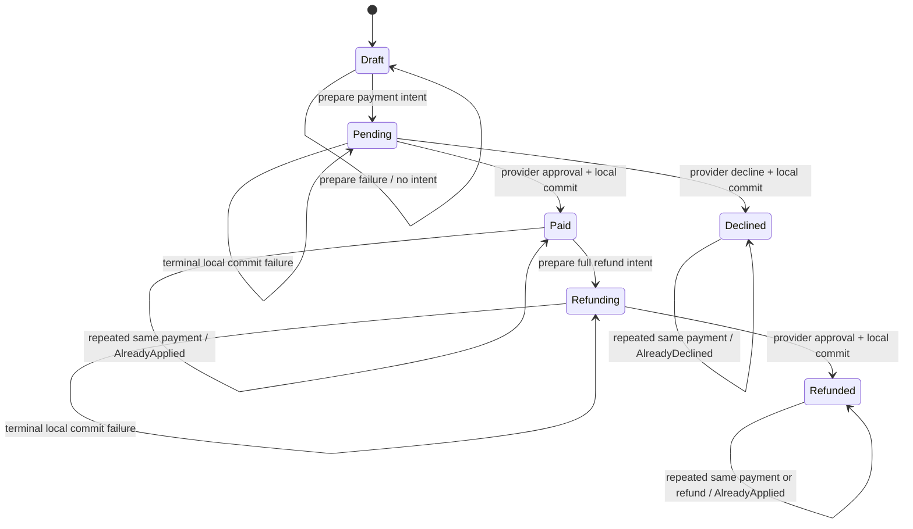

# Orders and payments: a ROO case study

This case study applies ROO (Relationship & Ownership Oriented design) to a
small checkout and refund workflow. It implements the same bounded behavior as
Java composition, Java template-method inheritance, and Rust composition, then compares what each
representation makes visible and what still depends on runtime or infrastructure
contracts.

The shared behavioral authority is the frozen [case specification](SPEC.md).
The example uses deterministic in-memory adapters. It does not contact a payment
provider, persist to a database, or move money.

> **Evidence status.** The shared fixture and expected-output files are
> [`scenarios.tsv`](../orders-payments/scenarios.tsv) and
> [`expected.tsv`](../orders-payments/expected.tsv); the cross-language checker
> is [`verify.py`](../orders-payments/verify.py), invoked by
> [`verify.sh`](../orders-payments/verify.sh). The dated validation records that the
> complete `bash case-studies/orders-payments/verify.sh` run passed: Java has
> 280 explicit unit checks across both variants and two intended
> compiler-negative checks; Rust has 20 unit tests, two positive doctests, and
> three compiler-negative examples checked for `E0382`, `E0502`, and `E0624`; all
> three runners match 42 oracle rows and reject ten malformed fixtures apiece.
> Formatting, Clippy with warnings denied, the original ROO laboratory checks,
> and the standalone recovery example also passed. These are local educational
> checks only; see [validation evidence](../../research/orders-payments-validation.md)
> and the [research source ledger](../../research/orders-payments-sources.md)
> for their scope and limits.

## Read this as a design method

ROO is a language-independent method: start with a scenario and its invariants,
make the relationships explicit, choose mechanisms for those relationships, then
state what evidence supports each guarantee and what remains an assumption.
Here the scenario is an order whose payment may complete while the caller sees
an unknown result. The decisions are to retain a stable intent, separate local
and provider commits, and publish terminal facts with local state. Java and Rust
realize those decisions with different access and reuse mechanisms; the
[PostgreSQL](postgres/README.md) and [HTTP](http/README.md) extensions carry them
across persistence and request boundaries.

Use the eight-field Relationship Contract below to review each realization.
Keep resource custody (who holds a value or connection), domain responsibility
(who protects an invariant), identity (what remains the same across retries),
and authorization (who is permitted to act) distinct. An order's responsibility
for its lines is a domain decision; an adapter's custody of a snapshot is an
implementation decision. Neither custody nor possession of an ID grants caller
authorization. The frozen specifications define this exercise's behavior; the
dated evidence records bound its execution claims.

Practice the six adoption exercises in the [executable track](track/README.md),
with separate Java/Rust starters and solutions, common policy cases, native
state assertions, and real PostgreSQL/HTTP recovery checks.

To adopt the method in an existing project, follow the [practical adoption
guide](../../docs/09-adoption-guide.md). Its worked artifacts complete the
[Relationship Contract](adoption/relationship-contract.md),
[architecture decision](adoption/architecture-decision.md), and
[design review](adoption/design-review.md) for this case, with the same recovery
decisions traced into Java and Rust.

## What this case teaches

The business rule is familiar: assemble an order, submit a payment, recover from
an uncertain provider result, publish a fact, and possibly refund the charge.
The design problem is the interaction among several lifetimes and authorities:

- The `Order` owns its line values and protects quantity, amount, total, and
  lifecycle invariants.
- A payment intent must be committed locally before an external effect is
  requested. The stable `PaymentId` lets a later call refer to that same intent.
- The provider can complete a charge while the caller sees a timeout. Local
  state must represent that uncertainty instead of pretending that the remote
  effect was rolled back.
- A terminal order transition and its immutable outbox event are prepared as one
  local candidate commit. A relay can deliver an event and then fail to record
  its acknowledgement, so a consumer must tolerate redelivery.
- A refund is a new, separately identified compensating effect against an
  already approved payment. It does not erase the historical charge or rewind
  the original payment operation.

The implementation variants keep these rules constant while changing where
capabilities are assembled and how the algorithm is reused. This makes the case
useful for discussing encapsulation, substitution, ownership, recoverability,
and evidence without attributing domain behavior to a class hierarchy or to the
Rust compiler.

## Scope and vocabulary

Each fixture row starts with a fresh order `O1` in `Draft`, with currency `USD`,
an empty local store, a scripted provider, an outbox, and a consumer. The runner
is deterministic and single-threaded. One scenario may contain several actions;
after a domain failure, later actions in that same row still execute.

The amount is a signed 64-bit integer number of minor units. Lines require a
positive unit amount and positive quantity. Multiplication and total addition
are checked against `9223372036854775807`; floating-point arithmetic and
rounding do not appear. The standard example's two lines total `250` minor
units: two units at `100`, then one unit at `50`.

The domain has six committed states: `Draft`, `Pending`, `Paid`, `Declined`,
`Refunding`, and `Refunded`. A bounded order receives at most one payment intent
and one full-amount refund intent. Decline is terminal in this exercise. Partial
refunds, replacement payment attempts, cancellation, and multiple orders per
fixture are excluded so that recovery and identity remain observable.

Four IDs name four different things:

| ID | Identifies | Example |
|---|---|---|
| `OrderId` | The order in the domain and local store | `O1` |
| `PaymentId` | One payment intent and its provider idempotency key | `p1` |
| `RefundId` | One refund intent and its provider idempotency key | `r1` |
| `EventId` | One immutable outbox fact and consumer deduplication key | `payment:p1` |

Fixture labels are strings at the input boundary, but domain APIs use distinct
ID types (Rust newtypes and Java value wrappers/records). An order ID is not a
payment ID simply because both happen to contain text. An ID is also not proof
of authorization.

The provider request for payment is the immutable tuple
`(PaymentId, OrderId, USD, amount)`. A refund request is
`(RefundId, PaymentId, OrderId, USD, amount)`. A key repeated with the identical
tuple returns its stored terminal answer without a second effect. Reusing a key
with any changed request field returns `KeyConflict`. These are guarantees of
the **simulated provider's contract**, whose records live for the whole fresh
scenario; they are not guarantees supplied by Java, Rust, ROO, or a real payment
provider.

### Identity across the three boundaries

The extensions preserve domain identity while adding storage and protocol
addresses. Read these identities together rather than treating every key as a
new domain entity:

| Boundary | Identity in this case | Relationship decision |
|---|---|---|
| Domain | Typed `OrderId`, fixed to `O1` in each scenario | Names the order independently of an object's memory address; line values belong to that order |
| PostgreSQL | `scope` identifies the scenario's stored order; `(scope, line_no)` identifies a retained line row | Keeps separate scenarios apart and makes line storage dependent on its order scope |
| HTTP | `/v1/scopes/{scope}` addresses that same persistent scenario | Selects the stored scenario for one application operation; domain order ID remains `O1` |

The line row key is a storage identity, not an independently introduced domain
`LineId` or an add-command receipt. It does not make line addition replay-safe.
Likewise, scope is a synthetic scenario partition, not proof of tenant isolation
or authorization. The [schema](postgres/schema.sql) and
[HTTP contract](http/SPEC.md) define the concrete mapping; a production design
would need to decide its own order addressing and authorization rules.

## Business walkthrough

### 1. Build and freeze the order

The caller asks the order to add a line. The order checks that the amount and
quantity are positive, that their product fits the supported integer range, and
that adding the product will not overflow the current total. It computes a
candidate and installs it only when every check succeeds. Thus a rejected line
does not partially change the previous line list or total.

An empty draft is a valid local object, but it is not payable. On the first valid
payment request, the order's commercial facts are frozen as part of preparing the
intent. An `add` after that point returns `InvalidState` and leaves the stored
total alone.

### 2. Persist the intent before asking the provider

For a valid draft, the application prepares a candidate snapshot containing the
immutable payment request and the `Pending` state. It asks the local store to
commit that candidate before making any provider call. In this laboratory, the
store replaces its committed snapshot atomically if that simulated commit
succeeds. A selected `prepare` failure installs nothing and returns
`LocalPrepareFailed`; no provider request has occurred and no payment identity
has been retained.

Once the intent is committed, the application sends the exact stored tuple to
the provider. The stable `PaymentId` ties a same-key retry or reconciliation to
the same logical operation. It does not create a universal exactly-once network
guarantee.

### 3. Treat timeouts as uncertainty

For a new provider key, the script can produce these observations:

| Scripted mode | Provider record/effect | Caller observes |
|---|---|---|
| `approve` | Records approval and one charge | `Approved` |
| `decline` | Records decline and no charge | `Declined` |
| `timeout_before` | Records nothing and creates no charge | `Unknown` |
| `timeout_after` | Records approval and one charge | `Unknown` |

`Unknown` describes what the caller knows. It is deliberately not stored as a
provider terminal result. Both timeout modes leave the order `Pending` with the
intent still present and create no terminal event. The two modes differ in the
provider's private record and effect, which later lookup can reveal.

Reconciliation queries the existing intent. In this simulator, `NotFound` means
the complete provider map has no record for that key; `Unknown` means lookup was
unavailable or inconclusive. A real provider's consistency and retention rules
must be established before treating a not-found response as proof that no charge
occurred. Reconciliation never creates a replacement key or a new event on an
unknown/not-found answer. A matching same-key request after `NotFound` is
permitted by the stated simulator contract.

If lookup finds approval, the application commits `Paid` and one
`PaymentApproved` fact. If it finds decline, it commits `Declined` and one
`PaymentDeclined` fact. A later retry with the same key returns the provider's
recorded result without repeating the effect. If a caller supplies a different
payment identity while an intent is active, the application returns
`IntentConflict` and retains the original identity.

### 4. Separate remote success from local finalization

The `commit` failure point happens after the provider call or a terminal lookup.
Suppose the provider approved and charged, but the local final commit fails. The
store still reports `Pending`; the simulated provider still has its independent
approval and one charge; the application reports `LocalCommitFailed`; and no
terminal event was added. A later read or operation consults the committed
snapshot; neither coordinator retains a mutable order object that advertises
`Paid` after the failed commit.

The intent was committed first, so the operation can be recovered. Reconciliation
or retrying the same persisted key can observe the already recorded answer and
try the final local commit again. The simulator's provider deduplication keeps
the effect count at one. This recovery relies on both the local two-commit
protocol and the simulated provider's stable-key contract.

The local candidate replacement is a teaching model for one atomic local commit.
It is not a database transaction, disk flush, process-crash recovery protocol,
distributed transaction, or proof that an external charge and a local row change
can commit atomically together.

### 5. Publish facts through the outbox

An approved or declined payment transition creates exactly one immutable event
with a deterministic `EventId` such as `payment:p1`. The state change and event
are part of the same successful local candidate commit. The event owns the
identities and amount facts needed for this example; it is not a live pointer
back into a mutable order.

The relay scans unacknowledged outbox records in insertion order. With
`send_fail`, it stops before delivery. With `ack_fail`, it delivers the first
pending event to the consumer and then stops before recording the acknowledgement.
The outbox still considers that event pending, so a later relay can send it
again. The consumer remembers each `EventId` and applies a unique event once.
Redelivery is therefore observable as another delivery attempt but not as another
consumer application or payment effect.

This demonstrates at-least-once delivery with consumer deduplication inside the
simulator. It does not model a broker, durable consumer database, acknowledgement
network, or concurrent relay workers. A production design must make the event
and state transaction real and define the consumer's durable deduplication
boundary.

### 6. Refund as a compensating operation

A refund begins only for a paid order. The application creates a distinct
`RefundId`, persists the complete refund intent, and moves the order to
`Refunding` before requesting the provider's full-amount refund. The refund is
bound to the existing approved `PaymentId`, order, currency, and amount. It
cannot exceed or silently detach from the original charge.

An approval commits `Refunded` plus one `RefundApproved` fact whose stable ID is
`refund:r1`. A timeout after the provider has recorded the refund leaves the local
order `Refunding`; reconciliation can finish the local transition without
refunding twice. A final local commit failure has the same split: the provider's
refund effect remains, while the store retains `Refunding` and no refund event.
The persisted `RefundId` and provider contract make recovery possible in this
bounded simulator.

A refund is a new financial effect that compensates for the charge. It is not
memory rollback, database rollback of the original order, deletion of the
payment fact, or reversal of history. The model intentionally allows only one
full refund and does not attempt partial refunds or refund-decline recovery.

## Architecture at a glance

The architecture keeps domain transition rules, local candidate commits,
provider behavior, and event delivery distinct. The boxes labeled store and
provider are in-memory simulators for this exercise.



The caller selects an action and a failure script. The coordinator owns the
application protocol: validate, prepare, call or look up, then commit a terminal
observation. The domain object owns order invariants. The store owns the last
committed snapshot and outbox. The provider owns its separate simulated record
map and effect counts. The consumer owns its set of applied event IDs.

This is a logical boundary diagram, not a production deployment diagram. All
components execute in one process and one thread for one fixture row. There is no
network hop or independently running worker.

## Order and payment states



An unsuccessful `add` or invalid action does not advance the committed state.
An `Unknown`, `NotFound`, or failed final commit preserves the active intent and
its in-progress state. The diagram omits `IntentConflict`, relay actions, and
other no-transition results to keep the state graph readable; they are detailed
in the transition and failure tables below.

| Current state | Action | Resulting state | Important side effect |
|---|---|---|---|
| `Draft` | `add` valid line | `Draft` | Candidate line and checked total committed |
| `Draft` | `add` invalid/overflowing line | `Draft` | Existing lines and total unchanged |
| `Draft` | `pay` with no lines | `Draft` | `InvalidOrder`; no intent or remote call |
| `Draft` | `pay`, prepare fails | `Draft` | `LocalPrepareFailed`; no remote call |
| `Draft` | `pay`, intent commits | `Pending` | Stable payment intent stored before provider call |
| `Pending` | request or lookup is `Unknown`/`NotFound` | `Pending` | Intent remains; no terminal event |
| `Pending` | approved + local commit succeeds | `Paid` | One charge at most; one payment event |
| `Pending` | declined + local commit succeeds | `Declined` | No charge; one payment-declined event |
| `Pending` | terminal local commit fails | `Pending` | Provider record/effect may exist; no event |
| `Paid` | first valid full refund prepare succeeds | `Refunding` | Stable refund intent tied to approved payment |
| `Paid` | refund prepare fails | `Paid` | No refund ID, provider request, or refund event |
| `Refunding` | request/lookup is `Unknown`/`NotFound` | `Refunding` | Refund intent remains; no refund event |
| `Refunding` | approved + local commit succeeds | `Refunded` | One refund at most; one refund event |
| `Refunding` | terminal local commit fails | `Refunding` | Provider refund may exist; no refund event |

## Payment and refund sequence

```mermaid
sequenceDiagram
    autonumber
    actor Caller
    participant App as Coordinator
    participant Order as Order candidate
    participant Store as Local store simulator
    participant Provider as Scripted provider
    participant Outbox as Outbox / consumer

    Caller->>App: pay(PaymentId, mode, failure)
    App->>Store: load committed Draft
    Store-->>App: detached snapshot
    App->>Order: validate nonempty Draft; prepare intent
    App->>Store: commit Pending + payment intent
    alt prepare fails
        Store-->>App: failure; committed Draft retained
        App-->>Caller: LocalPrepareFailed
    else intent committed
        Store-->>App: committed Pending snapshot
        App->>Provider: request(PaymentId, OrderId, USD, amount)
        alt provider returns Unknown
            Provider-->>App: Unknown
            App-->>Caller: Unknown; remain Pending
        else provider returns terminal result
            Provider-->>App: Approved or Declined
            App->>Order: apply terminal result; create immutable event
            App->>Store: commit terminal state + outbox event
            alt final commit fails
                Store-->>App: failure; reload Pending
                App-->>Caller: LocalCommitFailed
            else final commit succeeds
                Store-->>App: committed terminal snapshot
                App-->>Caller: Approved or Declined
                opt relay requested later
                    Outbox->>Outbox: deliver and deduplicate by EventId
                end
            end
        end
    end

    Caller->>App: reconcile(active intent)
    App->>Store: load Pending or Refunding intent
    Store-->>App: detached committed snapshot
    App->>Provider: lookup(stable intent ID)
    Provider-->>App: Approved, Declined, NotFound, or Unknown
    Note over App,Provider: NotFound is distinct from unavailable or unknown lookup.
```

The figure shows the payment path. Refund uses the same prepare / remote call /
finalize shape after `Paid`, with its own `RefundId` and a request bound to the
approved payment. The relay is a later action: event creation happens with the
local terminal transition, while delivery and acknowledgement happen afterward.

## Relationship Contracts

The following contracts apply the eight fields from [ROO relationship design](../../docs/02-relationship-design.md#21-the-eight-field-relationship-contract).
They are scoped to this exercise. They are not blanket recommendations that
every commerce system should store payment state inside an order or use one
process as its execution boundary.

### `Order → LineItem`

| Field | Contract |
|---|---|
| Owner / resource custodian | `Order` owns its line values. A line has no independently retained identity in this bounded specification. |
| Stable identity | The order is identified by `OrderId`; lines are embedded values belonging to that order. Do not infer a durable line key from list position. |
| Invariant coordinator | Only invariant-preserving order operations add a line or update the checked total. Once a payment intent is prepared, line changes are forbidden. |
| Authorization | Not implemented in this teaching case; a live system needs an authenticated caller policy. |
| Access regime | Callers supply candidate values and receive values, immutable views, or snapshots. They do not replace the internal list, status, or total directly. |
| Validity horizon | A line remains part of the order until the order value is discarded; commercial facts are frozen from successful intent preparation onward. A detached store snapshot has its own observation time. |
| Execution domain | One coordinator operates on one detached candidate at a time in a deterministic single-threaded scenario. No concurrency guarantee is exercised. |
| Failure boundary | Validate positivity, multiplication, and sum overflow before installing the candidate. Rejection preserves prior committed lines and total. |

**Enforcement and evidence.** Java private state and Rust private fields restrict
ordinary callers from replacing the representation. The languages do not
automatically validate positive quantities or checked totals. Runtime domain
checks and tests must cover those conditions. Rust borrowing can prevent
conflicting safe mutable aliases during a call; it does not establish the order's
business policy by itself.

### `Coordinator → LocalStore`

| Field | Contract |
|---|---|
| Owner / resource custodian | The store owns the last committed order snapshot, outbox records, and acknowledgement flags. The coordinator owns the current operation and its detached candidate. |
| Stable identity | The store resolves the scenario's `OrderId`; event records use their `EventId`. A snapshot is not itself the durable identity. |
| Invariant coordinator | The coordinator proposes a candidate. The store alone decides whether the simulated commit is installed. |
| Authorization | Not implemented in this teaching case; a live system needs an authenticated caller policy. |
| Access regime | Candidate and committed state are copied or otherwise detached according to the implementation. Callers must not retain a mutable alias that can advertise an uncommitted terminal state. |
| Validity horizon | A candidate is valid for one local operation. After a failed commit, the next read or operation observes the committed snapshot; a fresh fixture starts empty. |
| Execution domain | In-memory, single-threaded, one process, one scenario. There are no concurrent writers, crash boundaries, or interprocess readers. |
| Failure boundary | Each simulated commit either installs the whole candidate state and candidate event list or installs neither. This is not evidence about a database transaction or durable storage. |

**Enforcement and evidence.** The in-memory store's replacement behavior is a
runtime simulation. Encapsulation keeps the coordinator from mutating committed
internals through normal APIs. Only integration with a real persistence engine
could establish database isolation and durability properties; no such adapter
exists here.

### `Coordinator → RemoteProvider`

| Field | Contract |
|---|---|
| Owner / resource custodian | The provider simulator owns the separate key-to-request/result records and successful-effect counts. They are not part of the local order snapshot. |
| Stable identity | Payment and refund IDs are distinct keys in operation-specific namespaces. Each key is paired with its complete immutable request tuple. |
| Invariant coordinator | The coordinator may request or look up an intent. The provider simulator decides its result and owns the effect record. A conflict probe is adapter-only and bypasses checkout. |
| Authorization | Not implemented in this teaching case; a live system needs an authenticated caller policy. |
| Access regime | The coordinator passes immutable typed request facts to the adapter and receives a result value: Java passes immutable record references; Rust passes a shared `&Request`. The simulator retains its own immutable record/facts; no mutable provider-record handle escapes. |
| Validity horizon | A request is bound to the intent persisted before the call. Simulator key records remain for the entire scenario with no expiry or eviction. |
| Execution domain | Synchronous function calls in one deterministic process. There is no network, concurrent provider worker, cancellation, or real timeout. |
| Failure boundary | `Unknown` can occur before or after a provider record/effect. Same tuple + same key reuses the terminal answer; any changed tuple field produces `KeyConflict`. |

**Enforcement and evidence.** The simulator enforces its key contract at
runtime. The language's type system can distinguish request and ID types, but
cannot compel a real provider to retain keys, make lookup authoritative, or
deduplicate a charge. Those guarantees require a provider contract and verified
integration evidence.

### `PaymentIntent → RemoteEffect`

| Field | Contract |
|---|---|
| Owner / resource custodian | The local store retains the immutable intent; the provider simulator separately retains any remote record and effect. Neither store owns both sides. |
| Stable identity | `PaymentId` identifies the attempt. The complete request also includes `OrderId`, currency, and amount so identity reuse cannot silently change its meaning. |
| Invariant coordinator | The coordinator prepares one intent in `Draft`; the provider applies the request; the coordinator records a confirmed local transition. No caller may rewrite the stored intent. |
| Authorization | Not implemented in this teaching case; a live system needs an authenticated caller policy. |
| Access regime | The intent is copied or borrowed immutably into a request. A retry uses that same request; it does not derive a fresh key from current object identity. |
| Validity horizon | The intent persists through `Pending` and remains available for retry/reconciliation. The simulator retains its matching key through the fixture scenario. |
| Execution domain | The local prepare, provider call, and local finalization are ordered by the coordinator but are separate boundaries. Provider state is outside the local commit. |
| Failure boundary | A local prepare failure happens before effect. A timeout can leave provider outcome unknown. A final commit failure can follow an approved charge. Stable-key retry/reconciliation repairs local knowledge; it does not roll back the charge. |

The same pattern applies to refund, with `RefundId` and a refund request tuple.
The provider simulator records only one effect for a matching key and request.
An out-of-range integer string is a domain `Overflow` in the fixture contract;
malformed numeric syntax is a runner/fixture error. Those parser boundaries are
not interchangeable.

### `OutboxEvent → Consumer`

| Field | Contract |
|---|---|
| Owner / resource custodian | The local store owns committed outbox records and acknowledgement state. The consumer separately owns the set/count of event IDs it has applied. |
| Stable identity | `EventId` is stable across retries: `payment:<PaymentId>` for the payment terminal fact and `refund:<RefundId>` for the full refund fact. |
| Invariant coordinator | The coordinator creates an immutable event with a terminal transition. The relay delivers and acknowledges. The consumer alone applies a unique event ID once. |
| Authorization | Not implemented in this teaching case; a live system needs an authenticated caller policy. |
| Access regime | Event values carry copied IDs and amount facts. The consumer does not mutate an order through an event back-reference. |
| Validity horizon | A committed event remains in the outbox throughout the scenario; a delivery attempt can recur until acknowledgement. Consumer deduplication state remains for that scenario. |
| Execution domain | Delivery is a scripted local call in insertion order. There is no broker, parallel relay, process restart, or independent consumer database. |
| Failure boundary | `send_fail` delivers nothing. `ack_fail` delivers once but leaves the record pending. Later redelivery is suppressed by consumer-side EventId deduplication. |

**Enforcement and evidence.** The deterministic IDs, relay stopping point, and
consumer set implement the scenario at runtime. Neither Java encapsulation nor
Rust ownership provides durable exactly-once event processing. A production
outbox needs a shared persistence transaction, and a production consumer needs
durable deduplication with an explicitly scoped retention policy.

### `RefundIntent → Payment`

| Field | Contract |
|---|---|
| Owner / resource custodian | The order store retains its refund intent; the provider retains the original payment record and any separate refund effect. |
| Stable identity | The refund has its own `RefundId` and retains the original `PaymentId`, `OrderId`, currency, and full amount. Payment and refund identities are never conflated. |
| Invariant coordinator | A refund can be prepared only for a confirmed `Paid` order. The coordinator requests one full refund; the provider verifies it against the approved charge. |
| Authorization | Not implemented in this teaching case; a live system needs an authenticated caller policy. |
| Access regime | The refund request refers to typed identities and copied amount facts, not a mutable pointer into the payment object. The original payment is observed through the provider's contract. |
| Validity horizon | The payment approval remains the basis for the refund. The refund intent remains active through `Refunding` until a terminal local transition is committed. |
| Execution domain | Refund execution is a separate provider operation coordinated after payment approval. The exercise processes one operation at a time in one thread. |
| Failure boundary | Timeout or final local commit failure can leave `Refunding` while a remote refund exists. Reconciliation uses the same RefundId. Refund is compensation, not rollback of the charge or order history. |

The simulator enforces the full-amount and approved-charge relationship at
runtime. It does not model provider-specific partial-refund rules, legal
settlement, disputes, authorization, fees, or accounting entries.

## What each language can enforce

ROO asks the implementation to distinguish static restrictions, API-level
encapsulation, runtime validation, simulated transaction behavior, and external
infrastructure promises. These are different evidence classes.

| Evidence layer | Java composition / template method | Rust composition | Limits in this case |
|---|---|---|---|
| Compiler and type checker | Java checks declared types, access control, final method/field restrictions, and method contracts expressed in signatures. `private` fields are not directly accessible to ordinary callers; `final` template methods cannot be overridden. | Rust checks types, visibility, moves, lifetimes, borrows, and trait bounds for safe code. A non-`Copy` value moved into an operation cannot be reused through the old binding. | Neither compiler understands that an order must be nonempty, that a provider key must identify one unchanged request, or that a refund must compensate an approved charge. |
| Encapsulation and API shape | Private fields and narrow methods prevent ordinary code from assigning status/total/IDs directly. Interfaces expose only the chosen collaborator operations. `final` prevents an override of the template algorithm, not arbitrary behavior inside every dependency. | Private fields and narrow methods control module-level mutation. `&mut self` requires exclusive mutable access for that borrow; owned IDs and request values make data flow explicit. Traits expose selected capabilities. | Java references can alias the same mutable object. Rust can use explicit interior mutability or unsafe code. Neither language boundary authenticates an end user or proves an external capability is legitimate. |
| Runtime domain checks | Constructor/method validation and explicit result types or exceptions can reject invalid line, state, identity, and arithmetic inputs. | Constructors/methods and `Result` can perform the same checks; checked integer operations return overflow instead of wrapping. | Tests must verify important outcomes. Input parsing and deserialization remain trust boundaries even with private constructors. |
| In-memory adapter behavior | The store/provider/outbox/consumer implementations install candidates, script failures, and count effects according to the case contract. | The same scenario behavior is implemented by Rust adapter values and methods. | These are executable simulations in one process. They do not prove filesystem, database, process, network, or concurrency behavior. |
| Infrastructure contract | A production adapter would need documented database and provider guarantees plus operational recovery. | The same infrastructure work is needed in Rust; the type system does not remove it. | No actual database, network call, provider account, broker, restart, or production permission is part of this exercise. |

Java's `final` on a class/method and Rust's absence of class inheritance answer
different extension questions. Neither should be described as a general safety
score. The comparison is about a named contract and selected enforcement
mechanisms, not a benchmark or universal language ranking.

## Java composition: assemble behavior with collaborators

The composition implementation assembles a coordinator with an order-domain
API, a store capability, a provider capability, and delivery collaborators. The
composition root is explicit constructor/manual dependency injection: it
constructs the concrete in-memory adapters and passes their interfaces/values to
the application object. This case does not require a dependency-injection
framework.

In the implementation, [`CompositionApplication.java`](java/src/roo/payments/CompositionApplication.java)
receives `StorePort` and `ProviderPort` in its constructor. Its payment, refund,
and reconciliation methods load a detached order, commit an intent, reload the
persisted intent, make the adapter call, and then use a private finalization
method to commit the terminal state and event. The two port interfaces
and their in-memory implementations are in
[`Adapters.java`](java/src/roo/payments/Adapters.java); the invariant-bearing
IDs, `Money`, `Line`, `Order`, events, states, and results are in
[`Domain.java`](java/src/roo/payments/Domain.java). The two coordinators
independently implement the same protocol rather than selecting a variant flag
inside one algorithm. The actual class is final and its public operations are
final as well, while its coordination is assembled from injected ports.

The coordinator holds the protocol. Collaborators answer narrower questions:
the store loads or conditionally commits a candidate; the provider executes or
looks up an immutable request; the relay and consumer model delivery. Domain
methods keep line and lifecycle mutation inside the order abstraction. Replacing
the scripted provider with a production adapter would be an infrastructure
change, but it would require a new review of its key retention, lookup, and
timeout semantics before preserving the same claims.

Composition makes the collaboration graph inspectable at construction time. Its
cost is explicit wiring and the discipline to keep the application protocol in
one coordinator rather than scattering ordering decisions through adapters. An
interface alone does not guarantee that every implementation is behaviorally
substitutable; the shared fixtures and unit contracts exercise selected behavior.

## Java template-method inheritance: reuse a fixed algorithm

The inheritance implementation uses a legitimate template-method shape. A base
coordinator owns the final public payment/recovery algorithm: validate the
request, prepare the durable-intent simulation, invoke the remote operation,
interpret uncertainty, and finalize state plus event. Narrow protected hooks
allow a concrete subclass to provide store/provider policy or adapter calls.
The algorithm's control flow is not an overridable extension point.

This is implementation reuse, not a claim that every provider subclass is a
behavioral subtype under all possible contracts. The base class's documented
postconditions and error behavior constrain each hook. A subclass that skips
intent preparation or changes the request key would violate the protocol even if
it compiled. A `final` template method blocks ordinary overriding of that method;
tests and review are still needed to check each hook's behavior.

The concrete arrangement is in
[`TemplateApplication.java`](java/src/roo/payments/TemplateApplication.java)
and [`InMemoryTemplateApplication.java`](java/src/roo/payments/InMemoryTemplateApplication.java).
The base class defines final `add`, `pay`, `refund`, and `reconcile` algorithms;
its protected abstract hooks return the store and provider capabilities. The
concrete class retains stable injected adapters and implements only those
accessor hooks. Terminal finalization is private to the base. This preserves the
sequence through normal Java overriding while leaving adapter behavior subject
to its port contract and tests.

The comparison intentionally does not use a subclass that bypasses invariants as
the “inheritance” example. It compares a constrained inheritance design with
composition while keeping the same fixture contract. In a real system, choose
template-method inheritance when the invariant algorithm should remain fixed
and the extension hooks are stable, narrow, and meaningful. Choose composition
when the collaborators and their lifecycle should be assembled independently.

## Rust composition: express access and transfer directly

Rust implements the same protocol with composition. Domain IDs, amounts,
requests, intents, events, and outcomes are values. In this case the coordinator
uses concrete in-memory adapters rather than port traits: the
[`Application<'a>`](rust/src/application.rs) struct holds exclusive
`&'a mut Store`, `&'a mut Provider`, and `&'a mut Consumer` borrows for its
scope. Its methods clone the committed candidate where needed, use short-lived
borrows to read persisted intent facts, and hold no mutable `Order` alias across
the provider call or candidate commit. The caller scopes the coordinator before
inspecting resources again. Rust trait boundaries are a possible extension, but
they are not part of this implementation.

The actual composition and scope boundary are visible in the compiled
[`recovery.rs` example](rust/examples/recovery.rs):

```rust
let mut store = Store::new(Order::new(OrderId::new("O1").unwrap()));
let mut provider = Provider::default();
let mut consumer = Consumer::default();
{
    let mut checkout = Application::new(&mut store, &mut provider, &mut consumer);
    checkout.add(100, 2);
    checkout.add(50, 1);
    checkout.pay(PaymentId::new("p1").unwrap(), Mode::TimeoutAfter, Failure::None);
}
println!("Committed state: {:?}; remote charges: {}", store.order().state(), provider.charge_count());
{
    let mut recovery = Application::new(&mut store, &mut provider, &mut consumer);
    recovery.reconcile(Lookup::Ok, Failure::None);
    recovery.refund(RefundId::new("r1").unwrap(), Mode::Approve, Failure::None);
    recovery.relay(RelayMode::AckFail);
    recovery.relay(RelayMode::Ok);
}
```

This excerpt is from the runnable example; its assertions and printed result
make the timeout/recovery boundary observable. The example passed in the
dated recorded run. The complete domain transitions are private to the
crate; [`lib.rs`](rust/src/lib.rs) includes compiler-negative doctests showing
use-after-move (`E0382`), an immutable view that conflicts with an exclusive
application borrow (`E0502`), and an external caller attempting a crate-private
transition (`E0624`).

The Rust compiler can reject a use-after-move or a conflicting safe borrow in a
deliberately chosen example. A compile-fail check is useful only if it verifies
the intended diagnostic category or source restriction. It does not prove
provider idempotency, transaction atomicity, or semantic substitutability. The
compiler also does not infer domain correctness from a `PaymentId` newtype;
runtime checks still validate fixture text, order state, amount arithmetic, and
the exact request tuple. The [`domain.rs`](rust/src/domain.rs),
[`adapters.rs`](rust/src/adapters.rs), and [`fixture.rs`](rust/src/fixture.rs)
files show those boundaries in the implementation.

Borrowing a provider or store for a call limits the validity of that Rust
reference to the checked lifetime. It does not shorten the external effect's
lifetime: a provider may have charged even if local state or a future is later
dropped. Ownership makes local custody and transfer explicit; it does not
control an independently committed remote record.

## Failure and recovery matrix

| Condition | Local committed state | Provider effect/record | Event / recovery meaning |
|---|---|---|---|
| Empty order payment | Remains `Draft` | No call | `InvalidOrder`; no intent or PaymentId |
| Invalid quantity or amount | Unchanged | No call | `InvalidLine`; prior lines and total remain intact |
| Multiplication/sum or out-of-range signed integer | Unchanged at rejected step | No call | `Overflow`; arithmetic and parser range errors are domain outcomes |
| Initial `prepare` failure | Remains `Draft` or `Paid` before refund | No call | `LocalPrepareFailed`; no newly installed intent |
| `timeout_before` request | `Pending` / `Refunding` | No record or effect | `Unknown`; same persisted key can be retried |
| `timeout_after` request | `Pending` / `Refunding` | Terminal record and one effect | `Unknown`; reconcile or retry with same key |
| Available lookup says `NotFound` | Remains in progress | No record in the complete simulator map | `NotFound`; distinct from lookup unavailability |
| Unavailable lookup | Remains in progress | May or may not have an effect | `Unknown`; no final commit or event |
| Approved/declined terminal observation; local commit succeeds | `Paid`, `Declined`, or `Refunded` | Existing terminal record | Exactly one corresponding event is committed |
| `commit` failure after remote approval | `Pending` / `Refunding` after reload | Effect remains independent and recorded | `LocalCommitFailed`; no terminal event; reconcile/retry same intent |
| Same key, same request tuple | As dictated by current domain state | Returns recorded terminal result without another effect | Retry can complete local state; repeated completed command is `AlreadyApplied` |
| Same key, changed tuple field | Local state unchanged | No new effect | `KeyConflict`; simulator rejects the changed request |
| Different ID while intent active | Retains the original active ID | No new call for conflicting intent | `IntentConflict` |
| `send_fail` relay | Order state unchanged | No change | `RelaySendFailed`; event remains pending |
| `ack_fail` after delivery | Order state unchanged | No change | Consumer applies EventId once; event remains pending and may be redelivered |
| Re-delivery after `ack_fail` | Order state unchanged | No new charge/refund | Consumer deduplicates EventId; successful retry can clear pending status |
| Add after intent prepared | State and total unchanged | No call | `InvalidState`; lines are frozen |
| Refund before `Paid` | State unchanged | No call | `InvalidState`; refund is bound to an approved payment |

The output `last_result` is the result of the last action in the fixture row.
It can therefore hide a failure from an earlier action if a later action
succeeds; tests for recovery include intermediate assertions for this reason.
Fixture syntax errors are different: malformed action shapes or invalid tokens
fail the runner with diagnostics on stderr and a nonzero exit rather than
emitting a domain result row.

## Shared scenarios and how to read them

The canonical fixture is the shared `scenarios.tsv`; `expected.tsv` defines the
normalized committed-state observations. Every implementation runner accepts
one fixture path and emits the same TSV schema, preserving row order. The shared
checker compares output to the expected file. These shared files are the
integration boundary across variants; the normative scenario list remains in
the [frozen specification](SPEC.md).

The scenarios exercise distinct evidence categories:

| Scenario family | Representative rows | What the observation is intended to show |
|---|---|---|
| Validation and arithmetic | `invalid_quantity`, `invalid_price`, `multiplication_overflow`, `sum_overflow` | Rejected candidates preserve earlier committed values; checked arithmetic is explicit. |
| Basic outcomes | `success`, `empty_order`, `decline`, `frozen_lines` | A valid payment, forbidden empty payment, terminal decline, and line freeze. |
| Uncertain remote work | `timeout_before`, `timeout_after`, `lookup_not_found`, `lookup_unavailable`, `reconcile_payment` | Caller knowledge differs from provider state; `NotFound` and `Unknown` are distinct. |
| Stable retry and conflict | `retry_same_key`, `retry_after_not_found`, `key_conflict`, `intent_conflict` | A same-key retry does not duplicate the effect; request and intent identities cannot be changed silently. |
| Local commit failures | `prepare_failure`, `commit_failure`, `recover_commit`, `reconciliation_commit_failure` | The intent precedes the external call; a final failure leaves recoverable in-progress state. |
| Delivery | `relay_retry`, `duplicate_delivery`, `relay_send_failure`, `relay_ack_failure` | Delivery and acknowledgement differ; consumer deduplication handles redelivery. |
| Refund | `refund`, `refund_timeout`, `reconcile_refund`, `refund_commit_recovery`, `refund_prepare_failure` | Refund identity and effect are separate from payment; preparation, timeout, and recovery are explicit. |
| Parser and candidate boundaries | `out_of_range`, `valid_after_invalid` | A valid signed integer outside `i64` is `Overflow`; a later valid add succeeds after a rejected action. |
| Replay and cross-state checks | `declined_replay`, `terminal_intent_conflict`, `refund_wrong_state`, `payment_while_refunding`, `reconcile_draft`, `empty_relay` | Terminal results, active intent identity, invalid state, and empty relay behavior remain explicit. |
| Additional refund recovery | `refund_timeout_before_retry`, `refund_intent_conflict`, `refund_commit_failure`, `refund_lookup_not_found` | A missing refund record is distinct from unknown lookup; same-ID retry recovers and changed ID conflicts. |

The required unit-level evidence adds assertions that a terminal fixture row
cannot show by itself: the full snapshot is unchanged after invalid addition;
failed final commits install neither state nor event; a mismatched provider
request is checked on order, currency, and amount; event identity stays stable
through retry; and a duplicate consumer delivery does not reapply the event.
Additional tests or shared rows cover an invalid cross-state operation, refund
`timeout_before` retry, and refund identity conflict. This is selected scenario
coverage, not proof of every interleaving or failure point.

### Input and output shape

Input is UTF-8 TSV with a `scenario` and `steps` header. A row contains one
unique scenario label and a nonempty semicolon-separated action sequence.
Actions include `add`, `pay`, `refund`, `reconcile`, `relay`, and the explicitly
test-only provider `conflict` probe. The parser validates the full row shape
before executing it. Tabs, semicolons, colons, and whitespace are reserved
delimiters and cannot appear inside IDs or tokens.

Output records committed state rather than a stale in-memory candidate:

```text
scenario	state	total	charge_count	refund_count	event_count	consumer_count	pending_outbox	last_result	payment_id	refund_id
```

Charge/refund counts are successful simulated effects, not request counts.
`event_count` counts committed outbox records; `pending_outbox` counts records
that have not been acknowledged. `consumer_count` counts unique event IDs
applied by the consumer. Missing IDs are `-`. Domain failures are explicit rows;
unexpected panics/exceptions and malformed fixtures are runner failures.

See [the scenario fixture](../orders-payments/scenarios.tsv),
[expected output](../orders-payments/expected.tsv), and
[shared verifier](../orders-payments/verify.py) for exact cases and schema.

## Porting the contract to other languages

The portable part is the business relationship: which state belongs together,
which identity names an operation, who may request a transition, when a
reference or snapshot is valid, and what survives a partial failure. Each
language expresses and checks those decisions differently.

To port the case, first write down the scenario's invariants and partial-failure
outcomes. Next fill the same eight contract fields for order/lines, intent/provider,
and event/consumer. Then choose local access rules, persistence keys and atomic
units, and protocol recovery behavior that realize those decisions. Finally
identify the supporting compiler checks, runtime checks, and recorded scenarios,
with assumptions about provider retention and durability kept explicit. Reuse
the decisions and verify the new mechanisms; translating class or borrow syntax
alone does not establish the contract.

Provider key rules also vary. The checked [Stripe API v1 idempotency guidance](https://docs.stripe.com/api/idempotent_requests)
describes replaying the first saved result and pruning keys after at least 24
hours; [Adyen's idempotency guidance](https://docs.adyen.com/development-resources/api-idempotency)
states a 7–14 day validity window and company-account scope. Those rules are not
interchangeable. This simulator has no clock or expiry and retains the complete
key record for a fresh scenario, so its stable-key retry claim is intentionally
stronger and simpler than either provider contract. The
[source ledger](../../research/orders-payments-sources.md) records the checked
scope and retrieval limits.

| Concern | Java | Rust | C# / Kotlin and similar languages |
|---|---|---|---|
| Object reuse | Composition through fields and interfaces; template method can fix an algorithm while exposing narrow hooks. | Composition through owned values, generics, or traits; no class implementation inheritance. | Interfaces and composition support similar capability boundaries; inheritance can be used where its subtype contract is valid. |
| Aliasing | Class references can create multiple mutable aliases; private fields and API design restrict ordinary mutation paths. | Safe references have checked borrow rules; moves transfer non-`Copy` values. Explicit shared ownership/interior mutability changes the access regime. | Managed references commonly alias objects; `readonly`/`val`/`final` restrictions vary by language and are often shallow. Encapsulation and synchronization remain explicit concerns. |
| Identity | Use typed value wrappers rather than relying on `==` or reference equality as a domain key. | Newtypes distinguish IDs; moving an ID does not change its domain meaning. | Use typed IDs/records/value classes where available; keep storage identity separate from object reference identity. |
| Failure | Exceptions or result-like types can model validation/provider outcomes; repository and transaction behavior is framework/infrastructure-specific. | `Result`/`Option` and ownership make outcomes and access shape explicit; external effects still need recovery. | Result types, exceptions, cancellation, and async APIs differ; model unknown remote outcomes explicitly instead of assuming task cancellation undid them. |
| Resource lifetime | Garbage collection manages memory; `try`/`finally`, `AutoCloseable`, and structured resource scopes manage external resources. | Ownership/drop scopes provide deterministic local resource cleanup for RAII types. | `using`/`IDisposable`, `use`, and structured concurrency provide resource scopes where used; managed memory collection alone does not close external resources. |
| Concurrency | Java Memory Model plus locks, immutable data, or confinement define runtime coordination. | `Send`/`Sync` constrain some cross-thread movement/sharing; locks/channels and domain protocols still matter. | Runtime synchronization primitives and confinement rules remain necessary; type systems do not establish distributed ordering. |

This table is orientation, not an exhaustive language survey. In particular,
“immutable” can mean a final binding, a shallow immutable object, or a deeply
immutable graph. A garbage collector can keep an object reachable but cannot
prove that its business entity is current, authorized, or still valid in a
database. A typed ID can survive object replacement while still naming a
deleted or stale record. Those distinctions belong in the Relationship
Contract regardless of syntax.

Do not infer that Rust is universally safer for a whole application because it
statically constrains some memory relationships, or that Java is inherently
more flexible because it permits implementation inheritance. Static checks,
runtime checks, tests, and infrastructure evidence answer different questions.
The case makes no performance, cost, productivity, or novelty claim.

## Running and validating the implementations

The Java build compiles the source with `javac --release 21`, all lint warnings
treated as errors, and runs the explicit `UnitTests` program. It then compiles
the two negative examples and checks for the intended private-access and
final-override diagnostics. The sources are in
[`java/src/roo/payments`](java/src/roo/payments); the negative cases are
[`PrivateMutation.java`](java/negative/PrivateMutation.java) and
[`OverrideAlgorithm.java`](java/negative/OverrideAlgorithm.java). The runners
are [`CompositionRunner.java`](java/src/roo/payments/CompositionRunner.java)
and [`TemplateRunner.java`](java/src/roo/payments/TemplateRunner.java).

From the repository root, the Java commands are:

```sh
bash case-studies/orders-payments/java/build.sh
java -cp case-studies/orders-payments/java/build/classes roo.payments.CompositionRunner case-studies/orders-payments/scenarios.tsv
java -cp case-studies/orders-payments/java/build/classes roo.payments.TemplateRunner case-studies/orders-payments/scenarios.tsv
```

The Rust implementation is a standard-library-only crate. Its domain model is
[`domain.rs`](rust/src/domain.rs), its local and remote simulators are in
[`adapters.rs`](rust/src/adapters.rs), the coordinator is
[`application.rs`](rust/src/application.rs), and strict fixture parsing and TSV
output live in [`fixture.rs`](rust/src/fixture.rs). The binary entry point is
[`main.rs`](rust/src/main.rs); compiler-negative and positive examples are
documented in [`lib.rs`](rust/src/lib.rs). The standalone Rust implementation
guide is [`rust/README.md`](rust/README.md).

From the repository root, the canonical validation command is:

```sh
bash case-studies/orders-payments/verify.sh
```

The dated [validation record](../../research/orders-payments-validation.md)
reports that it exited successfully. The Java build compiled with
`javac --release 21 -Xlint:all -Werror`, ran 280 explicit assertions across both
variants, and checked two expected diagnostics. Rust ran 20 unit tests, two
positive doctests, and three compile-fail doctests; the independent negative
checker confirmed exactly the intended codes `E0382`, `E0502`, and `E0624`.
Formatting, Clippy with warnings denied, and the binary build passed. Each of the
three runners matched all 42 rows of the independent TSV oracle and rejected all
10 malformed fixtures with a nonzero result and diagnostic. The original ROO
laboratory's 10 unit tests, three positive doctests, and four compile-fail
doctests also remained passing.

The standalone recovery example can be run with:

```sh
cargo run --offline --manifest-path case-studies/orders-payments/rust/Cargo.toml --example recovery
```

It was separately executed successfully: the example observed `Unknown` while
the order remained `Pending` with one charge, reconciled to `Approved`, approved
one refund, then demonstrated a lost relay acknowledgement, successful retry,
and two unique consumed facts. The validation record identifies exactly which
commands ran and what they established.

The shared fixture match demonstrates agreement with the selected TSV contract
for those rows. A unit test demonstrates only the assertions it executes. A
compile-fail check demonstrates that the compiler rejects the documented code
for the checked reason. None of these demonstrates real database durability,
network timeout semantics, process-crash recovery, concurrent writers, or a
production provider's idempotency retention window. The [shared verifier](../orders-payments/verify.py)
checks output order, schema, row counts, exact oracle equality, and malformed
fixture rejection; its role is not to prove production guarantees.

## Limits and open production questions

The exercise is deliberately in-memory and single-threaded. It does not test:

- Real database transactions, isolation levels, write conflicts, or durable
  flush behavior.
- Process termination between local prepare, remote effect, and local final
  commit; restart recovery; filesystem corruption; or deployment rollback.
- Real provider idempotency scope, retention, key expiry, lookup consistency,
  timeout behavior, or refund policy.
- Network delivery, broker acknowledgement durability, multiple relay workers,
  consumer crashes, or cross-service event ordering.
- Concurrent commands, re-entrancy, actor shutdown, lock contention, or
  cancellation of a real async request.
- Authentication, authorization, fraud, PCI scope, tax, FX conversion,
  cryptographic integrity, accounting policy, reconciliation operations, or
  service scale.

A production system would need to answer at least these questions before using
the same recovery claims: Where is the intent persisted, and under which unique
constraint? Which transaction commits the local state and outbox? How does the
provider scope and retain idempotency keys? What evidence makes a not-found
lookup authoritative? How are stale intents and unresolved unknown outcomes
operated? Which consumer store durably deduplicates an event, and for how long?
What authorization permits a refund? How do multiple writers coordinate the
same order? These are infrastructure and product-policy questions, not gaps a
language's ownership or inheritance model can fill.

## Source map

| Material | Purpose |
|---|---|
| [Frozen specification](SPEC.md) | Exact domain, action grammar, output schema, required scenarios, implementation bounds, and acceptance criteria. |
| [Shared scenarios](../orders-payments/scenarios.tsv) | Inputs executed by each implementation. |
| [Expected TSV](../orders-payments/expected.tsv) | Normalized committed observations for the shared scenarios. |
| [Shared verifier](../orders-payments/verify.py) and [shell entry point](../orders-payments/verify.sh) | Cross-implementation output checks. |
| [Java implementation guide](java/README.md) | Java-specific structure, build requirements, unit-test scope, and compiler-negative examples. |
| [Java domain model](java/src/roo/payments/Domain.java) | Typed IDs, checked money/lines, encapsulated order transitions, and immutable event facts. |
| [Java adapters](java/src/roo/payments/Adapters.java) | Detached local snapshot/outbox store, scripted provider, relay, and consumer. |
| [Java composition coordinator](java/src/roo/payments/CompositionApplication.java) | Constructor-injected store/provider composition. |
| [Java template coordinator](java/src/roo/payments/TemplateApplication.java) | Final template algorithms with protected adapter hooks. |
| [Rust implementation guide](rust/README.md) | Crate structure, exact Rust commands, relationship summary, and compiler/runtime proof limits. |
| [Rust domain model](rust/src/domain.rs) | Typed identities, positive money, owned lines, private transitions, and immutable event values. |
| [Rust coordinator](rust/src/application.rs) | Concrete composed adapters behind scoped exclusive mutable borrows; intent/recovery protocol. |
| [Rust adapters](rust/src/adapters.rs) | Candidate replacement, independent provider records/effects, outbox relay, and consumer deduplication. |
| [Rust fixture parser](rust/src/fixture.rs) | Full-row validation, signed integer range handling, scenario isolation, and normalized output. |
| [Runnable recovery example](rust/examples/recovery.rs) | Compiled and executed timeout, reconciliation, refund, and redelivery walkthrough. |
| [Primary-source ledger](../../research/orders-payments-sources.md) | Provider idempotency, local-outbox, and language-semantics source checks with evidence limits. |
| [Local validation evidence](../../research/orders-payments-validation.md) | Exact local toolchain, commands, results, and proof boundaries. |
| [Relationship design](../../docs/02-relationship-design.md) | ROO's eight-field contract and commerce relationship discussion. |
| [Architecture](../../docs/05-architecture.md) | Boundaries, persistence, messages, transaction and failure distinctions. |
| [Cross-language transfer](../../docs/06-cross-language.md) | Language-specific ownership, identity, encapsulation, and concurrency considerations. |

The source ledger is research material, not a substitute for the case's
separate local execution evidence.
