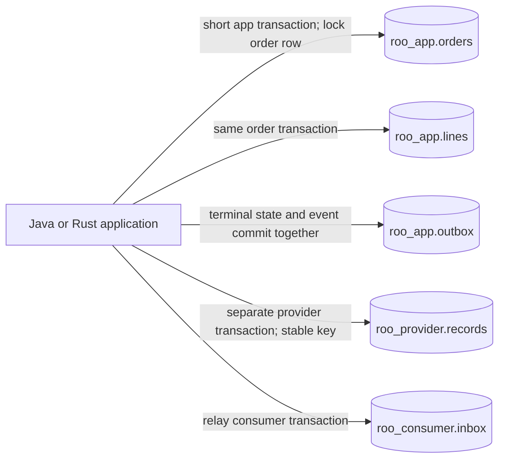
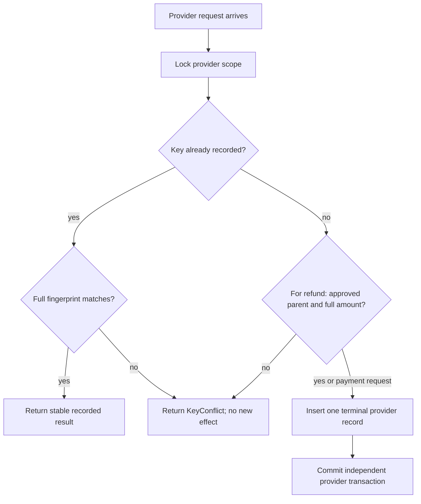
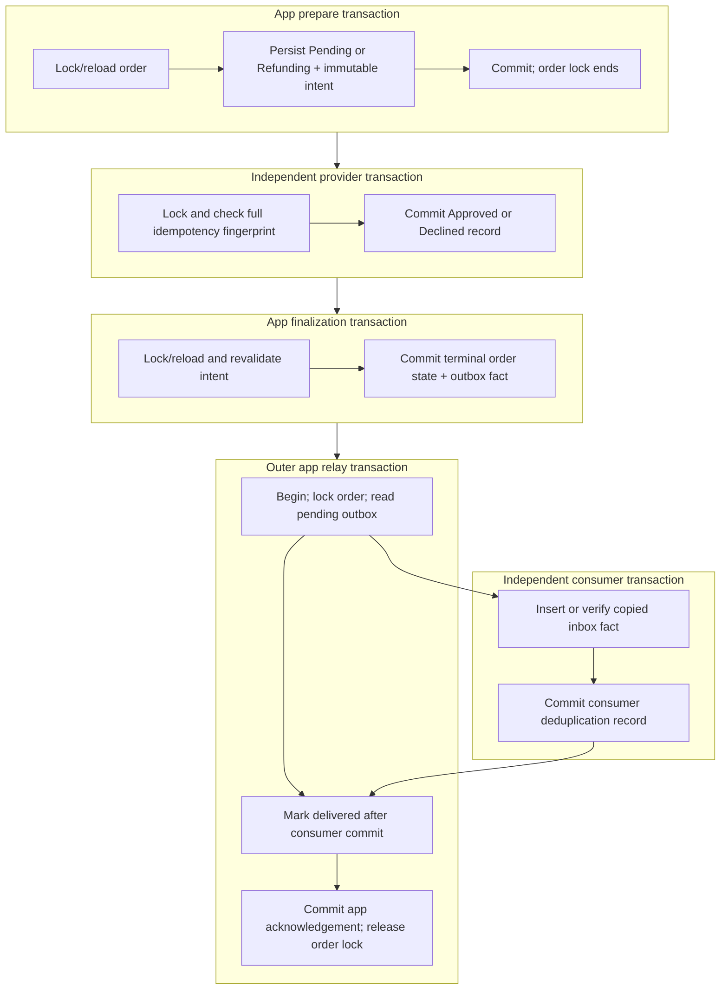
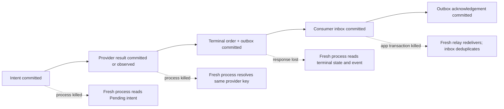

# Orders and payments with PostgreSQL

This tutorial extends the [original ROO orders-and-payments case](../README.md)
from deterministic in-memory adapters to a local PostgreSQL database. The
business contract and its 42 fixture rows remain the same. The additional
implementation makes transaction scope, row-level coordination, independently
committed effects, process recovery, and PostgreSQL restart recovery visible.

The frozen [PostgreSQL contract](SPEC.md) is normative for this extension. The
[schema](schema.sql) is the database adapter boundary; Java composition, Java
template-method inheritance, and Rust composition remain responsible for domain
validation, typed identities, transition rules, and orchestration. The original
case remains useful as the simpler baseline for comparing these relationships.

> **Evidence boundary.** The schema and protocol described here are the frozen
> design. Execution claims belong to the [PostgreSQL run record](../../../research/postgres-run.md)
> and [validation evidence](../../../research/postgres-validation.md). The
> [primary-source ledger](../../../research/postgres-sources.md) explains the
> PostgreSQL, JDBC, and Rust client rules behind the design. A check is evidence
> only when a dated validation record identifies execution against this implementation.

## Carry the method across persistence

ROO (Relationship & Ownership Oriented design) is a language-independent method.
It starts here with the same scenario and invariants as the in-memory case. The new question is which
relationships must survive a process and coordinate competing writers. Retain
the eight contract fields, then choose row keys, locks, transactions, and
recovery observations to realize them. Java and Rust still express local access
and orchestration; PostgreSQL supplies the cross-session commit and locking
mechanisms. The evidence records below delimit the checked failure schedules
and leave external-provider and hardware assumptions explicit.

Resource custody and domain responsibility remain different: an adapter holds a
connection, PostgreSQL retains committed rows, and domain/application operations
protect the order's business rules. Storage identity selects the facts to load;
it does not authorize a caller to mutate them.

## What changes when storage becomes durable

The in-memory case has one process and a candidate-store commit. This extension
has several PostgreSQL transactions and can have multiple Java or Rust processes
working on one scenario scope. Its important relationships are therefore
defined by stable database identities and transaction boundaries, not by the
lifetime of an in-memory object.

- `roo_app.orders` is the serialization row for one scope. Writers lock it with
  `SELECT ... FOR UPDATE`, reload the current state, check the domain transition,
  and commit a short local transaction.
- `roo_app.lines` preserves accepted line facts. The application validates
  checked integer arithmetic before writing; SQL also rejects invalid scalar
  values and impossible line products.
- `roo_provider.records` is the durable payment-provider simulator. It uses an
  independent transaction and a complete request fingerprint. It has no
  foreign key to app state, because its commit is allowed to outlive a failed
  application transaction.
- `roo_app.outbox` stores an immutable terminal fact in the same transaction as
  the terminal order transition. Delivery acknowledgement is a later app write.
- `roo_consumer.inbox` records a consumer effect on its own connection and
  transaction. It has no foreign key to the application schema, so a committed
  delivery can survive failure of its outbox acknowledgement.

PostgreSQL constraints protect scalar shape and uniqueness. The application
still enforces rules that cross rows, such as checked total arithmetic,
immutable intent matching, event consistency with the current order, and a
refund's relationship to an approved full payment. This is a synthetic local
exercise, not a tenant-security or production payment design.

### Domain identity and storage identity

The domain order is `OrderId("O1")` within each synthetic scenario. PostgreSQL's
`scope` primary key distinguishes the stored scenarios and selects their
serialization row; it does not replace the order ID in payment or event facts.
Line facts use `(scope, line_no)`, with a foreign key to the order scope and line
numbers allocated under its row lock. That dependent storage key introduces no
independent domain `LineId` and no command receipt. The accepted add operation
remains non-idempotent. The [schema](schema.sql) and
[add implementation](java/src/roo/postgres/Store.java) make the mapping concrete;
HTTP later exposes this same scope in its resource path. Scope partitions test
data and supplies no tenant authorization policy.

## Run locally

From the repository root, run the serial qualification script:

```sh
bash case-studies/orders-payments/postgres/verify.sh
```

It verifies the pinned JDBC jar, fetches locked Rust dependencies, runs the
Java and Rust checks, creates a private PostgreSQL cluster, installs the schema,
and runs the shared integration harness. It stops only its marked test cluster
when database qualification finishes. Python 3, Bash, a JDK 21 or newer,
Rust/Cargo 1.96, and PostgreSQL 18 server tools must be available. This recorded
run used JDK 26 and compiled for release 21. The cluster script uses `pg_ctl`
from `PATH`, or the directory named by `ROO_PG_BINDIR`.

The harness selects a free port and stores its configuration and data under
this case's `.runtime` directory. It binds only to `127.0.0.1` and passes the
explicit `ROO_PG_HOST`, `ROO_PG_PORT`, `ROO_PG_DATABASE`, and `ROO_PG_USER`
values to each runner. The runners reject arbitrary hosts and DSNs. Schema
installation does not drop tables or reset scopes; each fixture run gets a
unique `ROO_RUN_ID` prefix. The script fetches pgJDBC 42.7.14 and Cargo
dependencies when they are not already available, so a first run needs network
access to those public package sources.

| Runtime or client | Version used by this case |
|---|---|
| PostgreSQL server | 18.6 (`server_version_num=180006`); the verified restart kept `fsync`, `synchronous_commit`, and `full_page_writes` set to `on` |
| Java | JDK 26, compiling with `--release 21` |
| pgJDBC | 42.7.14; pinned jar SHA-256: `73914527305a40cce504b0d3d90b23caf565136912d607ae8ae7c5895512332c` |
| Rust | 1.96, edition 2024 |
| Rust client | `postgres = "=0.19.14"`, locked in `rust/Cargo.lock` |

Set `ROO_PG_BINDIR` to PostgreSQL 18's `bin` directory when `PATH` does not
select the matching server tools. If `pg_ctl` on `PATH` comes from Homebrew's
libpq package and has no paired `postgres` executable, the helper checks the
standard Apple Silicon (`/opt/homebrew/opt/postgresql@18/bin`) and Intel
(`/usr/local/opt/postgresql@18/bin`) Homebrew locations. The helper requires
`postgres`, `initdb`, `pg_ctl`, `psql`, and `createdb` from one selected
directory.

For direct runner commands after building, see the
[Java usage guide](java/README.md) and
[Rust usage guide](rust/README.md). `verify.sh` is the reproducible entry point
for the whole case because it owns setup, serial checks, schema application,
integration, and cleanup.

The local `initdb --auth=trust` setting is acceptable only for this isolated,
synthetic, loopback test cluster. It supplies no password protection and is not
a production authentication example. Do not point this harness at a personal,
shared, staging, or production database.

For a guided code tour, Java keeps the immutable facts in
[`Domain.java`](java/src/roo/postgres/Domain.java), connection configuration and
short-transaction retry in [`Database.java`](java/src/roo/postgres/Database.java),
app writes and relay in [`Store.java`](java/src/roo/postgres/Store.java), and
the independent provider map in [`Provider.java`](java/src/roo/postgres/Provider.java).
Rust combines the database protocol in
[`database.rs`](rust/src/database.rs) and pure domain rules in
[`domain.rs`](rust/src/domain.rs).

## Read the system as three authorities

There are three durable authorities in the local simulator. They share one
PostgreSQL database instance and WAL durability domain for repeatable testing,
but they do not share a transaction. Separate schemas and connections model
independent commit boundaries; they do not create independent server, storage,
or recovery domains.



The schema is intentionally not event-sourced. The current order row and line
rows are operational state. Outbox rows are retained terminal facts for
delivery. Provider records represent the simulator's idempotency contract, and
inbox rows represent the simulator consumer's deduplicated effect. Keeping the
authorities separate lets the tests create real failure windows without
pretending that one SQL transaction spans them.

### State that is stored

| Table | Role | Identity and guard |
|---|---|---|
| `roo_app.orders` | Current state and active payment/refund intent | `scope` primary key; checks constrain state shape and USD order facts |
| `roo_app.lines` | Accepted unit price and quantity facts | `(scope, line_no)` primary key; FK to order; positive values and bounded product |
| `roo_app.outbox` | Terminal event facts and delivery flag | `(scope, event_id)` primary key; stable ID derived from payment/refund identity |
| `roo_provider.records` | Independent terminal simulator result | `(scope, kind, operation_id)` primary key and complete request fingerprint |
| `roo_consumer.inbox` | Independently committed deduplicated consumer effect | `(scope, event_id)` primary key and copied event fingerprint |

Provider and inbox tables intentionally have no foreign key to `roo_app`. A
foreign key would incorrectly imply that deleting or rolling back an app row can
undo an independent provider/consumer record. The harness retains records for
the fresh synthetic scenario and performs cleanup only through its owned test
data lifecycle.

The checks in [schema.sql](schema.sql) are useful defenses, but they cannot prove
that `sum(lines) = orders.total`, that a historical transition was legal, or
that an arbitrary SQL writer preserved an immutable intent. Those rules belong
to the Java and Rust adapters while they hold the order lock. In particular,
PostgreSQL's `CHECK` constraints are not a substitute for checking every
cross-row rule in the same serialized transaction.

## One payment, several short transactions

The core protocol is a local durable intent, an independent provider effect,
then local finalization. Each application transaction is short. The order row
lock is released before the provider adapter runs, which means application
workers serialize decisions without holding database resources over an external
effect.

```mermaid
sequenceDiagram
    autonumber
    participant W as Worker
    participant A as roo_app
    participant P as roo_provider

    W->>A: BEGIN; SELECT order FOR UPDATE
    W->>A: validate Draft; write Pending + PaymentId
    W->>A: COMMIT (release order lock)
    W->>P: BEGIN on a separate connection
    W->>P: lock provider scope; inspect key + fingerprint
    W->>P: insert Approved or Declined record
    W->>P: COMMIT provider result
    W->>A: BEGIN; reload and lock order
    W->>A: validate same intent; write terminal state + outbox event
    W->>A: COMMIT
```

The protocol stores `Pending` and the immutable request before calling the
provider. If the application stops after provider commit, a later process can
recover from that intent and use the same `PaymentId`. The provider simulator
returns its retained result for an identical request and rejects a key reused
with a different order, currency, amount, or parent payment.

The relevant SQL shape is:

```sql
-- Application prepare transaction (illustrative parameter names).
BEGIN;
SELECT state, total, payment_id, refund_id
  FROM roo_app.orders
 WHERE scope = $1
 FOR UPDATE;
-- Validate the reloaded row and the immutable request in Java or Rust.
UPDATE roo_app.orders
   SET state = 'Pending', payment_id = $2
 WHERE scope = $1;
COMMIT;
```

The implementation's adapter owns the actual statement sequence. The example
omits conflict and error handling to keep the transaction boundary visible.
`SELECT ... FOR UPDATE` coordinates other database sessions only until this
transaction ends. It is not a lock that survives `COMMIT`, and it does not
protect work performed later by the provider adapter.

### Provider idempotency is a database contract here

The simulator commits a new provider result on a separate connection. Under a
scope-scoped advisory transaction lock it loads the complete record for
`(scope, kind, operation_id)` and compares every immutable request field. The
primary key arbitrates duplicate keys, and a partial unique index ensures one
full refund per approved payment even if callers race with different refund
keys.



This table is a simulator, not a real provider. Its complete key retention and
lookup semantics are chosen by the frozen contract. A real provider may have
different idempotency scope, retention, eventual consistency, or status lookup
rules. A local database commit cannot roll back an effect performed by an
external service.

### Finalization revalidates before it writes

After observing a provider result, finalization opens a new app transaction,
locks and reloads the order, and compares the current active intent with the
same full request. A worker may have already completed that intent. In that
case, the adapter returns the stable terminal no-op instead of inserting a
second event or replacing a later Refund state. A conflicting intent or event is
never overwritten.

For a real terminal transition, one transaction writes both the order state and
the deterministic event. If either write fails, neither one becomes committed.
The provider record may already exist; it remains available for reconciliation.

```sql
-- App finalization transaction (illustrative only).
BEGIN;
SELECT state, total, payment_id, refund_id
  FROM roo_app.orders
 WHERE scope = $1
 FOR UPDATE;
-- Revalidate the persisted request and terminal observation.
UPDATE roo_app.orders
   SET state = 'Paid'
 WHERE scope = $1;
INSERT INTO roo_app.outbox
       (scope, event_id, event_kind, order_id, currency, payment_id,
        refund_id, amount)
VALUES ($1, 'payment:' || $2, 'PaymentApproved', 'O1', 'USD', $2,
        NULL, $3);
COMMIT;
```

The actual event amount and event kind depend on the validated provider result.
The event identity is stable: `payment:<PaymentId>` for either payment
terminal fact, and `refund:<RefundId>` for a refund fact. The primary key
protects against a second insert, while application-level fingerprint checking
prevents a conflicting row from being treated as a valid duplicate.

## Transaction map

The payment path uses three transactions: app prepare, provider effect, and app
finalization. Relay then uses an outer app transaction and an independent
consumer transaction nested in its work. The outbox acknowledgement is part of
the outer relay transaction; it does not open a sixth transaction.



The relay contract deliberately holds the app order lock while it reads pending
outbox rows in sequence order, calls the synthetic consumer on a separate
connection, and marks delivery. This creates deterministic serialized fixture
behavior. It trades throughput for a simple lesson about independent commits;
do not carry this lock policy over to a production relay making network calls.

## Add, pay, refund, and snapshot behavior

### Add a line

The runner parses the complete action and integer text before database work.
Inside a short transaction, it locks the order row and reloads the current
state and total. It accepts the line only while the order is `Draft`, then
checks positive price and quantity and checked multiplication/addition against
the locked total. While still holding the order lock it allocates the next
`line_no`, inserts the line, updates the total, and commits both writes
together. A second writer cannot allocate the same per-scope line number
because it must acquire the same order lock first. A rejected candidate
installs no line or changed total.

### Pay an order

Payment has three meaningful outcomes after preparation:

| Provider observation | App state after action | Event | Recovery action |
|---|---|---|---|
| `Approved`, finalized | `Paid` | `PaymentApproved` committed with state | Return stable terminal result |
| `Declined`, finalized | `Declined` | `PaymentDeclined` committed with state | Return stable terminal result |
| `Unknown` or `NotFound` | `Pending` | None | Keep the same intent; reconcile or retry its stable key |

`Unknown` describes what the caller observed. It does not assert that the
provider did nothing. `NotFound` is definitive only because this simulator
retains every scenario key. A timeout before the simulated provider commit and a
timeout after it both return `Unknown`, but a same-key retry or read-only lookup
distinguishes their durable provider records.

### Refund a payment

Refund uses the same prepare/provider/finalize protocol. The order moves from
`Paid` to `Refunding` with a durable `RefundId`, then the provider simulator
checks the approved parent payment and complete amount, then app finalization
commits `Refunded` and one `RefundApproved` outbox fact. A refund is a separate
compensating effect with a separate stable identity. It is not a rollback of the
earlier payment.

### Read a snapshot

The eleven-column fixture output stays unchanged. The persistent runner reports
the original scenario labels and fields, while database scopes receive a fresh
`ROO_RUN_ID` prefix so old data is never mistaken for a new fixture. `init`
creates a Draft only when the scope is absent; it does not reset an existing
scope.

Use one SQL statement with scalar aggregates for the snapshot, or a read-only
`REPEATABLE READ` transaction if several statements are necessary. Under the
default `READ COMMITTED` isolation, each statement can observe a newer commit;
several independent reads can otherwise report counts from different points in
time. An action result represents that action's own decision, while its
subsequent snapshot may include a concurrent worker's later commit.

## Row locks, concurrency, and retry

Every app mutation follows the same lock order: lock the scope's order row, then
read and validate the current order and its dependent outbox rows as needed.
Provider writes take only the provider scope advisory lock. Inbox insertion
takes no app or provider lock. This avoids a provider-to-app or inbox-to-app
inverse lock path.

The row lock is an inter-process database guarantee. Java's synchronization
primitives and Rust's local ownership rules do not substitute for it. Likewise,
Rust's exclusive `&mut Client` borrow coordinates use of that particular client
inside one program; another `Client`, JVM, or process can still race for the
same database row. PostgreSQL arbitrates that race.

When a short transaction is known to have aborted with SQLSTATE `40001`
(`serialization_failure`), `40P01` (`deadlock_detected`), or `55P03`
(`lock_not_available`), the contract permits retrying the whole short
transaction up to three attempts. Each attempt needs a fresh transaction or
connection, a new read, and full validation against current rows. Stable domain
identities remain the same. Do not retry only the last SQL statement.

Other errors require their own handling. A uniqueness error such as `23505` is
not automatically a transient failure. If the connection is lost while waiting
for a `COMMIT` reply, the client cannot infer whether PostgreSQL committed.
That is an unknown observation, not a known abort. Reconnect, inspect the
persisted intent and state using stable identities, and reconcile. Never
automatically repeat an add after an uncertain commit. Resolve an uncertain
provider commit by the same key or a status lookup; resolve an uncertain inbox
commit by deduplicated redelivery.

## Relay and the outbox/inbox boundary

The outbox narrows the gap between changing local state and recording the fact
that needs delivery. It does not make delivery exactly once. The consumer's
unique `(scope, event_id)` inbox identity makes its synthetic effect
idempotent, and the app's delivered flag makes relay progress observable.

```mermaid
sequenceDiagram
    autonumber
    participant R as Relay worker
    participant A as roo_app connection
    participant C as roo_consumer connection

    R->>A: BEGIN; lock order; read pending events in seq order
    R->>C: BEGIN; INSERT inbox event ON CONFLICT DO NOTHING
    R->>C: New statement reads winner and compares full event fingerprint
    R->>C: COMMIT consumer inbox
    R->>A: Mark event delivered
    R->>A: COMMIT acknowledgement
```

The second consumer statement matters under `READ COMMITTED`: a concurrent
insert may cause `ON CONFLICT DO NOTHING` even when the conflicting row was not
visible to that insert statement's snapshot. A new statement sees the winner;
the adapter compares every copied event field before accepting it as a
duplicate. Identical EventIds with different payloads are conflicts, not
successful deduplication.

The `ack_fail` injection is a concrete two-commit failure: the consumer inbox
commits, then the app acknowledgement rolls back. A relay retry redelivers the
event, finds the identical inbox fact, and records the app acknowledgement. The
simulated consumer must not acquire app or provider locks, so the lock order
cannot invert.

## Crash windows and fresh-process recovery

The deterministic gate points make otherwise timing-sensitive windows
observable. The harness holds a PostgreSQL advisory session lock, starts a
worker, and releases or kills it after seeing the worker wait at the selected
point. `inside_prepare` exposes an uncommitted write while its order lock is
held, so a second worker can demonstrate blocking and revalidation. It is a
concurrency witness; the four `after_*` points below expose committed recovery
windows. A delay by itself is not evidence that a worker reached the intended
state.



| Gate | Durable state before the worker blocks | What a killed worker leaves behind | Fresh-process recovery |
|---|---|---|---|
| `after_prepare` | `Pending` or `Refunding` intent committed; provider call not started | Intent survives; no provider record from this attempt | Reconcile the same identity; `NotFound` stays distinct from `Unknown`; retry the persisted key only under the contract |
| `after_effect` | Provider request/result has been observed; provider transaction already committed if it produced an effect | Provider record/effect survives beside pending app intent | Same-key lookup/retry returns the terminal provider record and app finalization can proceed |
| `after_finalize` | Terminal order and outbox event committed | Both local facts survive even if the response was never returned | Read the order and event; do not append another event |
| `after_delivery` | Consumer inbox committed; app acknowledgement not committed | Inbox survives; killed app transaction rolls back its acknowledgement | Redeliver; compare and deduplicate inbox fact, then mark the event delivered |

The runner also preserves existing `prepare` and `commit` failure actions. Those
roll back only the specific local transaction they target. In particular,
`LocalCommitFailed` does not roll back the already committed provider
transaction.

### Process restart is not PostgreSQL restart

Killing a Java or Rust worker leaves PostgreSQL running. A fresh application
process then proves that the application did not need its old heap, thread, or
Rust stack to reconcile the durable rows. It says nothing about the database
server's own crash path.

The dedicated harness separately performs an immediate PostgreSQL server
shutdown and restart. On startup, PostgreSQL replays WAL to recover committed
transactions. The recorded run shows immediate shutdown, successful startup,
WAL redo, and survival of app, provider, outbox, and inbox rows. A graceful stop
does not exercise the same immediate-shutdown recovery path.

This is evidence about the selected PostgreSQL build, host, filesystem, and
configuration. It is not a physical power-loss test and cannot prove that
hardware caches or a real storage controller honor flushes. The simulator's
provider table shares this PostgreSQL server and WAL; its survival is not
evidence about an external provider.

## The eight-field Relationship Contract in a durable system

The [ROO relationship chapter](../../../docs/02-relationship-design.md) asks
eight questions. PostgreSQL makes their answers span memory, durable identities,
database connections, locks, and independently committed participants.

| Relationship | Owner / resource custodian | Stable identity | Invariant coordinator | Authorization | Access regime | Validity horizon | Execution domain | Failure boundary |
|---|---|---|---|---|---|---|---|---|
| Order → line facts | App database retains lines under the order row | `(scope, line_no)` | Validated add operation; order row serializes allocation | Not implemented; synthetic callers only | Order-row lock, line insert, and total update in one app transaction | Lines remain while the synthetic scope is retained; frozen after prepare | Concurrent sessions and processes share PostgreSQL coordination | Rejected or aborted add leaves both line and total unchanged |
| Command → order row | Application adapter owns each connection and transaction; database owns committed row | `scope` identifies one synthetic order | Domain decides; adapter performs validated writes | Not implemented; synthetic callers only | Fresh `SELECT ... FOR UPDATE`, then reload and revalidate | Lock exists only until commit/rollback; stable scope lasts through the fixture | Any Java/Rust worker using the dedicated cluster | Known abort may retry the whole short transaction; uncertain commit is inspected |
| Use case → connection/transaction | Adapter opens and closes one connection for each short unit; no application cache owns committed state | Connection/session identity is temporary; domain scope and operation IDs carry durable identity | Adapter may issue only the writes for its current unit of work | Not implemented; synthetic callers only | Java disables auto-commit; Rust's `Transaction` exclusively borrows its `Client` | The transaction ends at commit/rollback; a closed connection cannot carry a lock forward | One connection per short operation; other sessions and processes remain independent | Known abort may retry the whole unit; lost commit reply requires a fresh connection and inspection |
| Order → payment/refund intent | `roo_app.orders` retains active immutable request | Separate `PaymentId` or `RefundId`, scoped to `scope` and typed operation | App use case prepares once; retries reuse the exact request | Not implemented; synthetic callers only | Persist intent under order lock; release lock before provider call | Intent survives app process loss and remains through the terminal state | Multiple local processes; each owns a separate connection | Prepare failure precedes provider call; later failure leaves intent available to reconcile |
| Application → provider simulator | `roo_provider.records` is an independent durable authority | `(scope, kind, operation_id)` plus full request fingerprint | Provider adapter inserts a terminal result; app supplies the persisted request | Not implemented; synthetic callers only | Separate connection; scope advisory transaction lock; PK and refund unique index | Retained until explicit synthetic harness cleanup | Independent provider transaction may overlap app workers | Provider commit survives app failure; matching key is stable; mismatch is `KeyConflict` |
| Terminal order → outbox fact | `roo_app.outbox` retains terminal event facts | `payment:<PaymentId>` or `refund:<RefundId>` within scope | Finalizer writes event only after revalidating intent | Not implemented; synthetic callers only | Same app transaction as terminal order state; unique EventId | Retained for the fixture, including delivered events | App session commits both rows atomically | Local rollback removes both candidate writes; provider effect remains independent |
| Relay → consumer inbox | `roo_consumer.inbox` owns the copied event fingerprint | `(scope, event_id)` | Relay requests delivery; consumer adapter commits one inbox row | Not implemented; synthetic callers only | Independent consumer connection and transaction; new-statement fingerprint check after conflict | Inbox fact survives app ack rollback and process restart | Multiple relay processes, serialized here by the order lock | Consumer commit can outlive app ack; safe retry deduplicates identical content |
| Observer → snapshot | Database retains each authority's rows; runner assembles output | Scope plus the selected retained identities | Read-only snapshot adapter | Not implemented; synthetic callers only | One aggregate `SELECT` or read-only `REPEATABLE READ` transaction | One statement snapshot, or one explicit read transaction | A new connection may observe later commits than the action response | Multiple READ COMMITTED statements can tear; use a consistent read boundary |

The same row-lock relationship has different language-level representations.
Java explicitly opens and closes JDBC connections and transactions. Rust's
synchronous `postgres` client lends a mutable borrow to a `Transaction`; this
helps prevent overlapping transactions through that client value and rolls an
uncommitted transaction back when it is dropped. Neither mechanism locks out a
second client. PostgreSQL's row lock provides the cross-session coordination.

## Java composition, Java template method, and Rust

The three runners execute the same persistent command protocol and the same
fixture oracle. The language comparison asks which responsibility is visible
and where the transaction contract actually lives.

### Java composition

Composition supplies the store and provider capabilities through narrow
interfaces or objects. The application coordinator remains responsible for
the prepare/effect/finalize ordering. A persistence adapter owns the JDBC
connections and opens an explicit transaction for every multi-statement unit.
JDBC connections default to auto-commit, so the adapter must disable it for a
transaction, commit on success, roll back on a known failure, and close each
connection. Provider and inbox operations use their own connections.

### Java template method

[`TemplateApplication.execute`](java/src/roo/postgres/TemplateApplication.java)
is `final` and owns the prepare/effect/finalize ordering, with narrow protected
hooks for the store, provider, and database gate. `JdbcTemplateApplication`
supplies those adapters. The independently coded
[`CompositionApplication.execute`](java/src/roo/postgres/CompositionApplication.java)
uses injected capabilities and executes the same phase order. The final method
protects the template algorithm from an override; it does not prove that a hook
implementation honors its contract or that a provider effect rolls back with a
JDBC transaction.

### Rust composition

The Rust `Database` retains structured connection configuration and creates a
new synchronous `Client` for each short transaction. A
`postgres::Client::transaction` borrows that client mutably; here the explicit
`build_transaction` path does the same. The `Transaction` consumes itself on
commit; if it is dropped unfinished, the client library rolls it back. This
makes one connection's transaction scope visible in Rust's borrowing model.

The borrow ends inside one process. It does not coordinate another Rust
`Client`, a Java connection, or a second process. The same SQL uniqueness rules,
order row locks, provider advisory lock, and idempotency fingerprints apply to
all three runners. Ownership is local access evidence, not distributed
consistency.

### Preserve parity as implementations evolve

The initial 42 fixture rows and eleven output fields are unchanged. Each of the
three persistent runners must match the independent oracle. The persistent
extension also needs common malformed-input checks and matching deterministic
adversarial cases: competing payment/refund identities, sequential and
concurrent same-key retries, add/payment row blocking, duplicate relay workers,
lost finalization, and recovery at the process-kill gates. A shared harness
should control barriers and compare
the actual database observations; a test name or authored fixture alone does
not establish a pass.

The old in-memory run remains a separate baseline. A new PostgreSQL result must
not overwrite its historical evidence or imply that the in-memory case tested
database concurrency.

## Executed validation

The final post-hardening serial `verify.sh` run exited successfully. It used one
private PostgreSQL 18.6 cluster and completed the same oracle and adversarial
checks against Java composition, Java template-method inheritance, and Rust
composition. This is local implementation evidence, not production acceptance;
the [independent final review](../../../research/postgres-review.md) records
candidate acceptance separately. The
[validation ledger](../../../research/postgres-validation.md) summarizes the
commands and outcome. The [machine-readable integration receipt](../../../research/postgres-integration-evidence.json)
and [serial checks log](../../../research/postgres-checks.log) preserve the
run-specific observations. The receipt's run ID is `pg_ffbd2dde5bf4`.

| Evidence lane | Final recorded result |
|---|---|
| Oracle parity | Each variant matched all 42 expected rows and rejected all 10 malformed fixtures |
| Persistent boundary guards | Each variant passed 3 guards: atomic fixture reservation, idempotent initialization that preserves existing data, and rejection of non-loopback configuration |
| Row-level concurrency | Each variant passed 7 witnessed schedules: competing payment keys, same payment key, competing refund keys, same refund key, add-before-pay, pay-before-add, and concurrent relays |
| Process recovery | Each variant passed 5 SIGKILL/fresh-process cases: after prepare, payment effect, finalization, delivery, and refund effect |
| PostgreSQL restart | One immediate server shutdown/restart preserved and recovered 12 durable snapshots, four per variant; startup logs contain WAL redo evidence, with `fsync`, `synchronous_commit`, and `full_page_writes` all `on` |
| SQL constraints | All 5 direct probes were rejected: 3 with `23514` and 2 with `23505` |
| Java checks | 52 pure checks and 2 intended compiler-negative checks passed |
| Rust checks | 6 unit tests, 2 positive doctests, and 4 compile-fail doctests passed; the negative examples produced the expected `E0382`, `E0499`, `E0597`, and `E0624` diagnostics |

The concurrency harness uses database-observed stages and lock witnesses, not
sleep duration alone. It records worker identity and SQLSTATE where applicable,
then checks rows from a fresh session after recovery. The checks log records
that the owned cluster stopped after qualification; its test data was retained.
The original in-memory regression suite was run separately and exited 0; its
receipt is [postgres-regression.log](../../../research/postgres-regression.log).
That evidence remains distinct from the PostgreSQL concurrency and recovery
results above.

## Limits and study questions

This extension establishes behavior only for the recorded local software,
schema, configuration, and synthetic fixture. It does not establish production
readiness, real provider behavior, external exactly-once delivery, tenant
isolation, authorization, PCI compliance, physical power-loss durability,
hardware cache correctness, exhaustive schedules, or performance at scale.
The `scope` value partitions test scenarios; it is not a tenant security
boundary. A real payment provider does not participate in this database's
transaction, so reconciliation and stable idempotency keys remain application
and provider contracts.

Use the implementation and evidence to answer these questions:

1. Which writes can be made atomic together, and which survive independently?
2. What fact lets a fresh process distinguish a provider effect from an
   application response that was lost?
3. Which lock coordinates two processes, and when does that lock end?
4. Why can a Rust mutable borrow not serialize a second process?
5. How does the inbox make a consumer retry safe after the app acknowledgement
   rolls back?
6. What new evidence does immediate PostgreSQL restart add beyond killing a
   worker, and what physical durability claim remains unproved?

## Sources and evidence

Read the [frozen PostgreSQL protocol](SPEC.md), [database schema](schema.sql),
[original case](../README.md), [fixture contract](../SPEC.md), [scenario rows](../scenarios.tsv),
[independent oracle](../expected.tsv), [execution record](../../../research/postgres-run.md),
[validation ledger](../../../research/postgres-validation.md), and
[primary-source ledger](../../../research/postgres-sources.md). ROO background:
[eight-field Relationship Contract](../../../docs/02-relationship-design.md),
[architecture boundaries](../../../docs/05-architecture.md), and
[cross-language discussion](../../../docs/06-cross-language.md).
