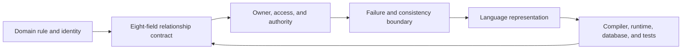

# Rust and object-oriented design: a relationship-first guide

Use this companion with the [canonical contract and procedure](02-relationship-design.md).
The original [Portuguese guide](../research/sources/RUST_VS_OO_GUIA_COMPLETO_2026.original.md)
is preserved; the coverage crosswalk below maps its 29 topics.

Rust and Java fences marked **Compiled and tested in CI** are checked directly
from this Markdown, together with the examples in
[cross-language portability](06-cross-language.md).
Other blocks are labeled **Illustrative**. For broader claims and review
provenance, see [Claims and limits](claims-and-limits.md) and
[How ROO was made](how-roo-was-made.md).

## 1. The thesis: design obligations before representation

Rust is not the opposite of object-oriented design. It is a multiparadigm language with structs, methods, encapsulation through module visibility, traits, generic abstraction, and dynamic dispatch through trait objects. It does not provide class inheritance of fields and implementation. “Object-oriented” has more than one definition.

If the term means packaging data with behavior and hiding representation, Rust can support that style. If it requires traditional class inheritance, Rust does not. Useful architecture does not depend on settling the label first. [The Rust Book: object-oriented programming features](https://doc.rust-lang.org/book/ch18-01-what-is-oo.html) describes this conditional terminology.

The comparison should separate four questions:

1. What domain rule must remain true?
2. What relationship lets one part of the program observe or change another?
3. Which language or runtime mechanism expresses that relationship?
4. Which evidence checks the result, and what remains outside that check?

No language supplies a complete architecture. A Java system can have narrow modules, strong tests, immutable values, and robust transaction handling. A Rust system can compile while authorizing the wrong tenant, losing a payment outcome, or publishing an event twice. The central ROO principle is modest:

> **Describe the operational contract of an important relationship before selecting its pointer, class, trait, identifier, lock, or message.**

## 2. Keep the comparison honest

Paradigm, language, memory management, framework, architecture, pattern, and guarantee are different dimensions.

| Dimension | Example | What it does not determine |
|---|---|---|
| Paradigm | Object-oriented, functional, procedural, data-oriented | A deployment topology |
| Language | Rust, Java, C#, C++, Go | A single architecture |
| Memory model | Rust ownership, tracing GC, RAII, reference counting | Business identity or authorization |
| Framework | Tokio, Spring, ASP.NET Core | Whether the domain model is correct |
| Architecture | Modular monolith, ports and adapters, services | How one value is allocated |
| Pattern | Adapter, State, Strategy | Whether the pattern is needed |
| Guarantee | Borrow checking, SQL constraint, test assertion, operational protocol | Properties outside that mechanism's scope |

“Rust versus OO” is shorthand for comparing design habits, not a formal opposition. “Traditional enterprise OO” in this guide means code organized primarily around mutable objects, class hierarchies, shared references, and framework wiring. It does not describe every modern Java or C# system. Java and C# have evolved beyond older class-heavy examples.

Java includes interfaces, default methods, records, sealed classes and interfaces, and pattern matching. C# includes records, value types, interfaces, generics, and newer reference-scoping features. Both languages support composition, immutable APIs, manual dependency wiring, and deeper modularity choices. Garbage collection is not a synonym for object orientation, and Rust is not heap-free.

Rust programs routinely use heap-backed String, Vec, Box, and shared handles. The relevant design questions are lifecycle, aliasing, authority, and runtime cost. The history of enterprise architecture also predates and crosses language ecosystems. GoF's 1994 book draws on C++ and Smalltalk; DDD, information hiding, ports and adapters, and transaction design are not owned by Java.

Use historical claims to explain context, not to imply that one language invented architecture.

### A compact comparison

| Concern | Java or C# application code | Rust application code | Shared design question |
|---|---|---|---|
| Encapsulated state | Classes, records, modules, access control | Structs, enums, modules, private fields | Which operations preserve the invariant? |
| Reuse | Delegation, composition, inheritance, defaults | Composition, helper functions, trait defaults | Is this reuse of state, code, or behavior? |
| Substitution | Interfaces and subclasses | Traits, generics, dynamic traits, enums | Are implementations behaviorally substitutable? |
| Absence and failure | Nullable types, optionals, exceptions, result types | Option and Result values, panic | Is the outcome expected and recoverable? |
| Memory lifecycle | GC plus deterministic resource scopes | Ownership, RAII, explicit sharing | Who retains and releases the resource? |
| Concurrency | Threads, tasks, locks, confinement | Threads, futures, locks, channels, actors | What serializes competing changes? |
| Persistence | ORM, driver, transaction, database constraints | Same | Which system is the source of truth? |
| Performance | Profile and benchmark the workload | Profile and benchmark the workload | What measured cost justifies the representation? |

Count verified properties, not classes, traits, crates, or lines of code. A property may be enforced by the compiler, a runtime check, a database, a test, or an external protocol. State which one applies.

## 3. The ROO Relationship Contract

Use the [eight-field contract](02-relationship-design.md#21-the-eight-field-relationship-contract)
and [six-step procedure](02-relationship-design.md#23-the-six-step-decision-procedure)
defined in chapter 2. Custody, invariant coordination, identity, and authorization
each have an explicit slot. The [short worksheet](../templates/relationship-contract.md)
fits in a PR or an ADR.

For `Order -> PaymentAttempt`, retain the immutable attempt ID before calling
the provider. The application coordinates prepare/call/finalize; the provider
retains its independent effect. A timeout produces an unknown observation,
resolved by the same attempt ID. Caller authorization is an additional policy,
absent from the teaching case. The
[completed recovery contract](../case-studies/orders-payments/adoption/relationship-contract.md)
shows the full record and Java/Rust mappings.

Three clocks explain why this matters: memory validity of a loaded value,
business validity of an attempt, and freshness of its observed status.
A safe reference can point to a status that is already stale.

## 4. Object-oriented design, inheritance, and composition

“Inheritance” often bundles four different goals:

| Goal | What the design asks for |
|---|---|
| State inheritance | A child receives the parent's data representation |
| Implementation reuse | A child reuses code from another type |
| Type substitutability | A child can be used where a parent type is accepted |
| Behavioral subtyping | The child preserves the parent's promised behavior |

Achieving one does not automatically achieve the others. A shared interface does not share state. Reusing implementation does not establish a valid subtype. A matching method signature does not prove that two implementations have the same effects, errors, or history constraints. Rust separates these goals. Struct fields or composition can share owned state.

Functions, delegation, and default trait methods can reuse implementation. Traits describe capabilities. Enums represent deliberately closed families. Generic parameters select concrete implementations at compile time. Dynamic trait objects enable runtime dispatch for a dyn-compatible trait.

### When inheritance is an honest choice

Inheritance remains reasonable when a language supports it and the domain really has a stable subtype relation with a behavioral contract that the child can preserve. It can provide direct substitutability and shared implementation. Review base-class assumptions, initialization order, protected state, overridable methods, and whether a future subtype can honor every promise.

Choose composition when a type needs one or more capabilities without being a semantic subtype, when policies combine independently, or when variations would otherwise produce a subclass matrix. Composition makes ownership and delegation explicit, but adds forwarding and can scatter a coherent behavior across objects.

| Situation | Candidate | Question to settle |
|---|---|---|
| A real subtype with a stable behavioral contract | Inheritance in Java or C# | Can every subtype preserve the base guarantees and invariants? |
| One type uses another type's state and operations | Composition | Who owns the component, and can its invariant stand alone? |
| Behavior changes among a known finite set | Enum or sealed family | Is the set intentionally closed to external extension? |
| External implementations must plug in | Interface or trait | What error, ordering, retry, and side-effect contract applies? |
| A short single algorithm varies at a call site | Function or closure | Does naming a separate type add useful meaning? |
| No real variation exists | Concrete type or function | Is the abstraction solving an actual change boundary? |

Neither “always compose” nor “inheritance is inherently bad” is a useful rule. Prefer the representation that preserves the real domain relationship with the smallest understandable contract.

### Modern Java and Rust can both model closed cases

Java records are special classes for fixed components. Their fields are final, but an object graph reachable through a component is not automatically immutable. Records cannot extend an arbitrary class, but can implement interfaces. Sealed classes and interfaces restrict the permitted direct subtypes.

Ordinary interfaces remain useful for open contracts, with default methods providing limited shared behavior.

[Oracle: record classes](https://docs.oracle.com/en/java/javase/26/language/records.html), [sealed classes and interfaces](https://docs.oracle.com/en/java/javase/26/language/sealed-classes-interfaces.html), [Java SE 26 Language Specification](https://docs.oracle.com/en/java/javase/26/docs/specs/jls26.pdf). The following examples exercise the same three closed payment outcomes.

<!-- roo-example: closed-payment-java -->
**Compiled and tested in CI · Java.**

```java
sealed interface PaymentResult permits Approved, Declined, Unknown {}

record Approved(String receiptId) implements PaymentResult {}
record Declined(String reason) implements PaymentResult {}
record Unknown(String attemptId) implements PaymentResult {}

class ClosedPaymentExample {
    static String describe(PaymentResult result) {
        return switch (result) {
            case Approved a -> "approved:" + a.receiptId();
            case Declined d -> "declined:" + d.reason();
            case Unknown u -> "unknown:" + u.attemptId();
        };
    }

    public static void main(String[] args) {
        if (!describe(new Approved("r1")).equals("approved:r1")
                || !describe(new Declined("limit")).equals("declined:limit")
                || !describe(new Unknown("p1")).equals("unknown:p1")) {
            throw new AssertionError("payment outcome classification");
        }
    }
}
```

<!-- roo-example: closed-payment-rust -->
**Compiled and tested in CI · Rust.**

```rust
enum PaymentResult {
    Approved { receipt_id: String },
    Declined { reason: String },
    Unknown { attempt_id: String },
}

fn describe(result: PaymentResult) -> String {
    match result {
        PaymentResult::Approved { receipt_id } => format!("approved:{receipt_id}"),
        PaymentResult::Declined { reason } => format!("declined:{reason}"),
        PaymentResult::Unknown { attempt_id } => format!("unknown:{attempt_id}"),
    }
}

assert_eq!(describe(PaymentResult::Approved { receipt_id: "r1".into() }), "approved:r1");
assert_eq!(describe(PaymentResult::Declined { reason: "limit".into() }), "declined:limit");
assert_eq!(describe(PaymentResult::Unknown { attempt_id: "p1".into() }), "unknown:p1");
```

Both approaches can make the alternatives explicit. Their construction rules, pattern matching, API evolution, serialization, and caller ergonomics differ. Neither verifies the authenticity of a provider response.

### Dependency injection is composition, not a Java-only feature

Constructor injection can be written directly in Java or C# without a reflection-based container. Rust commonly wires dependencies in a composition root and uses concrete types, generics, or a trait object. A container is useful when its lifecycle and composition features repay its cost; it is not a prerequisite for OO. This Java example tests a wired reader with a known and a missing identity.

A repository contract narrows the method available to the use case; it says nothing about database isolation or tenant authorization.

<!-- roo-example: reader-injection-java -->
**Compiled and tested in CI · Java.**

```java
import java.util.Objects;
import java.util.Optional;

record UserId(long value) {}
record User(UserId id, String name) {}

interface UserReader {
    Optional<User> load(UserId id);
}

final class FindUser {
    private final UserReader reader;

    FindUser(UserReader reader) {
        this.reader = Objects.requireNonNull(reader);
    }

    Optional<User> find(UserId id) {
        return reader.load(id);
    }
}

class ReaderInjectionExample {
    public static void main(String[] args) {
        User user = new User(new UserId(1), "Ada");
        FindUser useCase = new FindUser(id ->
            id.equals(user.id()) ? Optional.of(user) : Optional.empty());
        if (!useCase.find(user.id()).orElseThrow().equals(user)
                || useCase.find(new UserId(2)).isPresent()) {
            throw new AssertionError("reader capability");
        }
    }
}
```

## 5. Rust ownership, borrowing, moves, and destruction

For a non-Copy value, a move transfers the value to a new owner. The old binding can no longer use it. This does not mean the value was destroyed, the represented entity ceased to exist, or bytes necessarily moved physically. A compiler can optimize the representation. Copy types have implicit copy semantics instead. Borrowing grants access without transferring ownership.

A shared reference is written as &T; an exclusive mutable borrow is written as &mut T. Rust prevents conflicting ordinary references to the same active region in safe code, while permitting reborrowing and non-overlapping use. The valid borrow horizon follows compiler lifetime analysis and actual use, not always the last brace in the source.

Drop runs the destructor for a value that is dropped during normal execution. It supports deterministic release of local resources such as files and lock guards. It is not an async shutdown protocol, a message-delivery acknowledgement, or distributed rollback. Abrupt process termination and deliberately forgotten values are examples where program logic must not depend on cleanup occurring.

A field is stored within its containing value. If the containing value lives inside a heap allocation, the inline field is there too. A Box typically provides owned indirection. A Vec stores a contiguous element buffer when its element size and capacity require allocation. A vector of zero-sized types can have elements without allocating an element buffer.

[Standard library: Vec](https://doc.rust-lang.org/std/vec/struct.Vec.html). Copy is a semantic commitment that implicit copying is acceptable for the type. It is not a benchmark result or cost guarantee. Large arrays can be Copy, and copying them can still move many bytes. Clone is explicit and may share a handle, copy a buffer, or perform a type-specific operation; inspect its contract.

[Standard library: Copy](https://doc.rust-lang.org/std/marker/trait.Copy.html)

### Relationship choices in Rust

| Rust form | What it commonly means | What it does not mean |
|---|---|---|
| T field | Owner contains a value | Value is necessarily on stack or has independent identity |
| Box<T> | One owned indirection | Shared ownership |
| &T | Temporary shared borrow | Durable entity ID or business permission |
| &mut T | Exclusive mutable access for a borrow | Authorization or persistence isolation |
| Rc<T> | Shared ownership within one thread | Thread-safe sharing |
| Arc<T> | Atomically counted shared ownership | Thread-safe mutable contents by itself |
| RefCell<T> | Runtime-checked interior borrowing | A proof that borrows will never conflict |
| Mutex<T> / RwLock<T> | Runtime access coordination | Deadlock-free or business-correct operation |
| Typed ID | Value used for later resolution | Proof that the target exists or is authorized |
| Snapshot | Independent retained observation | Freshness or automatic updates |
| Owned command | Transferred work description | Work acceptance, execution, or durable delivery |

An ownership problem is not automatically solved by adding Rc<RefCell<T>> or Arc<Mutex<T>>. Shared ownership is appropriate when independent holders really must extend a value's lifetime. Interior mutability is appropriate when the contract intentionally allows runtime-coordinated mutation. Identify that requirement first.

## 6. Graphs, cycles, and shared state

There are several distinct graphs in a system:

| Graph | Example | Cycle policy |
|---|---|---|
| Normal package dependency graph | api -> application -> domain | Keep build dependencies acyclic where possible |
| Development dependency edges | Test helper depends back on library | Cargo allows some cycles involving dev-dependencies; test builds can be subtle |
| In-memory ownership graph | Rc<A> points to Rc<B> and back | Strong reference cycles retain allocations |
| Domain graph | Customers and orders reference one another | May be cyclic; IDs and queries can express it |
| Database relation graph | Tables refer through foreign keys | Cycles depend on database constraints and transaction design |
| Message/protocol graph | Actor A sends to B; B replies to A | Cyclic conversation is possible; define protocol and shutdown |
| Architecture policy graph | Layer dependencies allowed by a team | Enforce through explicit policy and a gate |

Cargo normally rejects package dependency cycles, with an exception for some development dependency cycles. Those cycles can produce confusing tests because two instances of a package may be linked. The [Cargo resolver guide](https://doc.rust-lang.org/stable/cargo/reference/resolver.html#dev-dependency-cycles) explains the exception.

Cargo does not infer an organization's architectural layering rules. Domain connectivity does not need to match the ownership graph. A store can own all customer and order records while each retains IDs to the others. A tree can own child nodes and use weak back-links. An arena can own nodes and use checked handles for edges.

If a handle uses reusable slots, define its generation, store identity, exhaustion policy, and serialization rules. Strong Rc or Arc cycles prevent ordinary reference counts from reaching zero. A Weak handle does not keep its target alive; upgrading can fail. Weak references help with non-owning back-links but do not guarantee target existence.

IDs and weak links also do not grant permission to navigate or mutate. Deletion needs a rule: reject while referenced, clear incoming edges, retain a tombstone, or allow a stale logical reference that is checked on use. Borrow checking does not prove that a graph is acyclic or that graph algorithms terminate on hostile data.

## 7. Types, invariants, and typestate

Types are most valuable when they carry a distinction the rest of the program can rely on. A CustomerId should not be interchangeable with a PaymentId. A Money type should define currency and arithmetic. An enum can make the possible state variants explicit. A newtype does not validate its value automatically.

Private fields, controlled constructors, and guarded parsing or deserialization are needed if an invariant must hold after construction. Smart constructors perform runtime checks; once they succeed, the API can preserve the validated state only if no bypass can create an invalid instance. Validation and parsing are not opposites.

Parse external bytes, validate meaning at the boundary, and produce a domain value whose local invariant is preserved. Continue checking facts that can change, such as authorization, tenant membership, entity version, time, and provider status. An enum with associated data can prevent combinations such as “approved with no receipt and also indeterminate.”

Exhaustive matching checks handling of declared variants, not whether the provider sent a truthful result or the database stores the latest state.

### Typestate or runtime state?

Typestate uses distinct types for stages of a local protocol. A consuming transition can make the old value unavailable and return a value with a new API. This is useful for local builders, open or closed resources, or a short compile-time workflow. Private constructors are important; a public generic constructor or unrestricted deserializer may manufacture an invalid stage.

Persisted, user-selected, or dynamically changing states usually fit an enum and validated transition methods better. Typestate can complicate collections, rehydration, serialization, and recovery. Neither typestate nor an enum proves authorization, elapsed-time policy, or database concurrency control. The following example checks that a consuming transition preserves content.

It sketches a local transition; the word Reviewed is a type-level label, not proof that a trusted person performed a review.

<!-- roo-example: article-transition-rust -->
**Compiled and tested in CI · Rust.**

```rust
struct Draft;
struct Reviewed;

struct Article<State> {
    content: String,
    state: std::marker::PhantomData<State>,
}

impl Article<Draft> {
    fn mark_reviewed(self) -> Article<Reviewed> {
        Article {
            content: self.content,
            state: std::marker::PhantomData,
        }
    }
}

let draft = Article::<Draft> {
    content: "Relationship decisions".into(),
    state: std::marker::PhantomData,
};
let reviewed: Article<Reviewed> = draft.mark_reviewed();
assert_eq!(reviewed.content, "Relationship decisions");
```

For a consuming operation that can fail, choose whether the caller keeps, recovers, or loses the input. Returning the rejected draft alongside an error supports repair and retry. Keeping the input borrowed can support an all-or-nothing local validation step. Neither strategy reverses an external side effect.

| Evidence class | Example | Still outside the mechanism |
|---|---|---|
| Type distinction | OrderId versus CustomerId | Whether an ID identifies a real row |
| Controlled construction | Percentage value in range | FFI or deserialization bypass |
| Local transition | Only Draft exposes submit | Trusted authorization and current policy |
| Behavioral test | Rejected update preserves the order | Untested histories or current business intent |
| Database constraint | Unique payment attempt key | Provider effect beyond the database |
| Distributed protocol | Idempotency and reconciliation | Universal exactly-once effect |

## 8. Polymorphism, contracts, and SOLID

Choose a form of polymorphism from the real variation:

| Requirement | Candidate |
|---|---|
| Closed and known set | Enum plus exhaustive match |
| Concrete variation selected at compile time | Generic parameter with a trait bound |
| Heterogeneous implementations selected at runtime | Dynamic trait object if the trait is dyn-compatible |
| Small callable policy | Function or closure |
| No real variation | Concrete type or function |

Generics can permit monomorphization and inlining, but may increase code size and compile work. Dynamic trait objects add dispatch and indirection, but can reduce repeated specialization and simplify runtime composition. Usually measure the workload before treating dispatch as a system bottleneck. [Rust standard library: dynamic trait objects](https://doc.rust-lang.org/std/keyword.dyn.html)

A trait or interface checks that required operations exist. It does not prove behavioral substitutability. If every payment adapter promises an idempotent authorization request, test that contract against each adapter. Test the error classification, retry behavior, amount handling, and uncertain-outcome policy that callers rely on. An async function in a trait is stable Rust.

A dispatchable async method returns an opaque future and is not dyn-compatible under the current trait rules. A method explicitly restricted with the bound where Self: Sized cannot be called through a trait object and may remain on a dyn-compatible trait. Future Send requirements and dynamic dispatch are API design choices; do not assume one from the async keyword.

[Rust Reference: dyn compatibility](https://doc.rust-lang.org/reference/items/traits.html#dyn-compatibility), [Rust project blog: async functions in traits](https://blog.rust-lang.org/2023/12/21/async-fn-rpit-in-traits/)

### SOLID as questions

SOLID is more useful as a set of questions than as an instruction to create one interface per type.

| Principle | ROO question |
|---|---|
| Single Responsibility | Which cohesive decision or invariant changes for the same reason? |
| Open/Closed | Is the variation set genuinely open, or should this be a closed enum? |
| Liskov Substitution | Does every implementation preserve the same observable promises? |
| Interface Segregation | Which capability does this caller actually need? |
| Dependency Inversion | Does policy depend on a meaningful capability, and where is the concrete adapter composed? |

Do not extract modules, crates, traits, services, or wrappers simply to satisfy a slogan. Keep direct code until a change boundary, test seam, or independent invariant justifies the abstraction. Manual composition works in Java, C#, and Rust; a dependency injection container is optional.

### GoF patterns

Do not repeat the full 23-pattern catalog here. Use the existing [ROO GoF Pattern Translation Catalog](04-pattern-catalog.md) for the complete catalog and examples. The selection rule is:

1. Name the problem and the variation that must remain open.
2. Prefer a concrete function or type when there is one stable behavior.
3. Use an enum for alternatives intentionally closed by the owning module.
4. Use generics for concrete compile-time variation.
5. Use a dyn-compatible trait object for runtime heterogeneity when the dispatch boundary is useful.
6. Use composition for independent policy layers and shared behavior that is not a subtype promise.
7. Record ownership, authority, failure, and test evidence for the chosen pattern.

An Adapter can preserve or translate a provider error. A Decorator can add a retry policy. A State representation can be an enum or typestate. A Strategy can be a closure, enum, generic, or trait. The pattern name alone does not tell you which representation is correct.

## 9. Architecture, domains, modules, and data-oriented work

Ports and adapters, DDD, Clean Architecture, and layered design are ways to organize policy and dependencies. They are not language-specific and do not automatically enforce security, ownership, transaction boundaries, or runtime isolation. A Rust domain model can use methods on entities and aggregates, or values transformed by functions.

An aggregate may be a useful local invariant boundary while its database transaction is defined separately. A repository trait describes a capability; the trait alone does not guarantee that memory and SQL implementations have identical isolation or concurrency behavior. Keep the composition root near the application edge.

It can load configuration, create a database pool, instantiate concrete adapters, construct use cases, and start supervised tasks. The domain need not depend directly on an HTTP framework or database driver. Java and C# can use the same boundary with constructor wiring or a container.

### Modules and Cargo packages

Start with modules inside one crate. Extract a package when the dependency boundary, reuse, target, publication, build, or ownership benefit is real. More crates add version, feature, visibility, build, and coordination work. Cargo checks package-level dependency constraints, but a repository may need a separate gate for the intended architectural graph.

Use cargo metadata as an input to that gate rather than treating a diagram as the source of truth. Keep normal package dependencies acyclic where possible; document the dev-dependency exception and the test-build risks. Edition 2024 is appropriate for new Rust work when the required toolchain supports it. Cargo resolver version 3 is the default associated with edition 2024.

Virtual workspaces should set the resolver explicitly at the workspace root. Record the project's tested minimum Rust version and exact toolchain policy separately. [Rust Edition Guide: resolver 3](https://doc.rust-lang.org/edition-guide/rust-2024/cargo-resolver.html), [Cargo workspaces](https://doc.rust-lang.org/cargo/reference/workspaces.html). The following manifest is illustrative.

Its package names, dependencies, lints, and workspace policy are not a project template.

**Illustrative · protocol or configuration.**

```toml
[workspace]
members = ["crates/*"]
resolver = "3"

[workspace.package]
edition = "2024"

[workspace.dependencies]
serde = { version = "1", features = ["derive"] }
```

### Data-oriented design and ECS

Data-Oriented Design focuses on how data is laid out and traversed for a workload. DDD focuses on domain language, business meaning, and consistency boundaries. They are separate axes and can coexist. An array of structures can suit algorithms that read most fields from each item. A structure of arrays can suit work that scans only one field across many items.

Either can win depending on access pattern, compiler, target, and workload. SoA introduces invariants such as equal column lengths; a type does not prove that automatically. ECS is useful for large sets of entities assembled from components, especially in game and simulation workloads. It is not a natural replacement for every CRM, ERP, or transaction-oriented domain model.

Profile and benchmark the actual path before changing the data layout or adopting an ECS.

## 10. Concurrency, async, errors, and distributed state

### Concurrency mechanisms

Safe Rust and sound dependencies prevent ordinary unsynchronized data races under the language's rules. This does not prevent logical races, deadlocks, starvation, stale reads, duplicate business commands, or conflicting writes from separate processes. Send describes whether a value can be transferred safely across thread boundaries.

Sync describes whether shared references can be sent safely across thread boundaries. These bounds are valuable evidence about a type. They do not prove business ordering, deadlock freedom, fairness, or transaction isolation.

| Pattern | Useful when | Costs and open questions |
|---|---|---|
| Mutex or read/write lock | State is small and operations are short | Lock duration, ordering, contention, poisoning, reentrancy |
| Actor or owning task | One coordinator should serialize commands | Queue capacity, acknowledgement, overload, supervision, shutdown |
| Channel | Values should transfer between owners | Backpressure, loss, retry, ordering, durability |
| Immutable snapshot | Readers need independent observation | Staleness and invalidation |
| Database transaction | Persisted updates need a defined atomic boundary | Isolation, retries, external effects, connection failure |

Actors and locks solve different coordination needs. A local actor channel is not a durable broker. A mutex does not coordinate another process. A bounded channel can provide backpressure, but a successful send may only mean the command entered the queue, not that its effect completed. Do not hold a blocking mutex guard across slow I/O or await without a specific reason.

An async mutex may allow a guard to cross suspension, but the lock still stays held and can serialize unrelated work. A task should have an explicit owner, supervisor, shutdown signal, and policy for accepted work.

### Async traits and cancellation

An asynchronous future can retain its inputs across suspension. A borrow across await can be valid, but it may keep access or a lock guard alive longer than intended. Review what data and capabilities the future retains. Dropping a future can release local state while an HTTP request, payment, or published message has already succeeded. Cancellation is not compensation.

At every meaningful suspension point, ask what could have completed remotely and where enough information remains for retry or reconciliation. [Rust Future documentation](https://doc.rust-lang.org/std/future/trait.Future.html), [Tokio graceful shutdown](https://tokio.rs/tokio/topics/shutdown)

### Errors describe outcomes, not recovery policy

Result places an error outcome in a function's type. It does not say whether the error is transient, whether retry is safe, whether a remote effect occurred, whether the transaction committed, or how the caller should alert and recover. Distinguish at least:

- **Rejected:** the command did not meet a stated business or validation rule.
- **Failed before effect:** evidence shows the external action was not accepted.
- **Outcome unknown:** a timeout or lost response leaves the external result uncertain.
- **Committed locally:** the durable store confirmed its transaction.
- **Published or acknowledged:** a separate external delivery step received the required acknowledgement.

Do not turn a timeout into “payment declined” if the provider could have charged the account. Use a stable attempt identity and reconcile against the provider's actual contract.

### Persistence boundaries

Rust values and type states stop being the source of truth at HTTP, database, file, queue, and FFI boundaries. Those boundaries involve bytes, schemas, versions, privileges, concurrent actors, and independent failure.

| Requirement | Candidate evidence | Remaining question |
|---|---|---|
| Relational integrity | Foreign key, unique constraint, check constraint | Is the rule also authorization-sensitive? |
| Optimistic concurrency | Conditional update using a version | Can another process have acted on a remote system? |
| Idempotency | Scoped command key and stored result | Does the provider honor the same identity? |
| Outbox | State and pending event committed in one database transaction | Can the relay publish twice or remain unavailable? |
| Inbox or deduplication | Consumer records processed identity | Is ordering also required? |
| Reconciliation | Query provider or authoritative system | What is the recovery policy during an outage? |

An in-memory aggregate's lifetime is not a database transaction. Dropping an Order does not delete its row. Dropping a payment request does not undo a charge. Holding a mutable borrow does not prevent another process from updating the same row.

### Outbox and remote payment gaps

The transactional outbox stores business state and a publication intent in the same database transaction. A separate relay delivers the event and records progress. A crash after publication but before marking the row can cause a duplicate. Consumers need idempotency or deduplication when the effect must tolerate replay.

The pattern does not enlist an external payment provider in the SQL transaction and does not guarantee end-to-end exactly-once behavior. [AWS Prescriptive Guidance: transactional outbox](https://docs.aws.amazon.com/prescriptive-guidance/latest/cloud-design-patterns/transactional-outbox.html). Conceptual sequence, not an executable implementation:

**Illustrative · protocol or configuration.**

```text
load the order at version v
validate price, quantity, currency, and state
commit the order transition and a payment-attempt intent if the store supports one transaction
send the request with a stable attempt identity
record the confirmed result or an explicit unknown outcome
publish committed events through a durable delivery mechanism
reconcile after timeout, process loss, or conflicting version
```

The database transaction may protect the order and an outbox row. The remote payment call remains a separate effect. A stable idempotency key helps only within the provider's documented scope, retention, and request-matching rules.

## 11. Unsafe Rust and FFI

Safe APIs can be implemented on top of carefully encapsulated unsafe code. The public guarantee still depends on the unsafe abstraction being sound and on external libraries honoring their contracts. For an unsafe function, document caller obligations in a Safety section. For an unsafe block, explain why the exact preconditions hold at that call site.

A comment that repeats “this is safe” is not an argument. FFI adds ABI, layout, ownership, aliasing, nullability, panic, unwind, and callback-lifetime obligations. The compiler cannot validate that a foreign declaration matches the linked library's actual symbol. Edition 2024 uses unsafe extern blocks and unsafe attributes for operations such as exporting an unmangled symbol.

Verify precise syntax against the [Rust 2024 Edition Guide](https://doc.rust-lang.org/edition-guide/rust-2024/unsafe-extern.html) and [unsafe attributes guide](https://doc.rust-lang.org/edition-guide/rust-2024/unsafe-attributes.html). Keep the trusted computing base small.

Prefer safe standard-library interfaces when they meet the need; isolate bindings behind a narrow safe wrapper; test representation and lifecycle assumptions with suitable tools. A compile or lint pass is not proof that a foreign library or application protocol is correct.

## 12. Diagrams that show the contract

UML can communicate types and relationships, but its association, aggregation, and composition symbols do not define Rust ownership, borrowing, Arc, lifetimes, or synchronization semantics. Add plain-language edge labels such as owns, borrows for call, resolves ID, shares handle, and sends command.

| Rust representation | Suggested label | Do not infer |
|---|---|---|
| Field T | Owns embedded value | Independent durable identity |
| Box<T> | Owns indirect value | A stack-resident owner |
| Rc<T> or Arc<T> | Shares ownership handle | Shared mutable access is safe |
| Shared reference | Borrows during a declared lifetime | Keeps target alive beyond the borrow |
| Mutable reference | Has exclusive mutable borrow during its lifetime | Business authorization |
| Typed ID | Resolves through named owner or store | Target exists or is fresh |
| Dynamic trait object | Uses runtime-selected capability | Trait is dyn-compatible or behaviorally correct |
| Channel sender | Sends owned message to receiver | Receiver accepted or durably processed it |

Do not draw a destruction marker merely because a non-Copy value moved. A move transfers access; the value may be used at its new location. A Cargo package graph is not a deployment diagram: crates do not identify network boundaries, trust zones, transaction scope, or latency. Conceptual Mermaid diagram, not generated from executable code:

**Illustrative · diagram.**



A sequence diagram should label effects and failure boundaries. This conceptual diagram shows why local ownership and remote effects are separate:

**Illustrative · diagram.**

```mermaid
sequenceDiagram
    participant App as Application
    participant DB as Database
    participant PSP as Payment provider
    App->>DB: Commit order and attempt intent
    DB-->>App: Commit confirmed
    App->>PSP: Authorize with stable attempt ID
    alt response received
        PSP-->>App: Approved or declined
        App->>DB: Persist result
    else response lost
        Note over App,PSP: Outcome may be unknown; reconcile
    end
```

The diagram does not prove that either API enforces authorization or that the database and provider share a transaction. Put the actual implementation and scenario tests beside the picture. For deployment views, use a system context or container view such as [C4](https://c4model.com/); do not confuse it with UML class notation.

## 13. Quality scenarios and trade-offs

Choose architecture from quality scenarios rather than fashion. State who triggers the event, the stimulus, environment, component, response, and measure. A scenario should name the observable failure boundary. Illustrative scenario, not an approved target or measured service level:

**Illustrative · protocol or configuration.**

```text
Source: authenticated order client
Stimulus: payment provider accepts a request but its response is lost
Environment: normal traffic; API process restarts before local persistence
Element: payment workflow
Response: no false decline; attempt remains reconcilable by stable identity
Measure: all injected cases end in a recorded confirmed or unknown state
```

“All injected cases” describes the test set, not all possible production executions.

| Choice | Possible benefit | Cost or risk | Evidence to collect |
|---|---|---|---|
| Inheritance | Shared implementation and direct subtype dispatch | Base assumptions constrain every subtype | Behavioral contract tests |
| Composition | Independent policy reuse | More delegation and objects | Change scenario and owner map |
| Generic trait | Static abstraction | Code growth and compile complexity | Build profile and API ergonomics |
| Dynamic trait object | Runtime extension and heterogeneous collections | Dynamic dispatch and narrower trait rules | Need for runtime selection |
| Typestate | Forbids selected local sequences | More types, awkward rehydration | Which illegal call it prevents |
| Runtime enum | Simple persisted state model | Transitions need runtime checks | Transition and concurrency tests |
| Mutex | Simple coordination for short operations | Contention, deadlocks, wrong scope | Lock scope and workload |
| Actor | One explicit state coordinator | Queue, supervision, and shutdown contract | Backpressure and recovery tests |
| SoA | May suit column-oriented scans | Parallel-array invariants and less local cohesion | Benchmark on representative data |
| Additional crate | Isolates dependencies or API | Build and release coordination | Actual independent boundary |
| Service split | Independent operation or scaling | Network and distributed consistency | Proven need for deployment independence |

Measure CPU, memory, allocations, build time, latency, queue depth, or operator effort only when that metric motivates the decision. A result from one benchmark, case study, or language does not automatically transfer to another workload.

## 14. Documentation, verification, and AI-assisted change

Tie each claim to its source of truth and checker:

| Claim type | Example | Useful evidence |
|---|---|---|
| Language rule | A value cannot outlive its borrow | Compiler diagnostic or language reference |
| Runtime behavior | Invalid quantity is rejected | Test against the public operation |
| Persistence | Duplicate attempt key is rejected | Database constraint and integration test |
| Architecture | Domain cannot import an adapter | Explicit dependency-policy gate |
| External contract | Provider deduplicates an idempotency key | Provider documentation and contract tests |
| Performance | New layout lowers memory use | Reproducible benchmark on representative data |
| Business policy | A customer may capture this payment | Current approved policy and authorization evidence |

Rust quality checks can include formatting, compilation, lints, unit and integration tests, doctests, documentation, dependency inspection, and architecture checks. A passing check only supports the claim it actually ran. Negative compiler examples need the intended diagnostic and a positive control; a test that fails for an unrelated reason teaches the wrong lesson.

Java checks should receive the same care. A record or interface declaration compiling does not establish correct money arithmetic, retry semantics, authorization, or transaction scope. Compare languages on the same business scenarios and fixtures.

### Reviewing AI-generated changes

The important measure is the cost of a correct, accepted change over its lifecycle, not the number of lines generated or whether a compiler accepted them. For a change, ask:

1. Which invariant or externally visible behavior must hold?
2. Which owner or API preserves it?
3. Which fields of the Relationship Contract change?
4. Which check or test demonstrates the behavior?
5. Which failure, cancellation, concurrency, or authorization cases remain untested?
6. Did the implementation add a clone, trait, lock, unsafe block, or framework because the requirement needs it?
7. Is the evidence tied to the exact source version being reviewed?

An AI agent may explain a compiler error, but changing the requirement or weakening the test to achieve a green build is not evidence that the original rule is met. Keep authoritative acceptance criteria independent from the implementation under review.

## 15. Orders and payments case study

The proposal-approval example in the source is intentionally replaced here by the project's complete [orders-and-payments case study](../case-studies/orders-payments/README.md) and its [scenario specification](../case-studies/orders-payments/SPEC.md).

Those case files compare Java composition, a legitimate Java inheritance variant, and idiomatic Rust against common requirements and failure scenarios. They use the same deterministic fixtures and observable outcomes across implementations.

The specification and scenarios cover typed IDs and money, positive quantities, checked totals, state transitions, payment idempotency, uncertain outcomes, reconciliation, and local failures. The case explains the remote-effect/local-commit gap and the outbox publication gap.

The [shared oracle](../case-studies/orders-payments/expected.tsv) specifies
42 in-memory scenarios across Java composition, Java Template Method, and Rust.
The [dated validation record](../research/orders-payments-validation.md)
records their execution. PostgreSQL and HTTP add separate
[restart](../case-studies/orders-payments/postgres/README.md) and
[response-loss](../case-studies/orders-payments/http/README.md) evidence.
Their scopes are collected in [Claims and limits](claims-and-limits.md).

## 16. Myths and project decisions

| Claim | More precise statement |
|---|---|
| “Rust has no object-oriented features.” | Rust supports encapsulation, methods, and polymorphism, but no class inheritance of implementation. |
| “Rust replaces every object model with data-oriented design.” | DOD is one option for measured access patterns; rich domain models remain possible. |
| “Java means deep inheritance and reflection.” | Modern Java supports records, sealed types, interfaces, composition, and manual construction. |
| “A move destroys the value.” | A move transfers ownership; destruction is a separate event. |
| “Every nonempty Vec allocates.” | A zero-sized element type may have vector elements without an element allocation. |
| “Copy means cheap.” | Copy permits implicit copying; cost depends on the type and operation. |
| “Rust makes every graph a DAG.” | Domain, SQL, and message graphs can have cycles; strong reference cycles can leak. |
| “Arc makes inner state thread-safe.” | Arc shares ownership; inner mutation still needs an appropriate contract. |
| “Send and Sync prevent business races.” | They express thread transfer and sharing properties, not business ordering. |
| “Actors are always better than locks.” | Choose based on state ownership, I/O, queueing, and workload. |
| “Result solves recovery.” | It represents an error outcome; retry and compensation need policy. |
| “Typestate proves a reviewer was authorized.” | It restricts local API sequences, not identity or current permission. |
| “Outbox means exactly-once publish.” | Durable intent supports recovery; duplicates remain possible. |
| “Dropping a future reverses its remote effects.” | Local cancellation does not undo an effect already accepted elsewhere. |
| “The compiler enforces our architecture layers.” | A separate policy check must inspect the package graph. |
| “UML composition equals Rust ownership.” | Add explicit labels; the notations have different semantics. |
| “A benchmark proves a language is faster.” | It supports a claim only for its tested workload and conditions. |
| “AI code that compiles meets the requirement.” | Acceptance requires behavior and evidence independent of the generated code. |

### Language and architecture decisions

Before changing language, module structure, or dispatch style:

1. Locate the current cost or risk with evidence.
2. Define correctness, security, privacy, deploy, recovery, latency, and cost requirements.
3. Compare realistic implementations using the same scenarios.
4. Keep persistence, authorization, and external protocol guarantees explicit.
5. Record the assumptions that would make the decision worth revisiting.

Rust may be attractive for a resource-constrained component, a native library, or a system where its ownership rules materially simplify safety work. Java or C# may be the lower-cost choice for a team with strong expertise and an I/O-bound business system. A mixed system can be appropriate when integration cost is understood. No language choice removes the need for measurement and design.

## 17. Learning sequence

Stages 1 and 2 of the [learning path](07-learning-path.md) define the domain and relationship contracts before its Rust Stage 3. The method artifacts are language-independent; the Rust examples and laboratory establish Rust-specific evidence. Applying the same contracts in another language is independent method adoption and requires evidence for that implementation.

1. **Object model and boundaries:** implement a small domain value with private state; compare it with a Java record and class.
2. **Ownership and access:** explain owned values, shared and exclusive borrows, indirection, shared handles, weak links, copying, cloning, and destruction without equating them to domain identity.
3. **Types and transitions:** compare newtypes, validated constructors, runtime enums, and a narrowly scoped typestate protocol.
4. **Substitution and reuse:** redesign a hierarchy using both a legitimate subtype and a composition alternative; explain when each serves the contract.
5. **Architecture:** build one use case with a concrete adapter, then add an interface only where a meaningful variation or test boundary exists.
6. **Async and failure:** model cancellation, an unknown remote outcome, and a retryable local operation.
7. **Data layout:** benchmark AoS and SoA for a declared workload; keep the result scoped to those measurements.
8. **AI-assisted change:** implement a reviewed requirement in two languages with the same fixtures and independent acceptance criteria.

Use the [learning path](07-learning-path.md) for exercises and suggested reading. Use the [laboratory](laboratory.md) for compiled Rust behavior. The orders-and-payments case adds executed local evidence for a bounded cross-language scenario set; see its [validation record](../research/orders-payments-validation.md) and retain the limits above.

## 18. Review checklist

### Relationship and domain

- [ ] The invariant and identity rule are stated before choosing a pointer or class.
- [ ] Owner/resource custodian is distinct from domain responsibility, stable identity, and caller authorization.
- [ ] Invariant coordination and caller authorization are separate.
- [ ] Access mode, validity horizon, execution domain, and failure boundary are explicit.
- [ ] Stale, missing, deleted, cross-tenant, and reused IDs have defined handling.
- [ ] Snapshots state their version or freshness boundary.

### Types, inheritance, and behavior

- [ ] Java records are not presented as deeply immutable object graphs.
- [ ] Inheritance is selected only when subtype behavior is substitutable.
- [ ] Composition is used for independent responsibilities, with its delegation cost understood.
- [ ] Newtype constructors and deserialization preserve the invariant they claim.
- [ ] Typestate is limited to local states that benefit from compile-time restriction.
- [ ] Trait contracts include observable errors, effects, retry semantics, and relevant history.
- [ ] Copy is not used as a blanket performance claim.

### Execution and recovery

- [ ] Send and Sync are not treated as business serialization or distributed consistency.
- [ ] Locks have a scope and ordering policy; actor queues have capacity and shutdown policies.
- [ ] Async cancellation describes what might already have happened remotely.
- [ ] Timeouts can produce an unknown result where the remote outcome is uncertain.
- [ ] Database atomicity is tied to a real transaction and supported isolation.
- [ ] Payment attempts have stable identity, idempotency scope, and reconciliation behavior.
- [ ] Outbox consumers tolerate the specified duplicate and ordering behavior.

### Evidence and documentation

- [ ] Each guarantee names its compiler, runtime, test, database, or protocol evidence.
- [ ] Compiler-negative examples are checked for the intended diagnostic.
- [ ] Code fences say whether they are illustrative or link to compiled source.
- [ ] Diagram syntax and diagram semantics are reviewed separately.
- [ ] Architecture gates test the intended package rules.
- [ ] Performance claims name workload, environment, and measurement.
- [ ] AI changes retain independent requirements and acceptance tests.

## 19. Coverage crosswalk and sources

The following crosswalk preserves each of the 29 original topics. The destination numbers refer to this guide's sections.

| Original topic | Original section | Coverage here |
|---|---:|---|
| Central thesis | 1 | [Section 1](#1-the-thesis-design-obligations-before-representation) |
| What is being compared | 2 | [Section 2](#2-keep-the-comparison-honest) |
| Why enterprise architecture became associated with Java | 3 | [Section 2](#2-keep-the-comparison-honest) |
| Comparison table | 4 | [Section 2](#a-compact-comparison) |
| Whether Rust is object-oriented | 5 | [Section 1](#1-the-thesis-design-obligations-before-representation) and [Section 4](#4-object-oriented-design-inheritance-and-composition) |
| Ownership, borrowing, move, and Drop | 6 | [Section 5](#5-rust-ownership-borrowing-moves-and-destruction) |
| Graphs, cycles, references, and sharing | 7 | [Section 6](#6-graphs-cycles-and-shared-state) |
| Types and invariants | 8 | [Section 7](#7-types-invariants-and-typestate) |
| Typestate and its limits | 9 | [Section 7](#7-types-invariants-and-typestate) |
| Polymorphism and dispatch | 10 | [Section 8](#8-polymorphism-contracts-and-solid) |
| SOLID revisited | 11 | [Section 8](#8-polymorphism-contracts-and-solid) |
| All 23 GoF patterns | 12 | [Section 8](#8-polymorphism-contracts-and-solid), with the full catalog at [docs/04-pattern-catalog.md](04-pattern-catalog.md) |
| Hexagonal architecture, DDD, and dependency injection | 13 | [Section 9](#9-architecture-domains-modules-and-data-oriented-work) |
| Modules, crates, and workspaces | 14 | [Section 9](#9-architecture-domains-modules-and-data-oriented-work) |
| Data-oriented design and ECS | 15 | [Section 9](#9-architecture-domains-modules-and-data-oriented-work) |
| Concurrency, actors, locks, and async | 16 | [Section 10](#10-concurrency-async-errors-and-distributed-state) |
| Errors, failures, and availability | 17 | [Section 10](#10-concurrency-async-errors-and-distributed-state) |
| Persistence, transactions, and distributed systems | 18 | [Section 10](#10-concurrency-async-errors-and-distributed-state) |
| unsafe, FFI, and trusted computing base | 19 | [Section 11](#11-unsafe-rust-and-ffi) |
| UML, C4, and visual documentation | 20 | [Section 12](#12-diagrams-that-show-the-contract) |
| Architectural qualities and trade-offs | 21 | [Section 13](#13-quality-scenarios-and-trade-offs) |
| Documentation and automated checks | 22 | [Section 14](#14-documentation-verification-and-ai-assisted-change) |
| AI, productivity, and software economics | 23 | [Section 14](#14-documentation-verification-and-ai-assisted-change) |
| Proposal-approval case study | 24 | Replaced with the [orders-and-payments case](../case-studies/orders-payments/README.md) and [specification](../case-studies/orders-payments/SPEC.md); see the [local validation record](../research/orders-payments-validation.md) for executed scope and limits |
| Frequent myths | 25 | [Section 16](#16-myths-and-project-decisions) |
| Choosing for real projects | 26 | [Section 16](#language-and-architecture-decisions) |
| Learning path | 27 | [Section 17](#17-learning-sequence) and [docs/07-learning-path.md](07-learning-path.md) |
| Review checklist | 28 | [Section 18](#18-review-checklist) |
| References and provenance | 29 | [Primary and author sources below](#primary-and-author-sources) |

### Primary and author sources

These links support the specific language rules or historical concepts cited above. Rust and Java online documentation changes over time. The links establish only the cited point; this guide does not claim every linked book, standard, or article was read in full.

#### Rust language and standard library

- Rust Book, [object-oriented programming features](https://doc.rust-lang.org/book/ch18-01-what-is-oo.html), [ownership](https://doc.rust-lang.org/book/ch04-01-what-is-ownership.html), and [reference cycles](https://doc.rust-lang.org/book/ch15-06-reference-cycles.html).
- Rust Reference, [destructors](https://doc.rust-lang.org/reference/destructors.html), [traits and dyn compatibility](https://doc.rust-lang.org/reference/items/traits.html#dyn-compatibility), and [trait objects](https://doc.rust-lang.org/reference/types/trait-object.html).
- Rust standard library, [Vec](https://doc.rust-lang.org/std/vec/struct.Vec.html), [Copy](https://doc.rust-lang.org/std/marker/trait.Copy.html), [Arc](https://doc.rust-lang.org/std/sync/struct.Arc.html), and [Future](https://doc.rust-lang.org/std/future/trait.Future.html).
- Rustonomicon, [Send and Sync](https://doc.rust-lang.org/nomicon/send-and-sync.html) and [races](https://doc.rust-lang.org/nomicon/races.html).
- The Rust Project, [async functions in traits](https://blog.rust-lang.org/2023/12/21/async-fn-rpit-in-traits/), [Edition 2024 Cargo resolver](https://doc.rust-lang.org/edition-guide/rust-2024/cargo-resolver.html), [Cargo workspaces](https://doc.rust-lang.org/cargo/reference/workspaces.html), [Cargo dependency resolver](https://doc.rust-lang.org/cargo/reference/resolver.html), and [unsafe attributes](https://doc.rust-lang.org/edition-guide/rust-2024/unsafe-attributes.html).
- Tokio, [shared state](https://tokio.rs/tokio/tutorial/shared-state) and [graceful shutdown](https://tokio.rs/tokio/topics/shutdown).

#### Java, architecture, and distributed systems

- Oracle, [Java SE 26 specifications](https://docs.oracle.com/en/java/javase/26/docs/specs/index.html), [record classes](https://docs.oracle.com/en/java/javase/26/language/records.html), and [sealed classes and interfaces](https://docs.oracle.com/en/java/javase/26/language/sealed-classes-interfaces.html).
- Barbara Liskov and Jeannette Wing, [“A Behavioral Notion of Subtyping”](https://www.cs.cmu.edu/~wing/publications/LiskovWing94.pdf), for behavioral contracts rather than signature-only substitution.
- The C4 Model, [diagramming software architecture](https://c4model.com/).
- AWS Prescriptive Guidance, [transactional outbox pattern](https://docs.aws.amazon.com/prescriptive-guidance/latest/cloud-design-patterns/transactional-outbox.html).
- PostgreSQL, [transactions tutorial](https://www.postgresql.org/docs/current/tutorial-transactions.html) and [SELECT locking clauses](https://www.postgresql.org/docs/current/sql-select.html).
- Martin Fowler, [Patterns of Enterprise Application Architecture](https://martinfowler.com/books/eaa.html), for the author's description of the book and its scope.

See [Claims and limits](claims-and-limits.md) for the proposal's scope and prior-art boundary.
