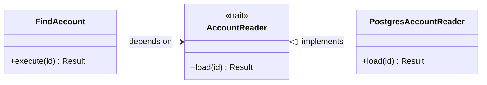
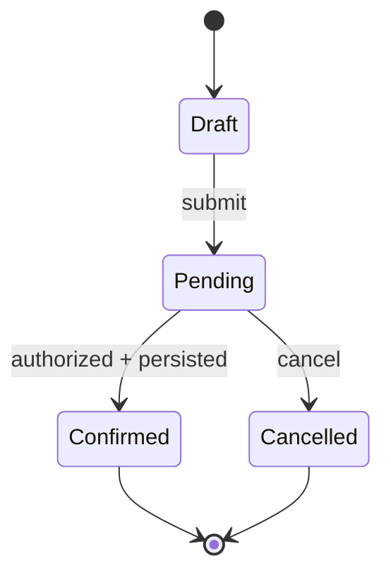

# Rust × Orientação a Objetos: fundamentos, arquitetura, padrões e engenharia verificável

**Versão:** 1.0 — documento independente e consolidado  
**Data de corte:** 11 de outubro de 2026  
**Idioma:** português brasileiro  
**Escopo:** comparação entre Rust e abordagens orientadas a objetos, sobretudo Java/C# e arquiteturas corporativas tradicionais, incluindo design de APIs, SOLID, GoF, DDD, arquitetura de serviços, concorrência, persistência, diagramas e desenvolvimento com agentes de IA.  
**Estado:** guia conceitual e técnico. Os exemplos são didáticos; sua adequação a um sistema real depende de requisitos, versão da toolchain e testes.  
**Aviso de verificabilidade:** fontes oficiais foram consultadas; os blocos de código deste guia **não foram compilados nesta sessão** porque o ambiente não dispõe de `rustc`/`cargo`. O texto separa deliberadamente garantias da linguagem, validação em execução, garantias do banco e hipóteses de arquitetura.

---

## Sumário

1. [Tese central](#1-tese-central)
2. [O que estamos comparando](#2-o-que-estamos-comparando)
3. [Por que a arquitetura corporativa ficou associada a Java](#3-por-que-a-arquitetura-corporativa-ficou-associada-a-java)
4. [Quadro comparativo](#4-quadro-comparativo)
5. [Rust possui orientação a objetos?](#5-rust-possui-orientação-a-objetos)
6. [Ownership, borrowing, move e Drop](#6-ownership-borrowing-move-e-drop)
7. [Grafos, ciclos, referências e compartilhamento](#7-grafos-ciclos-referências-e-compartilhamento)
8. [Sistema de tipos e invariantes](#8-sistema-de-tipos-e-invariantes)
9. [Typestate e seus limites](#9-typestate-e-seus-limites)
10. [Polimorfismo e despacho](#10-polimorfismo-e-despacho)
11. [SOLID revisitado em Rust](#11-solid-revisitado-em-rust)
12. [Os 23 padrões GoF traduzidos para Rust](#12-os-23-padrões-gof-traduzidos-para-rust)
13. [Arquitetura hexagonal, DDD e DI](#13-arquitetura-hexagonal-ddd-e-injeção-de-dependências)
14. [Organização de módulos, crates e workspaces](#14-organização-de-módulos-crates-e-workspaces)
15. [Data-Oriented Design e ECS](#15-data-oriented-design-e-ecs)
16. [Concorrência: atores, canais, locks e async](#16-concorrência-atores-canais-locks-e-async)
17. [Erros, falhas e disponibilidade](#17-erros-falhas-e-disponibilidade)
18. [Persistência, transações e sistemas distribuídos](#18-persistência-transações-e-sistemas-distribuídos)
19. [`unsafe`, FFI e base de confiança](#19-unsafe-ffi-e-base-de-confiança)
20. [UML, C4 e documentação visual](#20-uml-c4-e-documentação-visual)
21. [Qualidades arquiteturais e trade-offs](#21-qualidades-arquiteturais-e-trade-offs)
22. [Documentação e verificações automatizadas](#22-documentação-e-verificações-automatizadas)
23. [IA, produtividade e economia do software](#23-ia-produtividade-e-economia-do-software)
24. [Estudo de caso: aprovação de proposta](#24-estudo-de-caso-aprovação-de-proposta)
25. [Mitos frequentes](#25-mitos-frequentes)
26. [Como escolher em projetos reais](#26-como-escolher-em-projetos-reais)
27. [Roteiro de aprendizado](#27-roteiro-de-aprendizado)
28. [Checklist de revisão](#28-checklist-de-revisão)
29. [Referências e proveniência](#29-referências-e-proveniência)

---

## 1. Tese central

**Rust não é o oposto de orientação a objetos (OO).** Orientação a objetos é uma família de técnicas de modelagem; Rust é uma linguagem multiparadigma. Rust possui dados com métodos, encapsulamento e polimorfismo. O que ele não possui é herança tradicional de implementação entre structs/classes. Sua diferença mais importante em muitos sistemas está em tornar **ownership, mutabilidade, empréstimos, certas relações entre threads e parte dos estados válidos** componentes verificáveis do programa.

A comparação rigorosa é entre diferentes **formas de expressar e verificar contratos**:

- **Modelagem OO tradicional:** objetos, classes, referências, interfaces, herança/composição, colaboração entre instâncias, regras comportamentais e convenções de framework.
- **Modelagem idiomática em Rust:** structs, enums algébricos, traits, composição, ownership, borrowing, generics, `dyn Trait`, visibilidade, lifetimes, funções puras quando apropriadas e mecanismos de verificação explícitos.
- **Engenharia de sistemas em qualquer linguagem:** requisitos, autorização, contratos externos, transações, testes, observabilidade, recuperação, governança e documentação de decisões.

Nenhum desses grupos é sinônimo de uma arquitetura pronta. Um programa Java/C# pode ter limites de módulos excelentes e provas comportamentais robustas. Um programa Rust pode compilar, passar Clippy e ainda cobrar o cliente duas vezes.

> **Princípio organizador:** não documente manualmente aquilo que pode se tornar uma restrição executável ou um artefato derivado. E nunca confunda uma restrição executável com prova de que a regra comercial escolhida é correta.

### 1.1. Qual é a diferença arquitetural mais relevante?

Em Rust, algumas decisões que em ambientes OO são tratadas como convenção passam a influenciar diretamente a API: quem possui um recurso, quem pode emprestá-lo, quem pode alterá-lo, quando o valor fica indisponível após um `move` e quais operações são expostas para um estado específico.

Por outro lado, **o compilador não conhece requisitos do mercado, autoridade do usuário, versão atual no banco, resultado de uma chamada remota ou semântica de um evento em uma fila**. Essas garantias precisam ser projetadas em outras fronteiras.

### 1.2. Por que não defender “Rust sempre superior”?

O resultado depende do problema, da equipe, dos custos de compilação/revisão, das bibliotecas, das restrições de operação e do horizonte de manutenção. Em um CRUD com gargalo no banco e equipe produtiva em C#, a vantagem de Rust pode não justificar a troca. Em um componente de rede com custo significativo de CPU e memória, Rust pode oferecer benefícios materiais. **A avaliação precisa medir o sistema, não a preferência pela linguagem.**

---

## 2. O que estamos comparando

### 2.1. Paradigma, linguagem, runtime e arquitetura são dimensões diferentes

| Dimensão | O que é | Exemplos |
| --- | --- | --- |
| Paradigma | Maneira de organizar ideias e comportamento | OO, funcional, procedural, orientado a dados |
| Linguagem | Regras de sintaxe, tipos e execução | Rust, Java, C#, Kotlin, Scala |
| Modelo de memória | Estratégias de validade e gerenciamento de recursos | ownership estático, GC, contagem de referências, RAII |
| Framework | Convenções e infraestrutura de aplicação | Spring, ASP.NET Core, Axum, Tower |
| Estilo arquitetural | Organização de componentes e dependências | monólito modular, hexagonal, eventos, microserviços |
| Padrão de projeto | Solução recorrente e contextual | Adapter, Builder, Strategy, State |
| Garantia | Propriedade com mecanismo de prova ou checagem | tipo, teste, constraint SQL, protocolo, auditoria |

A frase “Rust versus OO” é, portanto, um atalho útil para o contraste de estilos, **não uma dicotomia formal**.

### 2.2. Java e C# modernos não são “OO clássico puro”

Java possui records, sealed classes/interfaces e pattern matching. C# possui records, structs por valor, interfaces, generics, `ref struct`, `Span<T>` e outras ferramentas de controle de alocação e referências. Ambas possuem recursos funcionais e as duas permitem soluções sem heranças profundas. No caso de C#, `ref` e stack-only types permitem disciplinar empréstimos específicos, embora com um modelo e alcance diferentes dos de Rust.

Quando este guia disser **“OO corporativo tradicional”**, significará predominantemente bases de código fortemente centradas em classes, objetos no heap, hierarquias, interfaces, DI em contêiner e métodos que alteram estado compartilhado. Não é uma descrição de todo código Java ou C# atual.

### 2.3. GC não é sinônimo de OO

OO não requer garbage collector. C++ combina OO com RAII; Swift usa ARC; Python usa contagem de referências mais coleta de ciclos; Java e C# possuem GCs modernos. Da mesma forma, Rust não elimina o heap: `Box`, `Vec`, `String`, `Arc` e diversas bibliotecas fazem alocações quando necessário.

---

## 3. Por que a arquitetura corporativa ficou associada a Java

A associação tem forte dimensão histórica, editorial e de mercado. Java se popularizou nas empresas durante a expansão de aplicações web, camadas de serviço, ORM, contêineres de DI e plataformas de aplicação. Parte considerável do material corporativo passou a usar exemplos em Java e, depois, em C#.

A cronologia, entretanto, importa:

- **GoF, _Design Patterns: Elements of Reusable Object-Oriented Software_ (1994):** surgiu antes do domínio de Java e utiliza referências centrais a C++ e Smalltalk; não é um livro originalmente “sobre Java”.
- **Martin Fowler, _Patterns of Enterprise Application Architecture_ (2002):** sistematiza padrões observados em várias plataformas, com exemplos Java/C#; o próprio autor relata influências de C++, CORBA e Smalltalk.
- **Eric Evans, _Domain-Driven Design_ (2003):** linguagem de domínio, entidades, value objects, agregados e bounded contexts não pertencem a uma linguagem específica.
- **Spring e o ecossistema Java enterprise:** popularizaram composição declarativa, reflexão, proxies, contêineres de DI, integração transacional e infraestrutura de aplicação.
- **ASP.NET e .NET:** consolidaram um conjunto diferente, mas igualmente sofisticado, de convenções para aplicações empresariais.

Portanto, não se deve concluir que a arquitetura corporativa foi inventada para remediar defeitos de Java. Ela incorpora princípios de modularidade, responsabilidade, evolução e integração que também se aplicam a Rust.

### 3.1. A contribuição específica de Rust

Rust incentiva fazer perguntas frequentemente adiadas em projetos de objetos compartilhados:

1. Quem possui este dado?
2. Qual operação pode alterá-lo?
3. Qual é a duração de sua validade?
4. A operação recebe `T`, `&T` ou `&mut T`?
5. A abstração é aberta ou fechada a novos tipos?
6. O custo está em alocação, despacho, bloqueio ou I/O?
7. O que acontece se a operação falhar ou a task for cancelada?

Essas perguntas **melhoram o desenho**, mas não substituem perguntas sobre regras de negócio, autorização e disponibilidade.

---

## 4. Quadro comparativo

| Tema | OO corporativo tradicional (com ressalvas) | Rust idiomático | Limite da comparação |
| --- | --- | --- | --- |
| Unidade de modelagem | Classe/objeto | `struct`, `enum`, `trait`, módulo | Uma struct pode ter métodos e estado rico |
| Herança de implementação | Frequente e suportada | Não há herança de structs | Traits permitem implementações-padrão |
| Substituição | Subclasse/interface | `trait`, generics ou `dyn Trait` | Semântica comportamental exige testes |
| Estado fechado | Classes/enum/sealed, dependendo da linguagem | `enum` + `match` exaustivo | Java/C# modernos também possuem variantes fechadas |
| Ausência de valor | `null`, tipos anuláveis, optionals | `Option<T>` | `Option` não resolve ausência de regra comercial |
| Falhas esperadas | Exceptions ou resultado explícito | `Result<T,E>` predominante | `panic!` também existe |
| Identidade vs valor | Objetos de referência e value objects | Value types por padrão, IDs e referências explícitas | Rust também possui endereços e alocações compartilhadas |
| Ownership | Em geral não visível na assinatura Java/C# comum | Movimento, empréstimos, lifetimes e RAII | C# tem `ref`/`Span<T>` em domínios específicos |
| Objetos compartilhados | Referências gerenciadas | `Rc`, `Arc`, `&`, `Box` e handles | `Arc` não sincroniza automaticamente o interior |
| Mutabilidade | Frequentemente via referências | `&mut`, `mut`, interior mutability | `mut` não significa acesso exclusivo universal a todo objeto |
| Despacho | Virtual/interfaces conforme declaração e runtime | Generics (estático), `dyn Trait` (dinâmico), enums | Ambos possuem múltiplas formas de despacho |
| Injeção de dependências | Composição manual ou contêiner DI | Composição manual, generics ou trait objects | Contêiner não é requisito de OO |
| Concorrência | Threads, tarefas, locks, filas e actors | Threads, Tokio, locks, canais e actors | Rust não impõe ator nem substitui locks |
| Memória | GC/RAII/ARC conforme a linguagem | Sem GC obrigatório; ownership/RAII | Nenhuma opção elimina todos os custos de memória |
| Arquitetura por camadas | Pacotes, assemblies, testes arquiteturais | Módulos, crates, gates arquiteturais | `rustc` não conhece a política de camadas da empresa |
| Data-Oriented Design | Também possível | Natural e bastante útil em alguns workloads | DOD só compensa quando a carga justifica |
| Compatibilidade | ABI, assemblies, SDKs, contratos externos | SemVer, features, MSRV, APIs, wire formats | Tipos não protegem contratos distribuídos |
| Foco de segurança | GC, análise, revisão, runtime checks | Safe Rust, `unsafe` auditado, testes, revisão | Erros de lógica e autorização seguem possíveis |
| Custo de desenvolvimento | Bibliotecas/ferramentas maduras em muitos domínios | Ownership, compilação e generics exigem engenharia | Economia operacional é contextual |

**Síntese:** compare a **porção do contrato realmente verificada** e o **custo da mudança de negócio aceita**; não conte classes, traits ou crates como sinal de qualidade.

---

## 5. Rust possui orientação a objetos?

A documentação oficial do Rust observa que não há definição única de OO e responde de maneira condicional. Sob a definição “dados + métodos + encapsulamento”, Rust pode ser considerado orientado a objetos. Sob a exigência de herança tradicional entre classes, não.

### 5.1. Dados e comportamento podem ficar juntos

```rust
struct Conta {
    saldo_centavos: i64,
}

impl Conta {
    fn saldo(&self) -> i64 {
        self.saldo_centavos
    }

    fn debitar(&mut self, quantia: i64) -> Result<(), &'static str> {
        if quantia < 0 {
            return Err("quantia negativa");
        }
        if self.saldo_centavos < quantia {
            return Err("saldo insuficiente");
        }
        self.saldo_centavos -= quantia;
        Ok(())
    }
}
```

Esse código possui encapsulamento e métodos de negócio. Não é necessário separar dados e funções só porque se está usando Rust. A operação de débito ainda precisa de testes para limites aritméticos e concorrência caso o saldo também exista num banco.

### 5.2. Métodos não implicam classe-base

`impl Conta` adiciona comportamento ao tipo. `impl AlgumaTrait for Conta` declara conformidade a um contrato. Nenhuma das duas operações cria uma superclasse com campos herdados.

### 5.3. Herança acumula duas preocupações distintas

Em OO clássico, a herança pode ser usada para reutilizar implementação e para permitir substituição. Rust geralmente as separa:

- **Reuso:** composição, funções auxiliares, módulos e métodos-padrão em traits.
- **Substituição:** traits com despacho estático ou dinâmico.
- **Conjunto de casos fechados:** enums algébricos e pattern matching.

Essa separação pode simplificar a API. Também pode aumentar o trabalho quando uma hierarquia OO seria perfeitamente adequada ao problema.

### 5.4. Mesmo contrato: Java moderno e Rust

O exemplo abaixo evidencia por que a comparação correta não é “Java só tem hierarquias; Rust tem enums”. Java moderno também pode expressar **alternativas fechadas** com `sealed` e `record`.

**Java (records e sealed interface):**

```java
sealed interface PaymentResult permits Approved, Declined {}

record Approved(String receiptId) implements PaymentResult {}
record Declined(String reason) implements PaymentResult {}
```

**Rust (enum algébrico com dados associados):**

```rust
enum PaymentResult {
    Approved { receipt_id: String },
    Declined { reason: String },
}
```

As duas estruturas distinguem resultados por tipo e admitem análises exaustivas nas construções apropriadas. O contraste é a **ergonomia e a semântica de suas APIs**, não a alegação de que apenas Rust admite variantes fechadas.

### 5.5. Injeção de dependência também pode ser manual em Java

```java
interface UserReader {
    User load(long id);
}

final class FindUser {
    private final UserReader reader;

    FindUser(UserReader reader) {
        this.reader = reader;
    }

    User execute(long id) {
        return reader.load(id);
    }
}
```

A composição via construtor é explícita e não exige Spring ou reflection. O equivalente Rust costuma usar `trait` com generic ou `dyn Trait`, conforme a variabilidade necessária. Uma comparação justa precisa considerar **essas duas implementações diretas**, e não forçar o Java a usar um framework complexo só para demonstrar a simplicidade de Rust.

---

## 6. Ownership, borrowing, `move` e `Drop`

### 6.1. Ownership é uma propriedade local e composicional

Em termos gerais, um valor possuído tem um responsável pelo seu ciclo de vida. Quando esse valor é movido, o binding anterior deixa de poder usá-lo (exceto em situações específicas de cópia ou movimentos parciais). O compilador aplica regras de empréstimo e aliasing sem exigir GC para a segurança de memória de código seguro.

```rust
let primeiro = String::from("proposta");
let segundo = primeiro; // Move: segundo passa a possuir o String.

assert_eq!(segundo, "proposta");
// println!("{primeiro}"); // erro: o binding foi movido.
```

**`move` NÃO é `drop`.** A transferência de posse não destrói necessariamente o valor, não invalida a entidade de negócio e não indica que uma alocação foi imediatamente liberada.

### 6.2. Emprestar não é transferir ownership

```rust
fn comprimento(s: &str) -> usize {
    s.len()
}

let texto = String::from("rust");
let tamanho = comprimento(&texto);
assert_eq!(tamanho, 4);
assert_eq!(texto, "rust"); // O dono continua com o valor.
```

O empréstimo pode ser inferido e encerrado antes do final do bloco graças à análise de lifetimes. Uma referência não pode ser usada para acessar armazenamento já inválido; o tempo de vida relevante é o **uso efetivo**, não sempre o escopo lexical até a última chave.

### 6.3. `&mut` e exclusividade

`&mut T` concede, durante a vigência do empréstimo, o acesso mutável exclusivo relevante ao objeto emprestado. Reempréstimos são possíveis; a regra não é “nunca podem existir duas setas `&mut` em todo o sistema”, mas sim que não haja acessos incompatíveis ativos à mesma região.

### 6.4. `Drop`, RAII e seus limites

Ao fim do ciclo de vida de um valor ainda possuído, Rust executa o comportamento de descarte aplicável. Esse mecanismo é excelente para fechar arquivos, liberar guardas de lock e devolver recursos locais. Ele não assegura que um evento foi entregue, que um processo conseguiu executar um encerramento ordenado ou que uma transação remota foi revertida.

**Não há garantia de que um `Drop` será executado em qualquer encerramento possível** (como término abrupto do processo). É incorreto prometer durabilidade distribuída apoiando-se apenas nele.

### 6.5. Valor inline, heap e localização real

Um campo `T` mora **dentro de seu dono**, onde quer que esse dono esteja. Se o dono estiver no heap, o campo inline estará no heap. `Box<T>` costuma introduzir uma alocação indireta no heap. `Vec<T>` armazena seus elementos em uma alocação contígua quando não está vazio, mas a struct `Vec` contém ponteiro, comprimento e capacidade em seu próprio local.

Não se pode equiparar rigidamente “field por valor = stack” e “OO = heap”. Layout real, otimização, representação e tipo de container importam.

### 6.6. `Copy` e `Clone`

- `Copy`: cópia implícita de tipos que permitem semântica de duplicação barata e sem destrutor personalizado.
- `Clone`: duplicação explícita; pode ser barata (clonar um handle `Arc`) ou cara (duplicar um buffer grande).
- `move`: transferência de posse, nem sempre significa mover bytes fisicamente em cada otimização.

Não declare `clone()` antipadrão por princípio. Analise cópia de payload, persistência de aliases, pressão sobre memória e clareza de contrato.

---

## 7. Grafos, ciclos, referências e compartilhamento

### 7.1. Rust não força toda arquitetura a ser um DAG

Há grafos diferentes:

| Grafo | Exemplo | Pode ter ciclo? |
| --- | --- | --- |
| Dependências de crates | `api -> application -> domain` | Cargo não permite ciclos entre pacotes |
| Ownership forte em objetos específicos | `Rc<A>` ↔ `Rc<B>` | Sim; pode vazar memória se o ciclo não for quebrado |
| Relações de domínio | Cliente ↔ pedidos | Sim; IDs e consultas modelam relações bidirecionais |
| Mensagens entre atores | A envia a B; B responde a A | Sim; protocolo pode ser cíclico |
| Relações SQL | Tabelas com FKs cruzadas | Sim, sob constraints apropriadas |
| Dependências arquiteturais permitidas | Regra declarada no projeto | Deve seguir a política explícita, não uma metáfora |

Uma forma madura de modelar entidades relacionadas é usar identificadores estáveis e consultas, em vez de tentar reproduzir um grafo de objetos Java com ponteiros em ambas as direções.

### 7.2. `Rc`, `RefCell`, `Arc`, `Mutex`, `RwLock` e `Weak`

| Primitiva | Objetivo | Cuidado |
| --- | --- | --- |
| `&T` | referência emprestada compartilhada | respeitar lifetime e aliasing |
| `&mut T` | referência mutável com exclusividade | evitar uso incompatível enquanto ativa |
| `Box<T>` | propriedade de valor em alocação indireta | alocação e eventual custo de indireção |
| `Rc<T>` | ownership compartilhado em contexto local | não é para compartilhar genericamente entre threads |
| `RefCell<T>` | empréstimos conferidos em runtime | violação da regra provoca panic na API tradicional |
| `Arc<T>` | contagem de referências atômica | não torna o interior automaticamente sincronizado |
| `Mutex<T>` | acesso mutuamente exclusivo | bloqueio, contenção, envenenamento conforme a implementação |
| `RwLock<T>` | múltiplos leitores ou escritor | fairness, contenção e starvation possíveis |
| `Weak<T>` | referência que não mantém ownership forte | precisa ser promovida, e a promoção pode falhar |

`Arc<Mutex<T>>` não é sinal obrigatório de má arquitetura. Pode ser a solução mais simples para estado compartilhado pequeno. A crítica adequada é ao **compartilhamento acidental e difuso**, não ao tipo em si.

### 7.3. Ciclos são possíveis e podem vazar

`Rc<RefCell<T>>` pode formar ciclos fortes. Como as contagens não chegam a zero, os valores permanecem alocados. Rust considera vazamento de memória compatível com memory safety; não promete ausência de leaks.

**Regra de desenho:** use `Weak` para ligações reversas sem propriedade forte, IDs para relações de domínio e canais quando os componentes devem se comunicar por mensagens em vez de manipular diretamente o estado uns dos outros.

---

## 8. Sistema de tipos e invariantes

### 8.1. Dados válidos são mais importantes que wrappers bonitos

Um newtype distingue conceitos semanticamente diferentes:

```rust
#[derive(Clone, Copy, Debug, PartialEq, Eq, Hash)]
struct UserId(u64);

#[derive(Clone, Copy, Debug, PartialEq, Eq, Hash)]
struct PropertyId(u64);

fn consultar_usuario(id: UserId) -> bool {
    id.0 != 0
}

let usuario = UserId(7);
assert!(consultar_usuario(usuario));
// consultar_usuario(PropertyId(7)); // erro de tipo.
```

**Mas `struct UserId(u64)` não garante que o valor seja diferente de zero.** Para isso, são necessários campos privados no limite da API, construtores controlados e caminhos de desserialização consistentes. `std::num::NonZeroU64` é uma alternativa pronta quando a única invariante é não ser zero.

### 8.2. Smart constructor: verificação em runtime, invariante preservada depois

```rust
#[derive(Debug, Clone, Copy, PartialEq, Eq)]
pub struct Percentage(u8);

#[derive(Debug, PartialEq, Eq)]
pub enum PercentageError {
    OutOfRange(u8),
}

impl Percentage {
    pub fn new(value: u8) -> Result<Self, PercentageError> {
        if value > 100 {
            Err(PercentageError::OutOfRange(value))
        } else {
            Ok(Self(value))
        }
    }

    pub const fn get(self) -> u8 {
        self.0
    }
}
```

A checagem `value > 100` **ocorre em runtime**. Depois da construção bem-sucedida, a API pode tratar `Percentage` como valor validado **se não existir nenhum caminho público que produza uma instância inválida**. Uma derivação `Deserialize` que recrie o campo sem checagem, um setter público ou FFI incorreto podem violar essa expectativa.

### 8.3. ADTs: o estado define os campos possíveis

```rust
enum ResultadoPagamento {
    Aprovado { recibo: String },
    Recusado { motivo: String },
    Indeterminado { tentativa_id: String },
}

fn precisa_reconciliar(resultado: &ResultadoPagamento) -> bool {
    matches!(resultado, ResultadoPagamento::Indeterminado { .. })
}
```

O enum evita um produto cartesiano de booleans e `Option` que representaria combinações sem sentido, como `aprovado=true` com `recibo=None` e `indeterminado=true`. O compilador exige que usos exaustivos de `match` cubram as variantes existentes.

Isso não prova que a resposta do PSP é autêntica ou que o estado salvo no banco corresponde à última versão.

### 8.4. “Parse, don't validate” corretamente interpretado

O princípio não proíbe validação em runtime. Ele recomenda **transformar a verificação inicial em conhecimento preservado no tipo**, para não precisar perguntar repetidamente se o dado ainda atende à condição.

Pipeline conceitual:

```text
bytes externos
  -> parse de formato
  -> validação semântica da entrada
  -> tipo de domínio com invariante local
  -> execução de caso de uso
  -> checagens contextuais atuais (autorização, versão, tempo, tenant)
  -> persistência protegida por constraints/transação
```

**Dados válidos ontem não provam autorização hoje.**

### 8.5. Escada de verificabilidade

| Classe | Exemplo | Quem verifica | O que o mecanismo não verifica |
| --- | --- | --- | --- |
| Tipada/estrutural | `UserId` ≠ `PropertyId` | compilador | identidade real do usuário |
| Construção validada | porcentagem ≤ 100 | construtor + testes | chamada externa que contorna o construtor |
| Comportamental | transição aprovada | código + testes | regra de negócio ainda aprovada |
| Infraestrutura | FK, `UNIQUE`, `CHECK` | banco de dados | autorização e intenção do comando |
| Arquitetural | domínio não importa adaptador | gate com grafo | semântica de dependências externas |
| Temporal/distribuída | não cobrar duas vezes | chave, protocolo, testes, reconciliação | exactly-once garantido universalmente |
| Organizacional | aprovação de política comercial | responsáveis, processo, evidência | compilador não acessa intenção comercial |

---

## 9. Typestate e seus limites

### 9.1. Quando é útil

Typestate usa tipos diferentes para estados diferentes de um valor e expõe operações apenas nas combinações permitidas. É especialmente valioso em **protocolos locais**: conexão desconectada/conectada, builder incompleto/completo, sessão autenticada e recurso aberto/fechado.

### 9.2. Exemplo de API com criação restrita

```rust
mod publication {
    use std::marker::PhantomData;

    pub struct Draft;
    pub struct Reviewed;

    pub struct Article<State> {
        content: String,
        _state: PhantomData<State>,
    }

    #[derive(Debug)]
    pub struct EmptyContent;

    impl Article<Draft> {
        pub fn new(content: String) -> Result<Self, EmptyContent> {
            if content.trim().is_empty() {
                return Err(EmptyContent);
            }
            Ok(Self { content, _state: PhantomData })
        }

        pub fn mark_reviewed(self) -> Article<Reviewed> {
            Article { content: self.content, _state: PhantomData }
        }
    }

    pub struct PublishedArticle {
        content: String,
    }

    impl Article<Reviewed> {
        pub fn publish(self) -> PublishedArticle {
            PublishedArticle { content: self.content }
        }
    }

    impl PublishedArticle {
        pub fn content(&self) -> &str {
            &self.content
        }
    }
}
```

Do lado de fora do módulo, não se constrói livremente `Article<Reviewed>` porque seus campos são privados. O método `publish` não existe para `Article<Draft>`.

**Limite:** `mark_reviewed()` não autentica um revisor nem verifica um processo editorial. O nome “reviewed” representa uma transição de API, não um fato que o compilador foi capaz de investigar. Se revisão exigir autorização, essa política deve ser imposta por um caso de uso e por mecanismos de confiança adequados.

### 9.3. O antipadrão que destrói a garantia

```rust
// NÃO ADOTE: permite fabricar qualquer estado, inclusive o final.
// impl<S> Article<S> {
//     pub fn new_in_any_state(content: String) -> Self { ... }
// }
```

Um construtor público genérico, desserialização irrestrita ou exposição de campos pode contornar toda a intenção do typestate.

### 9.4. `move` na transição não é destruição

Quando `Article<Draft>` é consumido e seu conteúdo compõe `Article<Reviewed>`, o binding anterior se torna inutilizável, mas o conteúdo pode ser reutilizado. Um diagrama não deve marcar o próprio serviço ou a entidade do domínio como “destruída” por causa de um `self` consumido.

### 9.5. Retornar o valor no erro

Uma operação local que consome um valor pode devolver a posse em um `Err`:

```rust
struct PendingOrder { id: u64, cents: u64 }
struct ConfirmedOrder { id: u64, cents: u64 }

#[derive(Debug)]
enum ValidationError { EmptyAmount }

fn confirm_local(
    order: PendingOrder,
) -> Result<ConfirmedOrder, (PendingOrder, ValidationError)> {
    if order.cents == 0 {
        return Err((order, ValidationError::EmptyAmount));
    }
    Ok(ConfirmedOrder { id: order.id, cents: order.cents })
}
```

Essa API preserva **o valor local** no erro. Ela não afirma que um sistema remoto voltou ao estado anterior. Para PSP, banco ou fila, existe a possibilidade de resultado externo indeterminado; modele-o explicitamente como estado de reconciliação.

### 9.6. Tipestate versus estado persistido

| Critério | Typestate | Enum runtime |
| --- | --- | --- |
| Transição dentro do processo | fortemente expressiva | checagem em execução |
| State vindo do banco | exige reidratação controlada | encaixa naturalmente |
| Coleções heterogêneas | mais complexas | simples |
| Serialização de estados | requer estratégia | mais direta |
| Autorização/tempo/concurrency | não resolvidos automaticamente | não resolvidos automaticamente |
| Complexidade de API | pode crescer bastante | geralmente menor |

Em sistemas CRUD, é frequente que `enum + validação + transação` seja mais simples e mais robusto que espalhar typestate por todas as camadas.

---

## 10. Polimorfismo e despacho

### 10.1. Escolha pela variabilidade real

- **`enum + match`:** conjunto conhecido e fechado de comportamentos; excelente para estados e variantes do domínio.
- **`T: Trait` / `impl Trait`:** o chamador ou container escolhe a implementação estaticamente; tende a permitir especialização e inlining.
- **`dyn Trait`:** implementações heterogêneas ou selecionadas em execução; normalmente introduz indireção e dispatch dinâmico.
- **Função/closure:** comportamento simples e curto; frequentemente mais legível que um trait com uma única função.
- **Módulo com funções:** quando não há variabilidade real, evite a abstração.

### 10.2. Polimorfismo estático

```rust
trait Formatter {
    fn format(&self, input: &str) -> String;
}

struct Uppercase;

impl Formatter for Uppercase {
    fn format(&self, input: &str) -> String {
        input.to_uppercase()
    }
}

fn render<F: Formatter>(formatter: &F, input: &str) -> String {
    formatter.format(input)
}
```

### 10.3. Polimorfismo dinâmico

```rust
fn render_dyn(formatter: &dyn Formatter, input: &str) -> String {
    formatter.format(input)
}
```

As duas soluções são legítimas. Generics podem ampliar monomorfização e tempo/tamanho de compilação; `dyn Trait` pode reduzir especializações e facilitar runtime composition. O custo do despacho raramente é importante quando a função faz consulta remota ou I/O caro. **Não escreva “zero overhead” como promessa automática de melhor desempenho em um sistema inteiro.**

### 10.4. Trait é contrato sintático, não prova de Liskov

Se duas implementações de `PaymentGateway` implementam `charge`, Rust não prova que ambas respeitam idempotência, classificação de erros ou semântica de retorno. Isso exige testes de contrato executados contra cada adaptador.

### 10.5. Traits assíncronas

`async fn` em traits existe em Rust estável. Mas uma trait com `async fn` não é diretamente compatível com `dyn Trait` pelas regras atuais de dyn compatibility; retornos de futures podem exigir bounds adicionais, especialmente `Send`.

Escolhas adequadas incluem generics com trait assíncrona, futures explicitamente retornadas (por exemplo, boxed futures quando despacho dinâmico for realmente necessário), wrappers ou macros de compatibilidade onde justificadas. Em API pública, a escolha de bounds faz parte do contrato de evolução.

---

## 11. SOLID revisitado em Rust

SOLID funciona melhor como **conjunto de perguntas de design**, não como receita para multiplicar traits. O princípio de menor abstração verdadeira deve prevalecer.

| Princípio | Leitura em OO tradicional | Pergunta idiomática em Rust | Risco da tradução literal |
| --- | --- | --- | --- |
| SRP | classe com uma responsabilidade | módulo, função, tipo ou crate possui razão coesa para mudar? | criar crate para cada struct |
| OCP | estender sem alterar classe existente | conjunto de variantes é aberto ou fechado? | usar traits onde `enum` resolveria melhor |
| LSP | subtipo substitui supertipo | implementações de trait preservam contrato observável? | achar que `impl Trait` prova semântica |
| ISP | interfaces pequenas e por consumidor | traits com métodos realmente exigidos pelo chamador? | dezenas de traits cerimoniais |
| DIP | abstrações de alto nível | casos de uso dependem de capacidades, não de driver SQL/HTTP? | criar uma interface para toda função sem variabilidade |

### 11.1. SRP: responsabilidade não é número de linhas

Uma responsabilidade é um conjunto coeso de decisões que mudam por razões semelhantes. Um módulo de 400 linhas pode estar mais coeso que sete módulos de 50 linhas com importações cruzadas. Extraia ao observar fronteiras relevantes: mudanças independentes, dependências diferentes, exigências de teste ou ownership distinto.

### 11.2. OCP: conjunto aberto ou fechado?

Para meios de pagamento conhecidos e controlados pelo produto, `enum PaymentMethod` pode ser superior a uma hierarquia extensível. Para provedores instaláveis ou conectados por equipes independentes, uma trait pode representar uma verdadeira extensão aberta.

### 11.3. LSP: contrato de comportamento

Uma implementação de `UserRepository` em memória que ignora concorrência, versão ou isolamento de tenant **não substitui** corretamente a implementação PostgreSQL, embora ambas compilem contra a trait. Testes de contrato devem validar os mesmos comportamentos relevantes.

### 11.4. ISP: evite interfaces “Deus”

Uma trait com `read`, `write`, `send_email`, `authorize`, `audit` e `refresh_cache` raramente corresponde à necessidade de um único consumidor. Separe por capacidades reais quando isso reduzir acoplamento, não para cumprir uma quantidade abstrata de interfaces.

### 11.5. DIP: inversão sem container obrigatório

Uma dependência é invertida quando uma política de alto nível usa contratos adequados à sua necessidade, enquanto detalhes concretos são conectados fora dela. Rust permite wiring explícito sem reflexão, mas composição manual também é possível em Java/C# e contêineres DI não são intrinsecamente maus.

---

## 12. Os 23 padrões GoF traduzidos para Rust

**Pergunta obrigatória:** qual problema o padrão resolve neste sistema e qual mecanismo Rust mais simples já o resolve? O nome do padrão não é prova de qualidade.

### 12.1. Padrões criacionais (5)

| Padrão | Tradução frequente em Rust | Quando faz sentido | Cuidado |
| --- | --- | --- | --- |
| Factory Method | função construtora, `new`, `try_new`, factory por trait | escolhas de construção com contrato | não exigir subclassing |
| Abstract Factory | trait de família de componentes / enum de backend | famílias consistentes de implementações | não criar fábrica de fábrica sem necessidade |
| Builder | builder fluente ou typestate builder | muitos parâmetros opcionais / construção por etapas | invariantes sempre no `build` ou em tipos de etapa |
| Prototype | `Clone`, cópia explícita, snapshot | duplicação semântica de configuração/estado | `Clone` pode ser custoso e não é sempre snapshot independente |
| Singleton | composição root com instância única, lazy initialization delimitada | recurso único por processo | evitar global mutable state e acoplamento escondido |

### 12.2. Padrões estruturais (7)

| Padrão | Tradução frequente em Rust | Quando faz sentido | Cuidado |
| --- | --- | --- | --- |
| Adapter | struct implementa trait de porta | integrar API/banco externo | preservar erros e semântica do provedor |
| Bridge | separar abstração e backend via trait/generic | produto varia em duas dimensões | verificar se duas interfaces valem o custo |
| Composite | `enum` recursivo com `Box`, traits quando aberto | árvores, AST, expressões | cuidado com recursão, alocação e profundidade |
| Decorator | wrapper com `T: Trait`, Tower layers | métricas, retry, cache, auth | ordem dos wrappers altera semântica |
| Facade | módulo/API pública pequena | esconder orquestração e detalhes | não esconder SQL ou falhas críticas |
| Flyweight | compartilhamento de valores imutáveis, interning, `Arc` | grande repetição de dados | medir memória e contenção |
| Proxy | wrapper para lazy loading, acesso ou cache | políticas transversais localizadas | evitar semântica invisível e efeitos ocultos |

### 12.3. Padrões comportamentais (11)

| Padrão | Tradução frequente em Rust | Quando faz sentido | Cuidado |
| --- | --- | --- | --- |
| Chain of Responsibility | composição de handlers, funções ou Tower | pipeline extensível de processamento | ordem e short-circuit devem ser explícitos |
| Command | `enum` de comandos, structs de intenção | filas, auditoria, reexecução, undo | comando não equivale a efeito realizado |
| Interpreter | AST em enums, parser + avaliador | regras/DSL | limite de complexidade, input e recursos |
| Iterator | `Iterator`, combinators e adapters | travessias e transformações | não esconder algoritmos complexos em chains ilegíveis |
| Mediator | coordenador de caso de uso, actor, event bus | muitas interações acopladas | não construir um objeto Deus |
| Memento | snapshot de estado com versionamento | undo, versões, recuperação local | snapshot em memória não é rollback distribuído |
| Observer | canais, assinaturas, streams, callback | notificações e eventos | entrega, ordem e perda de eventos não são automáticas |
| State | `enum` + `match`, trait ou typestate | estados com comportamentos diferentes | escolher runtime vs compile time conforme o domínio |
| Strategy | generic, `dyn Trait`, função ou closure | algoritmo realmente substituível | não criar trait para um único `if` estável |
| Template Method | função comum com callbacks/traits | esqueleto fixo com pontos de variação | não reproduzir hierarquia de métodos virtuais |
| Visitor | visitor por trait ou `match`/`fold`/`map` | tipos estáveis, operações novas frequentes | custo de evolução de enums e dupla-dispatch |

### 12.4. Padrões GoF não são obrigações

É perfeitamente correto que uma aplicação robusta use **zero** implementações reconhecíveis de certos padrões. Muitas vezes uma função, enum ou módulo reduz mais acoplamento que uma transposição literal de classes e interfaces.

### 12.5. Antipadrões de tradução OO → Rust

- Hierarquias de structs simuladas com reexports, `Deref` ou macros para imitar herança.
- `Rc<RefCell<T>>` em todo lugar só para escapar de pensar em ownership.
- `Arc<Mutex<T>>` envolvendo cada campo sem política de concorrência.
- Traits para todo método, mesmo sem variabilidade real.
- Generics propagados de ponta a ponta para economizar um dispatch irrelevante diante do I/O.
- `Clone` de buffers grandes em toda fronteira sem medir.
- Builder que aceita pular campos obrigatórios e construir estado inválido.
- Globais mutáveis para imitar singleton gerenciado por contêiner.
- “Mocks” que possuem contratos mais permissivos que os adaptadores reais.
- Macros que tornam impossível localizar lógica de negócio e mensagens de erro.

Esses são **sinais de investigação**, não proibições universais.

---
## 13. Arquitetura hexagonal, DDD e injeção de dependências

### 13.1. Os princípios atravessam linguagens

**Ports & Adapters** separa políticas do negócio dos mecanismos que implementam I/O. **DDD** usa modelos coerentes com linguagem e fronteiras de negócio. **Clean Architecture** enfatiza direção de dependências. Nenhuma dessas ideias exige classes Java nem dispensa responsabilidade pelo contrato.

A implementação idiomática em Rust costuma ser direta: um trait define uma capacidade, uma struct concreta implementa essa capacidade, e uma composição no bootstrap conecta as partes.

### 13.2. Exemplo: caso de uso que recebe um repositório

```rust
#[derive(Clone, Copy, Debug, PartialEq, Eq, Hash)]
pub struct AccountId(u64);

#[derive(Debug)]
pub struct Account {
    pub id: AccountId,
    pub display_name: String,
}

#[derive(Debug, PartialEq, Eq)]
pub enum LookupError {
    NotFound,
    Unavailable,
}

pub trait AccountReader {
    fn load(&self, id: AccountId) -> Result<Option<Account>, LookupError>;
}

pub struct FindAccount<R> {
    repo: R,
}

impl<R: AccountReader> FindAccount<R> {
    pub fn new(repo: R) -> Self {
        Self { repo }
    }

    pub fn execute(&self, id: AccountId) -> Result<Account, LookupError> {
        self.repo.load(id)?.ok_or(LookupError::NotFound)
    }
}
```

A regra depende apenas de `AccountReader`. Adaptadores podem usar SQLx, HTTP, memória ou outro mecanismo. **Mas uma trait isolada não prova** que os adaptadores obedecem à mesma consistência, isolamento ou tratamento de erros.

### 13.3. Composition root explícito

```text
api-server/main.rs
  -> carrega configuração
  -> inicializa logging/tracing
  -> cria pool PostgreSQL
  -> cria AccountPgReader
  -> constrói FindAccount<AccountPgReader>
  -> cria handlers e Router
  -> inicia servidor e supervisão de tasks
```

O ponto de composição fica em uma borda que pode depender de drivers e frameworks. O domínio não precisa conhecer Axum ou SQLx. **Composição explícita não implica que toda função seja genérica**; tipos concretos e trait objects também podem ser usados conforme as necessidades.

### 13.4. Onde definir as portas?

Duas opções são defensáveis:

1. **Ports no crate `application`:** o caso de uso define os recursos de que necessita; adaptadores implementam traits desse crate ou de um módulo de contratos.
2. **Crate `ports` dedicado:** útil quando múltiplos casos de uso e implementações reutilizam contratos, preservando o grafo de dependências pretendido.

Colocar toda trait num crate `ports` universal pode criar uma plataforma de interfaces altamente acoplada. Criar um trait para cada função simples pode tornar a leitura pior. O critério é **mudança independente e contrato significativo**.

### 13.5. DDD em Rust sem dogma de rich entity

| Conceito DDD | Materialização possível em Rust | Limites |
| --- | --- | --- |
| Entity | struct identificada por ID e regras | persistência e concorrência são externas ao objeto |
| Value Object | newtype/struct imutável ou API controlada | precisa validar construção e operações |
| Aggregate | módulo com transições e invariantes | fronteira transacional precisa ser definida separadamente |
| Domain Event | enum/struct de evento de negócio | persistência e entrega não estão implícitas |
| Domain Service | função pura ou struct de política | evite serviço anêmico onipresente |
| Repository | trait de consulta/persistência | transações e consistência têm contrato próprio |
| Bounded Context | capability/módulo/crate/serviço | limite organizacional não exige microserviço |
| Anti-corruption Layer | adapter + tradução de dados | preservar semântica e erros das fontes externas |

Rust aceita modelos de domínio ricos com métodos; também aceita dados explícitos transformados por funções. **A decisão deve ser guiada por invariantes, coesão e evolução, não por religião “OO versus dados”.**

### 13.6. Portas assíncronas e contratos de execução

É legítimo usar `async fn` em traits de aplicação, mas defina antecipadamente:

- o future deve ser `Send` para rodar em executor multithread?
- a trait precisa ser usada como `dyn`?
- cancelamento durante `.await` é seguro em qual sentido?
- erros de I/O preservam a categoria temporária/definitiva/indeterminada?
- a operação pode ser reexecutada com a mesma chave?

Essas perguntas são mais importantes do que escolher entre `async_trait`, `impl Future` e boxing por preferência estética.

---

## 14. Organização de módulos, crates e workspaces

### 14.1. Comece com módulos e extraia por necessidade

O equivalente de um pacote Java não precisa ser um crate. Um crate possui fronteiras próprias de compilação, dependência, API, features e potencial distribuição. Quanto mais crates, mais pontos de coordenação entre manifests, versões, CI, cache e decisões públicas.

Crie um crate adicional quando houver motivo forte: conjunto de dependências isolado, reutilização genuína, plataforma/target diferente, proc macro, FFI, API estável, ownership independente ou benefício medido no build.

### 14.2. Exemplo de monólito modular por capacidades

```text
company-platform/
├── Cargo.toml
├── Cargo.lock
├── rust-toolchain.toml
├── crates/
│   ├── app-api/
│   ├── app-worker/
│   ├── identity-domain/
│   ├── identity-application/
│   ├── identity-postgres/
│   ├── proposals-domain/
│   ├── proposals-application/
│   ├── proposals-postgres/
│   ├── platform-http/
│   └── platform-observability/
├── tools/
│   └── xtask/
├── test-support/
│   └── integration-harness/
├── docs/
│   ├── adr/
│   ├── architecture/
│   └── generated/
├── ARCHITECTURE.md
├── CONTRIBUTING.md
└── RUNBOOK.md
```

É um modelo, não um template obrigatório. Uma aplicação pequena pode manter `domain`, `application` e `infra` como **módulos no mesmo crate**. A composição por capacidade evita crates genéricos gigantes chamados `shared`, `services` ou `common`.

### 14.3. `Cargo.toml` virtual workspace (Edition 2024)

```toml
[workspace]
resolver = "3"
members = ["crates/*", "tools/xtask"]
default-members = ["crates/app-api", "crates/app-worker"]

[workspace.package]
edition = "2024"
license = "MIT OR Apache-2.0"

[workspace.dependencies]
serde = { version = "1", features = ["derive"] }
tracing = "0.1"

[workspace.lints.rust]
unsafe_op_in_unsafe_fn = "deny"
unused_must_use = "deny"

[workspace.lints.clippy]
undocumented_unsafe_blocks = "deny"
```

Na prática, use versões, toolchain, MSRV e licenças aprovadas pelo projeto. O resolver 3 é o padrão associado à Edition 2024, mas **workspaces virtuais precisam configurar resolver explicitamente** porque não há package root para inferi-lo.

### 14.4. Política arquitetural não nasce automaticamente da compilação

```text
app -> application -> ports -> domain
    -> adapters -> ports -> domain
```

Se `domain` adicionar uma dependência de `adapter`, o código ainda pode compilar. Cargo impede ciclos de dependência entre crates, mas **não conhece a política de camadas da empresa**.

Use um gate que leia `cargo metadata --format-version 1`, relacione os Package IDs sem interpretar seus textos, classifique crates novos e verifique arestas proibidas. Em matrizes com features opcionais, teste o conjunto máximo ou a matriz de combinações efetivamente suportadas.

```bash
cargo metadata --format-version 1 --all-features --locked > target/cargo-metadata.json
python3 tools/crate_graph.py target/cargo-metadata.json --check
```

A ferramenta `tools/crate_graph.py` é **exemplo de interface de automação**, não um comando padrão do Cargo; deve existir e ter sua própria suíte de testes. A política de dependências precisa incluir o significado de dependências `normal`, `dev` e `build`.

### 14.5. `xtask` e documentação derivada

Ferramentas específicas do repositório podem morar em um crate de automação `xtask` para gerar OpenAPI, gráficos de crates, relatórios de compatibilidade ou scaffolding. Use scripts pequenos quando forem suficientes; não crie uma framework própria de CI para executar três comandos.

### 14.6. Features, MSRV, SemVer e build cost

- **Features:** preferencialmente aditivas; a unificação de features torna escolhas mutuamente exclusivas difíceis de coordenar.
- **MSRV:** documente o Rust mínimo realmente testado; combine com lockfile e matriz de CI.
- **SemVer:** trate alterações de assinatura, behavior e wire format com políticas distintas e explícitas.
- **Build:** meça `cargo build --timings`, número de especializações, macros, `build.rs`, linker e cache antes de reestruturar crates por performance.
- **Publicação:** `publish = false` quando não houver distribuição prevista; evite APIs públicas acidentais só para facilitar testes.

---

## 15. Data-Oriented Design e ECS

### 15.1. DOD não é o oposto obrigatório de DDD

O **Data-Oriented Design** orienta escolhas pela carga de trabalho, layout de memória, contiguidade e operações predominantes sobre os dados. **DDD** orienta escolhas pelo modelo de negócio e fronteiras semânticas. São eixos diferentes que podem coexistir.

Uma aplicação transacional frequentemente se beneficia de modelos de domínio explícitos no controle de casos de uso e de processamento orientado a dados em etapas de cálculo, deduplicação, matching, ingestão e indexação.

### 15.2. AoS versus SoA

```rust
// Array of Structures (AoS): cada item reúne campos relacionados.
struct Point { x: f32, y: f32 }
let points: Vec<Point> = vec![Point { x: 1.0, y: 2.0 }];

// Structure of Arrays (SoA): cada campo forma uma coluna.
struct Columns {
    xs: Vec<f32>,
    ys: Vec<f32>,
}
```

SoA pode melhorar acessos quando o algoritmo usa apenas uma coluna de muitos elementos. AoS pode ser superior quando o algoritmo percorre todos os campos de cada registro. **A escolha é dependente do padrão de acesso, do compilador, do layout e de benchmarks**.

`Columns` tem uma nova invariante: `xs.len() == ys.len()`. Isso precisa de construção controlada e testes, pois o compilador não a prova automaticamente.

### 15.3. ECS sem extrapolação

Entity Component System é útil para grandes conjuntos de entidades compostas dinamicamente por componentes, em especial simulações e jogos. Pode atender certos workloads analíticos, mas **não é um substituto natural de todo sistema de CRM, ERP ou DDD**.

### 15.4. Regras de otimização

1. Meça o problema real e o perfil de memória/CPU.
2. Diferencie custo de algoritmo, alocação, cópia, cache miss, lock, I/O e rede.
3. Introduza SoA, arena, pooling ou buffers reutilizáveis apenas com impacto demonstrado.
4. Mantenha API de domínio legível sobre estruturas otimizadas quando isso reduzir acoplamento.
5. Documente limites de dados e responsabilidades pela capacidade de memória.

---

## 16. Concorrência: atores, canais, locks e async

### 16.1. O que Rust garante

Código seguro e dependências sound impedem **data races** no sentido de acessos concorrentes conflitantes não sincronizados à memória. Isso não impede **race conditions lógicas**, deadlocks, starvation, inversão de ordem, respostas obsoletas ou dois processos confirmando o mesmo pedido no banco.

`Send` indica segurança para transferência entre threads; `Sync`, segurança para compartilhamento por referência entre threads. Essas traits não significam atomicidade de uma operação composta nem consistência distribuída.

### 16.2. Atores versus estado compartilhado

Tokio documenta duas estratégias válidas: `Mutex` para estado simples e uma task proprietária para recursos que exigem operações assíncronas ou serialização de comandos. A arquitetura deve escolher pelo padrão de uso, não por dogma.

| Pergunta | Mutex/estado compartilhado | Actor/canal |
| --- | --- | --- |
| Estado pequeno, operação instantânea | geralmente simples | pode acrescentar protocolo desnecessário |
| I/O async vinculado a recurso exclusivo | lock assíncrono pode ser possível | ator frequentemente expressa ownership melhor |
| Backpressure | não é inerente à trava | canal bounded pode oferecer |
| Ordem de operações | ordem de aquisição/execução precisa ser compreendida | ordem conforme canal/processamento, não global |
| Erro do proprietário | protegido por escopo e lógica do chamador | exige supervisão da task |
| Latência | custo de contenção | custo de fila e troca de mensagens |
| Compartilhamento multiprocesso | requer protocolo externo | canais locais também não são broker durável |

### 16.3. Exemplo mínimo de ator Tokio

Dependência necessária: Tokio com recursos `sync` e runtime apropriado. Exemplo ilustrativo:

```rust
use tokio::sync::{mpsc, oneshot};

enum Command {
    Increment { reply: oneshot::Sender<Result<u64, &'static str>> },
    Stop,
}

async fn counter_actor(mut rx: mpsc::Receiver<Command>) {
    let mut counter = 0_u64;
    while let Some(command) = rx.recv().await {
        match command {
            Command::Increment { reply } => {
                let result = counter.checked_add(1).ok_or("overflow");
                if let Ok(next) = result {
                    counter = next;
                }
                let _ = reply.send(result);
            }
            Command::Stop => break,
        }
    }
}
```

A task possui o contador; o canal transporta comandos. O sucesso do `send()` não significa que o comando já foi executado. Se o processo morrer, o contador desaparece a menos que uma estratégia de persistência o proteja.

### 16.4. `Arc<Mutex<T>>` não é o inimigo

Para um `HashMap` com operações curtas de leitura/escrita, um mutex pode ser mais simples que um ator. Não segure um `std::sync::MutexGuard` durante `.await`: além dos problemas com `Send` e bloqueio, isso pode criar contenção e deadlock. Um `tokio::sync::Mutex` permite manter o guard através de `.await`, mas isso **não torna automaticamente sensato** segurar o lock durante I/O remoto.

### 16.5. Cancelamento de futures

Ao perder um future, uma operação assíncrona pode ser interrompida em pontos de suspensão. Porém **destruir o future não desfaz um HTTP já enviado, um evento já aceito ou uma transação já confirmada**. Para cada `.await` crítico, documente o que pode ter sido feito e qual informação persiste.

### 16.6. Tasks estruturadas e shutdown

Defina explicitamente quem inicia, supervisiona, cancela e aguarda cada task. Use task handles/`JoinSet`, cancelamento cooperativo e tratamento de falhas conforme necessidade; uma task de background que morre silenciosamente pode deixar uma API aparentemente saudável mas sem processamento de eventos.

Um shutdown robusto costuma separar:

```text
parar novas admissões
  -> sinalizar produtores
  -> concluir/drenar trabalho aceito conforme orçamento
  -> persistir/reservar estado recuperável
  -> aguardar tasks com política de prazo
  -> fechar pools e recursos
```

Não confunda “sinal enviado” com “trabalho integralmente drenado”.

---

## 17. Erros, falhas e disponibilidade

### 17.1. `Result` é tipo, não política de recuperação

Uma função que retorna `Result<T,E>` mostra que erros esperados são parte da API. Ela não indica por si só:

- se a falha é transitória;
- se é seguro repetir a operação;
- se o provedor remoto já efetuou o efeito;
- se a transação foi confirmada;
- como converter a falha para HTTP;
- qual log/alerta/compensação deve ocorrer.

### 17.2. Erros de domínio versus infraestrutura

```rust
#[derive(Debug)]
enum ApprovalError {
    Forbidden,
    Expired,
    AlreadyApproved,
    VersionConflict,
    InfrastructureUnavailable,
    OutcomeUnknown { attempt_id: String },
}
```

Essas variantes devem corresponder a cenários reais. **Não converta timeout em `Rejected` se o efeito externo pode ter ocorrido.** Uma classificação de erro incorreta frequentemente causa mais danos que um tipo mal desenhado.

### 17.3. Panic é possível em Rust seguro

`unwrap`, indexação fora de limites, asserts e erros lógicos podem provocar panic. Safe Rust restringe comportamento indefinido de memória sob abstrações corretas; **não promete alta disponibilidade** nem ausência de falhas de execução.

### 17.4. RAII não substitui compensação

Descarte de uma conexão, lock ou handle é uma propriedade local. Saga, transação distribuída, reconciliação, idempotência e restauração são problemas de protocolo e operação.

---

## 18. Persistência, transações e sistemas distribuídos

### 18.1. O limite do processo

Os tipos Rust deixam de ser a fonte de verdade diretamente quando dados cruzam HTTP, banco, arquivo, fila ou FFI. Nessa fronteira, há bytes, schemas, versões, privilégios e sistemas diferentes.

| Problema | Mecanismo principal | O que ele não resolve sozinho |
| --- | --- | --- |
| Integridade relacional | FK, UNIQUE, CHECK | autorização comercial |
| Concorrência otimista | versão em UPDATE condicional | efeito externo já realizado |
| Autorização | contexto confiável e política no caso de uso | race com revogação externa sem contrato temporal |
| Idempotência | chave+escopo+hash do comando e resultado persistido | side effects externos sem protocolo correspondente |
| Transactional outbox | grava estado e evento pendente na mesma transação | publicação ou consumo exatamente uma vez |
| Inbox/deduplicação | identifica evento/processamento repetido | ordenação global |
| Lease/claim worker | reserva trabalho recuperável | fim de duplicatas sem idempotência |
| Reconciliation | consulta provedor para estado real | consistência instantânea durante indisponibilidade |

### 18.2. Janela 1: efeito remoto antes do commit local

```text
PSP aceita cobrança
    ↓
processo morre / banco falha / resposta se perde
    ↓
estado local ainda não registra o resultado
```

Mitigue com chave idempotente adequada, identidade estável da tentativa, logs duráveis de intenção e reconciliação. Nem todo timeout implica rejeição; às vezes o resultado deve ser `Indeterminate` até obter evidência.

### 18.3. Janela 2: commit local antes da publicação

```text
UPDATE orders + INSERT outbox_event
    ↓
COMMIT no PostgreSQL
    ↓
relay publica no broker e obtém confirmação
    ↓
relay marca evento publicado
```

O **outbox não faz a operação remota participar da transação SQL**. Ele persiste a intenção de publicação para recuperação. Se a publicação ocorreu e o processo morreu antes da marcação local, a reentrega é possível. O consumidor deve suportar deduplicação/efeitos idempotentes conforme o contrato.

### 18.4. Erro fatal em um relay didático

```rust
// ERRADO:
// publish_to_broker(event).await; // TODO
// UPDATE outbox SET processed_at = now() WHERE id = ...
```

Se a etapa de publicação é somente um comentário, marcar `processed_at` é **perda de evento**, não implementação de outbox. O gate de aceitação deve exigir a confirmação de publicação antes da marcação, e um teste de crash entre cada estágio.

### 18.5. `LISTEN/NOTIFY`, polling e `SKIP LOCKED`

PostgreSQL `LISTEN/NOTIFY` pode acelerar a reação do worker, mas **não substitui o armazenamento durável na tabela** e não garante recuperar notificações perdidas durante desconexões.

`FOR UPDATE SKIP LOCKED` pode ajudar múltiplos workers a reivindicar eventos sem esperar pelos mesmos locks. Ele não garante ordem global de consumo; se a ordem por aggregate importa, ela precisa ser projetada e verificada.

### 18.6. Por que não dizer exactly-once?

Exactly-once de ponta a ponta envolve escopo preciso, idempotência do efeito final, identidade da mensagem, condições de crash e acordos entre sistemas. Queue + outbox frequentemente produz **at-least-once**, e a aplicação torna as reentregas seguras. Não proclame uma garantia mais ampla que o protocolo implementado.

---

## 19. `unsafe`, FFI e base de confiança

### 19.1. Safe Rust não significa ausência de `unsafe` em todo o processo

APIs seguras podem ser construídas sobre implementações internas com `unsafe` corretamente encapsulado. Crates nativos, bibliotecas C, drivers e operações de ponteiros ampliam a **base de confiança (trusted computing base)**. A garantia pública depende da correção dessas abstrações.

### 19.2. Contrato de `unsafe`

- `# Safety` no rustdoc documenta as condições que o **chamador** de uma função unsafe precisa cumprir.
- `// SAFETY:` antes de um uso unsafe documenta por que **aquele uso interno** respeita as condições da operação chamada.
- `unsafe fn` não elimina a necessidade de blocos `unsafe { ... }` para operações inseguras sob a lint/política de Edition 2024.

### 19.3. Exemplo de FFI com Edition 2024

```rust
// Declaração é unsafe porque quem a escreve deve garantir
// que a assinatura corresponde ao símbolo da biblioteca externa.
unsafe extern "C" {
    fn abs(input: i32) -> i32;
}

fn absolute_small_number(value: i32) -> i32 {
    assert!(value != i32::MIN);
    // SAFETY: a função foi declarada com a ABI e assinatura
    // esperadas; value evita o caso sem representação positiva.
    unsafe { abs(value) }
}
```

**Este código é apenas ilustração:** a disponibilidade/linkagem do símbolo da libc depende do target. Em wrappers reais, prefira uma API que não precise sair do Rust se ela já existir de forma segura, como operações inteiras checadas.

Para exportar símbolos, Edition 2024 exige atributos no formato `#[unsafe(no_mangle)]` quando aplicável. Nome e linkage globais não são uma obrigação trivial: documentação de segurança precisa acompanhar a escolha.

### 19.4. Gate de qualidade

Em código de alto risco: revisores especializados, invariantes de representação, testes de propriedade, Miri/fuzz quando aplicável e separação de crates de FFI podem ser mais importantes que um padrão GoF.

---

## 20. UML, C4 e documentação visual

### 20.1. UML é uma aproximação, não mapeamento 1:1 do modelo de memória

É produtivo usar o vocabulário visual de classes para comunicar structs, traits, associações e serviços. Porém a UML não define `Arc`, `&mut`, `Drop`, lifetime elision, monomorfização ou política de concorrência Rust.

| Recurso Rust | Notação visual sugerida | Ressalva |
| --- | --- | --- |
| `struct T { child: U }` | linha de composição **anotada** como `owns U` | composição UML e ownership não são equivalentes formais |
| `Box<U>` | associação `owns Box<U>` | não presume que dono está na stack |
| `Rc<U>` / `Arc<U>` | associação `shared handle` | diamante vazio UML não implica refcount |
| `&'a U` | associação `borrows &'a U` | lifetime depende do uso, não apenas do escopo desenhado |
| `&'a mut U` | associação `borrows &mut U` | exclusividade depende de aliasing ativo; reborrows são possíveis |
| `impl Trait for T` | realização de interface/trait | não herda campos |
| `T: Trait` | dependência genérica | não é necessariamente `dyn` |
| `dyn Trait` | dependência por trait object | requer dyn compatibility |
| `fn f(x: U)` | seta rotulada `move U` quando útil | não significa necessariamente destruir U no destino |
| canal `mpsc::Sender<Event>` | seta de mensagem com `Event` | envio não prova processamento nem durabilidade |

**Convenção fundamental:** não use `destroy` em diagrama de sequência apenas porque houve `move`. Um serviço continua vivo depois de passar a posse de um payload.

### 20.2. Exemplo estrutural Mermaid



Essa é uma **representação conceitual**. O código real pode implementar a dependência por parâmetro genérico, trait object ou outro arranjo. Não infira overhead de runtime apenas pelo símbolo da seta.

### 20.3. Exemplo de sequência sem destruição fictícia

```mermaid
sequenceDiagram
    actor Client
    participant API
    participant UseCase
    participant Repo
    Client->>API: POST /orders/123/confirm
    API->>UseCase: execute(command)
    Note over API,UseCase: command pode ser movido; API continua viva
    UseCase->>Repo: confirm_if_version(expected_version)
    alt versão correta
        Repo-->>UseCase: Confirmed
        UseCase-->>API: Ok(result)
        API-->>Client: 200
    else versão desatualizada
        Repo-->>UseCase: Conflict
        UseCase-->>API: Err(VersionConflict)
        API-->>Client: 409
    end
```

O diagrama mostra o **contrato da interação**, não o local físico dos objetos nem a garantia de que o backend realmente valida autorização. Acrescente evidência de teste ou link para o código do caso de uso.

### 20.4. Diagrama de estados



Esse diagrama pode documentar transições de domínio. A política normativa deve apontar para um conjunto de testes que rejeite transições não representadas. Um desenho Mermaid válido não é, por si, especificação executável.

### 20.5. C4 em Rust

- **Contexto:** atores, sistemas externos e fronteira do produto.
- **Contêineres:** processos implantáveis, filas, bancos e canais de comunicação.
- **Componentes:** responsabilidades dentro de um contêiner; podem ou não coincidir com crates.
- **Código:** tipos/contratos quando isso reduz custo de compreensão; não desenhar toda struct.

**Cargo graph ≠ arquitetura de implantação.** Um crate pode participar de vários binários; vários crates podem compor um único serviço; o grafo de crates não mostra latência, rede, trust boundaries ou transações entre processos.

---

## 21. Qualidades arquiteturais e trade-offs

Em vez de escolher “hexagonal”, “atores” ou “microserviços” por moda, comece de cenários mensuráveis de qualidade.

### 21.1. Cenário de qualidade — modelo

```text
Fonte/ator: quem desencadeia
Estímulo: o que acontece
Ambiente: carga, degradação, adversário, versão
Elemento: o que deve responder
Resposta: comportamento esperado
Métrica: como medir ou demonstrar
```

Exemplo **hipotético, não meta aprovada**:

```text
Fonte: operador de API de propostas
Estímulo: PostgreSQL indisponível por 30 segundos
Ambiente: carga normal, sem rollback manual
Elemento: endpoint de aprovação
Resposta: não confirma localmente; informa falha coerente;
         tentativas idempotentes podem ser reconciliadas
Métrica: taxa de confirmação incorreta = 0 em cenários testados;
        tempo de diagnóstico e recuperação são medidos
```

Não transforme o “0 em cenários testados” em promessa universal de ausência de defeitos.

### 21.2. Trade-offs frequentes

| Escolha | Benefício esperado | Custo/risco | Evidência necessária |
| --- | --- | --- | --- |
| Monólito modular | transações simples, implantação menor | isolamento operacional mais fraco | frequência de mudanças e acoplamento real |
| Microserviços | deploy/escala independentes | rede, consistência, observabilidade | necessidade comprovada de independência |
| Trait genérica | despacho estático, API expressiva | especializações/build e tipos propagados | medição + ergonomia |
| `dyn Trait` | runtime composition, API menor | indireção, restrições de dyn compatibility | perfil, necessidade de heterogeneidade |
| Typestate | impede chamadas locais em estados indevidos | fricção em persistência e serialização | frequência de erros evitados |
| Enum runtime | simplicidade para estado persistido | falhas de transição tratadas em execução | testes de transição/concorrência |
| Actor | ownership localizado, serialização de comandos | fila, supervisão, mensagens | contenção e protocolo de shutdown |
| `Mutex` | simplicidade para estado pequeno | contenção, possíveis deadlocks | medição e revisão de lock scope |
| SoA | possível melhoria de cache/simd | perda de coesão local, invariantes de colunas | benchmark de workload real |
| Crate adicional | isolamento de API/dependência | overhead de build/governança | fronteira de responsabilidade demonstrada |

### 21.3. Revisão de arquitetura leve, inspirada em ATAM

1. Liste responsáveis e objetivos de negócio.
2. Defina atributos críticos: correção, segurança, latência, custo, recuperação, evolução.
3. Escreva cenários e critérios de medição.
4. Proponha arquiteturas alternativas realistas.
5. Liste pontos de sensibilidade e trade-offs.
6. Registre decisão (ADR), hipóteses e evidências esperadas.
7. Verifique depois da implementação; revisite ao mudar workload ou política.

Arquitetura é uma **decisão contextual de restrições concorrentes**, não uma coleção de diagramas.

---

## 22. Documentação e verificações automatizadas

### 22.1. A verdade deve ter origem identificável

| Tipo de afirmação | Exemplo | Origem recomendada |
| --- | --- | --- |
| Normativa | “domain não depende de postgres-adapter” | política arquitetural |
| Derivada | “este é o grafo real de crates” | `cargo metadata` |
| Verificada | “não foi possível misturar UserId e PropertyId” | compile-fail test |
| Inferida | “este crate tornou a build mais rápida” | análise e benchmark; declarar incerteza |
| A confirmar | “timeout do PSP nunca gera cobrança” | documentação + teste com o provedor |
| Alvo | “p99 deve cair abaixo de X” | cenário/requisito aprovado |

### 22.2. Artefatos mínimos úteis

```text
README.md             propósito, instalação e quickstart
ARCHITECTURE.md       fronteiras, diagramas úteis e contratos
CONTRIBUTING.md       como validar e alterar o projeto
RUNBOOK.md            deploy, recuperação e incidentes
docs/adr/             decisões e trade-offs
crates/*/src/lib.rs   rustdoc dos contratos públicos
```

Não crie um arquivo por assunto quando um único `ARCHITECTURE.md` ainda for suficiente.

### 22.3. Gates recomendados

```bash
cargo fmt --all -- --check
cargo check --workspace --all-targets
cargo clippy --workspace --all-targets --all-features -- -D warnings
cargo test --workspace
cargo test --doc --workspace
cargo doc --workspace --no-deps
cargo metadata --format-version 1 --locked > target/cargo-metadata.json
```

Esses comandos pressupõem a toolchain e dependências apropriadas. `--all-features` pode não ser uma combinação suportada em projetos com features excludentes; execute a matriz real. Ferramentas como nextest, cargo-deny, cargo-vet, SemVer checks, fuzz e Miri podem ampliar cobertura conforme o risco.

### 22.4. Documentação de `unsafe`

Uma função unsafe deve descrever precisamente as obrigações do chamador em `# Safety`; um bloco unsafe deve ter argumento de correção local. Apenas escrever `// SAFETY: safe` não demonstra as pré-condições.

### 22.5. Diagramas como código

Valide sintaxe Mermaid no CI com versão fixada das dependências. **Parse correto não comprova diagrama fiel à arquitetura**. Prefira artefatos derivados do código, migration, schema ou rota quando a extração for confiável.

### 22.6. Rust versus OO na documentação

O avanço de Rust não é “dispensar documentação”: é permitir que **mais contratos locais** sejam expressos por mecanismos verificáveis. O restante exige prosa, testes ou especificações formais em qualquer linguagem.

Uma base Java/C# com regras de dependências e cenários testados pode estar mais bem documentada que uma base Rust com tipos sofisticados e ADRs obsoletos.

---

## 23. IA, produtividade e economia do software

### 23.1. Por que a comparação mudou

Agentes de IA podem reduzir o custo de escrita de Rust, explicação de erros de compilação, construção de adaptadores e manutenção do código. Isso amplia os cenários em que Rust pode ser economicamente viável, **mas não garante ROI nem prova superioridade sobre alternativas que também empregam IA**.

A unidade de sucesso não é “linhas escritas”, “compilou” ou “PR entregue”. É:

> **Custo por alteração de negócio correta, aceita e operando ao longo do ciclo de vida.**

### 23.2. Custos a medir

```text
custo total =
  especificação + implementação + compilação + testes
  + revisão + retrabalho + integração
  + operação + incidentes + manutenção posterior
```

A comparação justa é entre **Rust + IA + ferramentas adequadas** e **melhor alternativa viável + IA + ferramentas adequadas**. Casos publicados de redução de CPU/memória são evidências locais do workload observado, não percentuais transferíveis para qualquer produto.

### 23.3. Protocolo de revisão de código gerado por IA

1. Fixar requisito, versão do repositório e critérios de aceitação antes da implementação.
2. Identificar invariantes locais e distribuídas afetadas.
3. Selecionar a **menor abstração verdadeira**: função, enum, trait, módulo ou crate.
4. Produzir diff pequeno com propósito claro; não inserir GoF por cosmética.
5. Rodar `fmt`, `check`, `clippy` e testes pertinentes.
6. Executar testes negativos, concorrência e falha parcial quando aplicável.
7. Comparar implementações de ports com a **mesma suíte de contrato**.
8. Verificar efeitos remotos, transações, auditoria, PII e semântica de erros.
9. Medir custo/latência/recurso quando performance motivou a mudança.
10. Registrar evidência ligada ao commit, limites e riscos residuais.

Uma IA que reescreve os testes para fazê-los passar **não demonstrou correção**. A aceitação deve vir de requisito independente e revisado.

### 23.4. Onde a IA precisa de orientação especial em Rust

- Não esconder ownership ruim atrás de clones sem avaliar.
- Não transformar toda dependência em `Arc<dyn Trait>` automaticamente.
- Não montar enums com variantes que não correspondem ao protocolo real.
- Não fabricar typestate por construtor genérico público.
- Não usar `unwrap()` para entradas ou serviços falíveis sem justificativa.
- Não tratar `Send + Sync` como garantia de atomismo.
- Não preencher `// SAFETY:` com explicação tautológica.
- Não atualizar banco/outbox fingindo que a publicação externa ocorreu.
- Não “resolver” borrow checker adicionando `unsafe` em lógica comum.

### 23.5. Arquitetura orientada a evidência

Um agente deve responder a quatro perguntas em cada PR:

```text
Que propriedade precisava ser verdadeira?
Onde a propriedade foi codificada?
Qual verificador a conferiu?
Que situações importantes permaneceram fora do teste?
```

A mesma disciplina beneficia humanos, independentemente do modelo de IA utilizado.

---
## 24. Estudo de caso: aprovação de proposta

Este caso foi inspirado em requisitos comuns de aplicações de negócio, mas **não define uma política comercial de nenhuma empresa**. Mostra por que uma arquitetura Rust correta exige mais que trocar classes OO por structs e traits.

### 24.1. Requisito ilustrativo

Uma proposta só pode passar de `Pending` para `Approved` se:

1. O comando vier de identidade autenticada.
2. O usuário estiver autorizado a atuar sobre **aquele tenant e aquela proposta**.
3. O estado persistido atual for `Pending`.
4. A proposta ainda estiver vigente no instante de referência da política.
5. O comando declarar a versão que o usuário avaliou.
6. Repetições com a mesma chave e mesmo conteúdo preservarem o resultado previsto.
7. A transição, o registro de autoria e a intenção de emitir evento forem confirmados de acordo com o mesmo limite transacional.

**Questões ainda a decidir:** momento exato de corte de validade, timezone, quantidade de aprovações, efeito de revogação de permissão durante a operação e política de respostas idempotentes. Sem essas escolhas, nenhuma linguagem pode adivinhar a implementação correta.

### 24.2. Anti-exemplo OO de organização por camada técnica

```text
controller
  -> ProposalService
     -> GenericRepository
        -> Database
     -> EventBus
```

**O desenho não é automaticamente ruim por ser OO.** O problema aparece quando `ProposalService` concentra validação, identidade, SQL, retries, e-mails, auditoria e cálculo comercial; quando o controller confia na autorização do front-end; ou quando a publicação do evento ocorre fora do commit sem recuperação. Os mesmos defeitos podem existir em Rust.

### 24.3. Estrutura Rust recomendada, inicialmente modular

```text
proposals/
  domain.rs        ProposalState, ProposalId, regras locais
  commands.rs      ApproveProposal, request metadata
  policies.rs      ApprovalPolicy, tempo e escopo
  ports.rs         ProposalStore, Authz, Clock
  application.rs   ApproveProposalUseCase
  postgres.rs      UPDATE condicional + outbox
  http.rs          status e wire contract
  tests.rs         invariantes e integração
```

Em aplicação maior, essa capability pode virar um grupo de crates. **A criação de crates não é a etapa inicial obrigatória.**

### 24.4. Tipos que realmente ajudam

```rust
#[derive(Debug, Clone, Copy, PartialEq, Eq, Hash)]
pub struct TenantId(pub u64); // Exemplo: não representa autenticação.

#[derive(Debug, Clone, Copy, PartialEq, Eq, Hash)]
pub struct ProposalId(pub u64);

#[derive(Debug, Clone, Copy, PartialEq, Eq)]
pub enum ProposalState {
    Draft,
    Pending,
    Approved,
    Rejected,
}

pub struct ApproveProposal {
    pub tenant: TenantId,
    pub proposal: ProposalId,
    pub expected_version: u64,
    pub command_key: String,
}
```

Os tipos impedem substituições acidentais, mas o campo `tenant` no próprio comando **não é uma fonte de confiança**. Ele precisa ser comparado à identidade validada ou derivado do contexto autenticado. A aplicação não deve aceitar que um cliente escolha livremente o tenant autorizado.

### 24.5. Onde está a autoridade?

```text
HTTP/auth middleware
  -> autentica credencial
  -> extrai AuthContext confiável
  -> application use case
  -> verifica autorização sobre recurso e tenant
  -> verifica regra de prazo/estado
  -> tenta UPDATE condicional no banco
  -> insere auditoria/outbox na mesma transação
```

A autorização deve funcionar também quando o caso de uso for chamado por CLI, worker ou outra API; não deve existir apenas como filtro visual em um controller.

### 24.6. SQL ilustrativo de concorrência otimista

```sql
UPDATE proposals
SET state = 'approved',
    version = version + 1
WHERE tenant_id = $1
  AND id = $2
  AND state = 'pending'
  AND version = $3
  AND valid_until > $4
RETURNING id, version;
```

O `UPDATE` protege a disputa de versão e estado sob o contrato transacional apropriado. O caso de uso ainda precisa distinguir “não existe”, “expirada”, “sem permissão”, “estado inválido” e “versão concorrente” sem provocar exposição de dados a tenants indevidos.

### 24.7. Outbox e deduplicação

Estrutura conceitual (campos e índices reais dependem do projeto):

```sql
CREATE TABLE command_idempotency (
    tenant_id UUID NOT NULL,
    command_key TEXT NOT NULL,
    request_hash BYTEA NOT NULL,
    response_json JSONB,
    PRIMARY KEY (tenant_id, command_key)
);

CREATE TABLE outbox_events (
    event_id UUID PRIMARY KEY,
    aggregate_id UUID NOT NULL,
    aggregate_version BIGINT NOT NULL,
    event_type TEXT NOT NULL,
    payload JSONB NOT NULL,
    created_at TIMESTAMPTZ NOT NULL DEFAULT now(),
    published_at TIMESTAMPTZ
);
```

Essas tabelas não implementam o contrato por si só. O processamento precisa tratar conflitos simultâneos de idempotência, persistência da resposta, crash após commit, publicação com confirmação e deduplicação de entrega. Uma constraint é uma peça da prova, não a prova integral.

### 24.8. Matriz de testes indispensável

| Caso | Evidência esperada |
| --- | --- |
| Usuário autorizado aprova proposta vigente | transição e trilha de autoria correspondentes |
| Usuário de outro tenant | acesso negado sem revelar dados do recurso |
| Proposta expirada | rejeição conforme instante de política |
| Estado já aprovado | resultado definido sem evento duplicado |
| Duas aprovações concorrentes | apenas transição permitida pelo controle de versão |
| Mesmo idempotency key e mesmo corpo | resultado previsível sem repetir efeito |
| Mesmo key com conteúdo diferente | conflito explícito |
| Falha antes do commit | estado e outbox não confirmados |
| Commit ocorrido, resposta HTTP perdida | retentativa encontra resultado persistido |
| Publicação aceita, marcação local perdida | possível reentrega e deduplicação |
| Evento fora de ordem | consumidor aplica política de versão/ordem |
| Revogação durante a operação | comportamento segue contrato temporal escolhido |
| Worker do outbox morre | serviço identifica falha e recupera backlog |

Nenhum desses cenários é resolvido automaticamente por `#[derive(Debug)]`, `Send`, typestate, Tower, DI ou Clean Architecture.

### 24.9. Comparação correta entre uma implementação Rust e uma OO

A comparação justa executa **a mesma suíte de aceitação** em duas implementações competentes. Registre tempo de desenvolvimento, revisão, defeitos, custo de manutenção posterior, consumo de recursos e comportamento de falha. Não dê à implementação Rust um framework especializado e force Java/C# a trabalhar sem bibliotecas adequadas.

---

## 25. Mitos frequentes

| Mito | Correção |
| --- | --- |
| “Rust não tem OO” | Possui dados com métodos, encapsulamento e polimorfismo; não herança clássica entre structs. |
| “Rust substitui toda OO por DOD” | DOD é uma opção conforme workload; modelos de domínio ricos continuam possíveis. |
| “Java inventou os padrões de arquitetura” | GoF é anterior ao domínio de Java; padrões refletem várias tradições. |
| “Todo projeto Java usa reflection e contêiner DI” | Composição manual, records e módulos também existem no ecossistema. |
| “Garbage collector incentiva necessariamente código ruim” | GC altera trade-offs de lifetime; arquitetura ruim é decisão humana. |
| “Rust nunca usa heap” | `Vec`, `Box`, `String`, `Arc` e bibliotecas usam heap. |
| “Rust obriga um DAG em todas as relações” | Ciclos podem existir em dados, SQL, mensagens e contagens fortes; Cargo rejeita ciclos de crates. |
| “Mover destrói” | `move` transfere ownership; `Drop` e desalocação são conceitos distintos. |
| “Campo por valor está sempre na stack” | O campo fica onde o dono está. |
| “`Arc` torna qualquer T thread-safe” | O conteúdo e seus bounds determinam acesso seguro. |
| “`Send + Sync` prova transação atômica” | Protege transferência/compartilhamento; não a lógica distribuída. |
| “Ator sempre é melhor que mutex” | São alternativas com custos e semânticas diferentes. |
| “Rust não tem race condition” | Impede data races em safe code sound, não corridas de negócio. |
| “`Result` elimina falhas de produção” | Falhas e panics continuam possíveis; política de recuperação é outra camada. |
| “Compile-time valida regras de negócio atuais” | Compilador valida regras expressas em tipos; não sua atualidade comercial. |
| “Newtype garante toda invariante” | Campos e construtores/deserialização precisam preservar o contrato. |
| “Typestate impede fraude de autorização” | Protege operações locais; identidade e contexto atual exigem verificação. |
| “`dyn Trait` é ruim por ser lento” | Overhead deve ser comparado ao custo real da operação e à arquitetura. |
| “Generics sempre dão zero overhead total” | Podem aumentar binário, build, complexidade e tempo de monomorfização. |
| “Toda porta precisa ser trait” | Introduza abstração quando houver contrato e variabilidade relevantes. |
| “Mais crates = arquitetura madura” | Fronteiras úteis importam; excesso aumenta coordenação e build overhead. |
| “Outbox faz publish exatamente uma vez” | Resolve dual-write local, mas reentrega é possível. |
| “`LISTEN/NOTIFY` é fila durável” | Sinalização não substitui tabela/broker persistente. |
| “`SKIP LOCKED` preserva ordem global” | Ajuda a distribuir trabalho, mas pode processar fora de ordem. |
| “Fechar future reverte efeito remoto” | Cancelar trabalho local não desfaz necessariamente efeito realizado. |
| “`Drop` garante graceful shutdown” | Descarte local não é protocolo de encerramento recuperável. |
| “UML tem semântica exata de `&mut` e `Arc`” | É notação adaptada; ownership precisa de rótulos explícitos. |
| “C4 é o mesmo que Cargo graph” | Diagramas de implantação/processos e grafos de crates descrevem coisas diferentes. |
| “Clippy e rustfmt provam qualidade” | Detectam classes de problemas, não intenção comercial. |
| “IA que compilou entregou o requisito” | A aceitação exige contrato, comportamento e evidência independentes. |

---

## 26. Como escolher em projetos reais

### 26.1. Decisão de linguagem

Não existe algoritmo universal, mas estes critérios ajudam:

| Contexto | Tendência a avaliar | Pergunta crítica |
| --- | --- | --- |
| API empresarial com gargalo no banco | Java/C#/Go/Rust são candidatos | onde está o verdadeiro custo operacional? |
| Gateway de alto throughput e memória cara | Rust merece avaliação forte | ganho sob tráfego real compensa custo de equipe? |
| Biblioteca nativa/integração C | Rust pode oferecer wrappers seguros | qual é a base de confiança de FFI? |
| Plataforma grande com times Java experientes | Java pode ser economicamente melhor | qual seria o custo real de reescrever e manter? |
| Pipeline massivo de ingestão/análise | Rust ou outra stack eficiente; medir DOD | throughput é CPU, memória, I/O ou banco? |
| Aplicação com mudança comercial rápida | escolher menor custo por alteração correta | as políticas são testáveis e a stack é dominada pela equipe? |
| Sistemas com concorrência local complexa | Rust facilita certas garantias estáticas | o protocolo distribuído também é correto? |
| Sistemas híbridos | separar responsabilidades por serviço ou biblioteca | custo de integração supera os benefícios? |

### 26.2. Decisão de arquitetura antes da linguagem

Escolha primeiro requisitos de consistência, autorização, privacidade, deploy, reversão, latência, observabilidade, disponibilidade e custo. Só depois decida se um monólito modular, serviços separados, atores ou fluxo de eventos são necessários.

### 26.3. Decisão de padrão dentro do código

```text
Qual propriedade precisa ser protegida?
  |
  +-- É troca de valor primitivo? -> Newtype / enum
  |
  +-- É regra de transição local? -> enum / teste / typestate (se compensar)
  |
  +-- É variabilidade de algoritmo? -> função / enum / trait
  |
  +-- É integração externa? -> adapter + contrato de erro
  |
  +-- É controle de I/O concorrente? -> lock / actor / fila, conforme workload
  |
  +-- É mudança de banco + mensagem? -> transação + outbox + relay
  |
  +-- É qualidade em runtime? -> cenário + benchmark + observabilidade
  |
  +-- É limite de módulo? -> visibilidade / crate + gate arquitetural
```

O padrão só entra depois de identificar a propriedade, o verificador e o preço da abstração.

---

## 27. Roteiro de aprendizado

A ordem abaixo privilegia **compreensão de contratos** em vez de memorização de padrões.

### Etapa A — Fundamentos e desconstrução de herança

Objetivo: distinguir dados + comportamento de herança de implementação e entender `struct`, `enum`, `impl` e `trait`.

Exercício: pegar uma hierarquia OO simples de notificações e criar duas alternativas Rust: `enum + match` (fechado) e `trait` (aberto). Justificar quando cada uma envelhece melhor.

Referências: Rust Book (capítulo sobre OO); Packt (anti-pattern de desenhar Rust como herança de OO).

### Etapa B — Ownership, borrowing e recursos

Objetivo: saber explicar sem metáforas falsas `T`, `&T`, `&mut T`, `Box`, `Rc`, `Arc`, `Weak` e `Drop`.

Exercício: implementar árvore com filhos possuídos e referência fraca para pai; discutir por que `move` não é destruição.

Referências: Rust Book, Rust Reference e Rust for Rustaceans.

### Etapa C — Type-driven design

Objetivo: distinguir garantia de tipo, validação de construtor e regra de domínio dinâmica.

Exercício: IDs incompatíveis, `Percentage` validado, máquina de estados por enum e versão typestate; introduzir uma tentativa de bypass em cada modelo.

Referências: _Parse, Don't Validate_; Type-Driven API Design; rust-unofficial.

### Etapa D — SOLID/GoF interpretados e engenharia de APIs

Objetivo: reconhecer problemas que justificam uma abstração, sem tentar reproduzir classes-base.

Exercício: implementar Adapter e Decorator sobre porta de repositório; depois simplificar um Factory/Strategy desnecessário para função ou enum.

Referências: GoF, Rust API Guidelines e Packt.

### Etapa E — DDD, arquitetura hexagonal e workspaces

Objetivo: compor um serviço sem acoplar domínio a SQL/HTTP.

Exercício: um caso de uso com contrato de repositório, adaptador em memória e SQLx; executar a mesma suíte de contrato em ambos; extrair um crate apenas quando houver razão objetiva.

Referências: Zero to Production in Rust; Cargo Book; PoEAA.

### Etapa F — Async, canais, atores e persistência

Objetivo: escolher entre mutex e actor com compreensão de `Send`, `Sync`, cancelamento, backpressure e shutdown.

Exercício: um worker com canal bounded, teste de fechamento e medição de saturação. Depois implementar outbox e injetar crashes após commit/publicação.

Referências: Tokio tutorials, Rustonomicon, SQLx, PostgreSQL e AWS Transactional Outbox.

### Etapa G — Data-oriented e custo real

Objetivo: distinguir otimização medida de estética de código.

Exercício: comparar AoS e SoA para um algoritmo específico, com warm-up, amostras suficientes, workloads representativos e variância registrada.

Referências: materiais de DOD/ECS e profiling do projeto.

### Etapa H — AI-assisted development com provas independentes

Objetivo: escrever requisitos que humanos e agentes consigam implementar e verificar.

Exercício: alterar regra comercial em sistema existente, preservando autorização, idempotência e contrato externo; medir custo até aceitação e revisão posterior.

---

## 28. Checklist de revisão

### Modelo conceitual

- [ ] O documento não trata Rust e OO como categorias mutuamente exclusivas.
- [ ] Java e C# modernos não são reduzidos a herança, GC e reflexão.
- [ ] Toda comparação especifica qual modelo de memória e de aplicação está sendo contrastado.
- [ ] DOD e DDD aparecem como ferramentas de problemas diferentes, sem exclusão artificial.

### Tipos e ownership

- [ ] `move` não é descrito como destruição.
- [ ] Campos por valor não são declarados automaticamente alocados na stack.
- [ ] `Arc` não é descrito como sincronização interna automática.
- [ ] `Rc<RefCell>` é julgado pelo desenho e pelo risco de ciclos, não pelo nome.
- [ ] Smart constructors não possuem bypass público; desserialização preserva invariantes.
- [ ] Typestate não é descrito como prova de política comercial ou autenticação.
- [ ] Semântica de `Copy`, `Clone`, `Drop` e RAII é apresentada com limites.

### Arquitetura

- [ ] Há objetivo de negócio e atributos de qualidade antes da seleção de padrão.
- [ ] Módulos e crates foram escolhidos por fronteiras reais.
- [ ] O grafo Cargo é verificado por política explícita, não atribuída ao compilador.
- [ ] Traits de porta têm contratos observáveis e testes entre implementações.
- [ ] `dyn Trait` versus generics versus enum foi escolhido conforme variabilidade e custo.
- [ ] APIs de fronteira versionadas não confundem tipo Rust com protocolo externo.

### Execução e consistência

- [ ] `Send/Sync` não são apresentados como solução para corrida lógica.
- [ ] Canais, locks e atores possuem ownership, capacidade, supervisor e shutdown.
- [ ] Operações falíveis distinguem resultado definitivo e indeterminado.
- [ ] Idempotência inclui escopo, identidade do comando e tratamento de conflito.
- [ ] Outbox armazena intenção na mesma transação, com relay real e ack.
- [ ] Duplicação, ordenação e crash recovery são testados.
- [ ] Métricas não confundem tentativa, commit, publicação e processamento.
- [ ] Contratos `unsafe` documentam obrigações e argumentos de correção.

### Documentação e IA

- [ ] Diagramas não usam `destroy` para representar qualquer `move`.
- [ ] Mermaid é validado, e informações deriváveis têm fonte gerada.
- [ ] ADRs indicam trade-offs e gatilhos de revisão.
- [ ] Há critérios de aceitação que o agente não pode enfraquecer unilateralmente.
- [ ] Tests/CI estão correlacionados à versão efetivamente verificada.
- [ ] Limitações e suposições estão explicitadas.

---

## 29. Referências e proveniência

### 29.1. Materiais que serviram como base desta consolidação

A síntese preserva e aprimora temas dos materiais fornecidos na conversa, sem considerar todos os exemplos anteriores como verificados ou corretos:

- `documentacao-rust-vs-oo.md` — princípio de documentar apenas semântica que não pode ser mecanicamente assegurada; comparação de documentação com OO.
- `documentacao-rust-notacao-oo.md` — UML adaptada, componentes, contratos, invariantes e fluxos.
- `RUST_PROJECT_ARCHITECTURE_DOCUMENTATION_GUIDE_2026_V6.md` — módulos/crates, workspaces, gates, SOLID/GoF, CI e LLD orientado a evidências.
- `Framework_Rust_Business_IA_Tese_e_Diretrizes_v1_2.md` — tese econômica, framework para pessoas e agentes, casos de uso e critérios de aceitação.
- `Pasted text(20261011-155340).txt` — exemplo de typestate, SQLx, outbox, workers e diagramas submetidos à revisão.
- `rust_architecture_review/REVISAO_ARQUITETURA_RUST_OWNERSHIP_TYPESTATE_OUTBOX.md` — correções técnicas sobre move/Drop, DAG, typestate, PSP, outbox e observabilidade.
- `rust-design-patterns.pdf` — material comunitário sobre idiomas, padrões e antipadrões Rust.
- Repositório da Packt com os códigos de _Design Patterns and Best Practices in Rust_ (Evan Williams), especialmente os capítulos 2, 3, 8–12.

### 29.2. Referências técnicas primárias e projetos

Links consultados para verificar conceitos centrais ou usados como referências de aprofundamento. As fontes oficiais prevalecem em divergências sobre sintaxe/garantias; exemplos educacionais não constituem evidência de produção.

| Ref. | Fonte | Uso neste documento |
| --- | --- | --- |
| R01 | [The Rust Book — OOP](https://doc.rust-lang.org/stable/book/ch18-01-what-is-oo.html) | Rust como linguagem multiparadigma; encapsulamento e polimorfismo |
| R02 | [The Rust Book — Ownership](https://doc.rust-lang.org/book/ch04-01-what-is-ownership.html) | posse e empréstimo |
| R03 | [Rust Reference — Destructors](https://doc.rust-lang.org/reference/destructors.html) | `Drop` e diferença de `move` |
| R04 | [Rust Book — Reference Cycles](https://doc.rust-lang.org/book/ch15-06-reference-cycles.html) | `Rc`, `RefCell`, `Weak` e vazamentos |
| R05 | [Rustonomicon — Send and Sync](https://doc.rust-lang.org/nomicon/send-and-sync.html) | garantias de compartilhamento entre threads |
| R06 | [Rustonomicon — Races](https://doc.rust-lang.org/nomicon/races.html) | data race versus race condition |
| R07 | [Rust Reference — Traits](https://doc.rust-lang.org/reference/items/traits.html#dyn-compatibility) | dyn compatibility e limitações do despacho |
| R08 | [Rust Blog — async fn in traits](https://blog.rust-lang.org/2023/12/21/async-fn-rpit-in-traits/) | async traits, `Send`, despacho |
| R09 | [Tokio — Shared State](https://tokio.rs/tokio/tutorial/shared-state) | Mutex versus actor |
| R10 | [Tokio — Graceful Shutdown](https://tokio.rs/tokio/topics/shutdown) | propriedade e encerramento de tasks |
| R11 | [Cargo — Workspaces](https://doc.rust-lang.org/cargo/reference/workspaces.html) | workspace, herança e resolver |
| R12 | [Edition Guide — Resolver 3](https://doc.rust-lang.org/edition-guide/rust-2024/cargo-resolver.html) | Edition 2024 e resolução de dependências |
| R13 | [Cargo — Metadata](https://doc.rust-lang.org/cargo/commands/cargo-metadata.html) | fonte de verdade para grafo de dependências |
| R14 | [Cargo — Features](https://doc.rust-lang.org/cargo/reference/features.html) | unificação e features aditivas |
| R15 | [Rust API Guidelines](https://rust-lang.github.io/api-guidelines/) | desenho de interfaces |
| R16 | [Rust 2024 — Unsafe Attributes](https://doc.rust-lang.org/edition-guide/rust-2024/unsafe-attributes.html) | FFI e `#[unsafe(no_mangle)]` |
| R17 | [Rust Reference — Unsafe Keyword](https://doc.rust-lang.org/reference/unsafe-keyword.html) | blocos `unsafe extern` |
| R18 | [rust-unofficial Design Patterns](https://rust-unofficial.github.io/patterns/) | padrões e antipadrões idiomáticos |
| R19 | [Packt — Design Patterns and Best Practices in Rust](https://github.com/PacktPublishing/Design-Patterns-and-Best-Practices-in-Rust) | exemplos de OO forçado, typestate e padrões |
| R20 | [Alexis King — Parse, Don't Validate](https://lexi-lambda.github.io/blog/2019/11/05/parse-don-t-validate/) | parse e preservação de invariantes |
| R21 | [Will Crichton — Type-Driven API Design](https://willcrichton.net/rust-api-type-patterns/) | desenho de APIs por tipos |
| R22 | [Martin Fowler — PoEAA](https://martinfowler.com/books/eaa.html) | padrões enterprise e referência histórica |
| R23 | [AWS — Transactional Outbox](https://docs.aws.amazon.com/prescriptive-guidance/latest/cloud-design-patterns/transactional-outbox.html) | dual-write, at-least-once, deduplicação |
| R24 | [PostgreSQL — SELECT / SKIP LOCKED](https://www.postgresql.org/docs/current/sql-select.html) | concorrência de workers e filas |
| R25 | [SQLx — PgListener](https://docs.rs/sqlx/latest/sqlx/postgres/struct.PgListener.html) | transitoriedade de notificações |
| R26 | [Microsoft Learn — C# Records](https://learn.microsoft.com/en-us/dotnet/csharp/language-reference/builtin-types/record) | alternativas modernas do OO em C# |
| R27 | [Oracle — Java SE 21 Specification](https://docs.oracle.com/en/java/javase/21/docs/specs/) | Java atual e recursos da linguagem |
| R28 | [Luca Palmieri — Zero to Production in Rust](https://www.zero2prod.com/) | caminho de engenharia backend em produção |
| R29 | [Jon Gjengset — Rust for Rustaceans](https://nostarch.com/rust-rustaceans) | design de APIs e semântica avançada |

### 29.3. Critério para atualização futura

O vocabulário do ecossistema evolui, mas as perguntas duráveis permanecem:

1. Qual contrato é local e qual depende de outra autoridade?
2. O que é verificado pelo compilador, pelo runtime, pelo banco ou pela operação?
3. O que acontece em falhas parciais e concorrência?
4. Qual abstração é realmente necessária e quanto custa?
5. Qual evidência permite afirmar que a mudança ficou correta?

Uma futura revisão deve atualizar links, estabilidade de recursos e exemplos de biblioteca conforme a toolchain escolhida; não deve transformar uma proposta de arquitetura em fato verificado sem evidência.

---

## Conclusão

A grande diferença entre Rust e o OO corporativo tradicional não é que um possui arquitetura e o outro não. Tampouco é uma oposição entre classes e dados, entre GC e qualidade, ou entre diagramas e tipos.

**Rust muda quais erros e invariantes o desenvolvedor consegue antecipar, quais contratos aparecem nas assinaturas e quanto custa ignorar ownership e concorrência.** Isso pode favorecer sistemas mais explícitos e verificáveis. Mas a arquitetura de produção continua exigindo modelagem de domínio, autorização, persistência, protocolos distribuídos, operação, testes e decisões de negócio.

A regra final é simples:

> **Escolha a linguagem pelo problema, o padrão pela variabilidade real e o mecanismo de verificação pela propriedade que você precisa garantir.**

